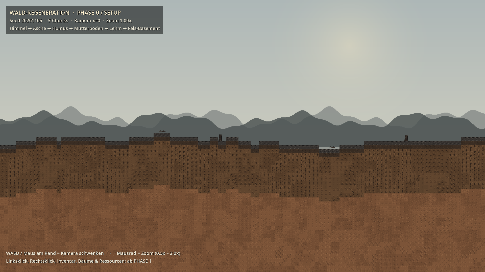
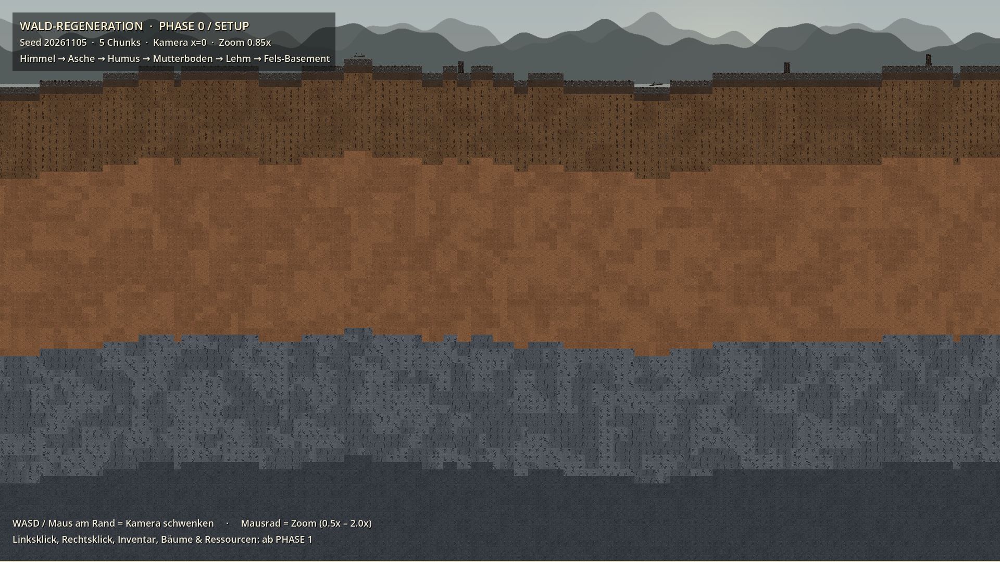
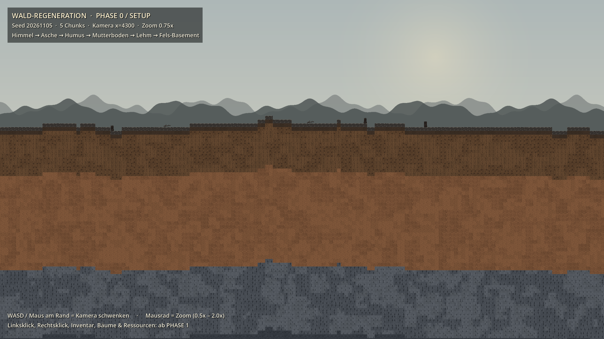

# PHASE 0 — Ergebnis

> **Status:** ✅ abgeschlossen · lauffähig · getestet  
> **Engine:** Godot `4.7.2.stable.official.ed1daf0bf` (Forward+ / Vulkan) · GDScript  
> **Datum:** 2026-11-05 · **Nächster Schritt:** PHASE 1 **erst nach deinem OK**

---

## 1. Screenshots (echte Godot-Renders, keine Mockups)



*F5-Startansicht: Himmel, Berge, Hügel, Asche, Bodenquerschnitt — Zoom 1.00x · Kamera x=0*



*Bodenquerschnitt bis zum Fels-Basement — Zoom 0.85x · Kamera y=790*



*Infinite Chunks: nach dem Pan auf x=4300 — Zoom 0.75x · Kamera x=4300*

## 2. Was PHASE 0 liefert

| Bereich | Datei |
|---|---|
| Einstieg / Verdrahtung | `src/Main.gd`, `src/Main.tscn` |
| Globals / Signals | `src/autoload/Global.gd`, `src/autoload/EventBus.gd` |
| Weltberechnung | `src/world/WorldGenerator.gd` (`height_at`, `material_at`, `chunk_seed`) |
| Chunks | `src/world/ChunkManager.gd`, `Chunk.gd`, `TerrainAtlas.gd` |
| Kamera | `src/camera/CameraController.gd` |
| Hintergrund | `src/background/SkyBackground.gd`, `MountainBackdrop.gd` |
| Info-Overlay | `src/ui/Phase0Overlay.gd` |
| Grafiken | `assets/placeholders/` (Generator: `tools/generate_placeholders.py`) |
| Tests | `tests/Phase0Smoke.gd` |

## 3. Code-Snippets (direkt aus dem Projekt)

### project.godot — Engine, Autoloads, Pixel-Perfekt

```ini
config_version=5

[application]

config/name="Wald-Regeneration"
config/description="2D-Seitenansicht: Regeneration eines Waldes nach dem Brand. PHASE 1 = Kern-Loop."
run/main_scene="res://src/Main.tscn"
config/features=PackedStringArray("4.7", "Forward Plus")
config/icon="res://assets/placeholders/icon.png"
boot_splash/bg_color=Color(0.89, 0.84, 0.73, 1)
boot_splash/show_image=false

[autoload]

Global="*res://src/autoload/Global.gd"
EventBus="*res://src/autoload/EventBus.gd"

[display]

window/size/viewport_width=1920
window/size/viewport_height=1080
window/size/resizable=true
window/stretch/mode="canvas_items"
window/stretch/aspect="expand"
```

### WorldGenerator.gd — seed-basierte Höhenlinie (height_at)

```gdscript
func height_at(world_x: float) -> float:
	var broad := _height_noise.get_noise_1d(world_x / 1000.0)
	var fine := _detail_noise.get_noise_1d(world_x / 170.0)
	var raw := BASE_SURFACE_Y + broad * 52.0 + fine * 10.0
	return roundf(raw / float(TILE_SIZE)) * float(TILE_SIZE)


func surface_tile_y_at(world_x: float) -> int:
	return int(height_at(world_x) / float(TILE_SIZE))


func depth_tiles_at(global_tile_x: int, tile_y: int) -> int:
	return tile_y - surface_tile_y_at(float(global_tile_x * TILE_SIZE))


# --------------------------------------------------------------------------- #
# Biome (PHASE 0-2: exakt 1 Biom, aber API + Noise fuer 3 Biome vorbereitet)
# --------------------------------------------------------------------------- #
```

### WorldGenerator.gd — Boden-Schichtung (material_at)

```gdscript
func material_at(global_tile_x: int, tile_y: int) -> SoilKind:
	var surface_ty := surface_tile_y_at(float(global_tile_x * TILE_SIZE))
	if tile_y < surface_ty or tile_y > BOTTOM_TILE_Y:
		return SoilKind.AIR
	if cave_at(global_tile_x, tile_y):
		return SoilKind.CAVE
	if reservoir_at(global_tile_x, tile_y):
		return SoilKind.WATER
	var depth_tiles := tile_y - surface_ty
	if depth_tiles == 0:
		return SoilKind.ASH
	if depth_tiles == 1:
		return SoilKind.HUMUS
	if depth_tiles <= 12:
		return SoilKind.TOPSOIL
	if depth_tiles <= 37:
		return SoilKind.CLAY
	return SoilKind.ROCK
```

### ChunkManager.gd — 5 Chunks laden/entladen + Pause

```gdscript
func _refresh() -> void:
	if camera == null:
		return
	var center := int(floor(camera.global_position.x / float(WorldGenerator.CHUNK_WIDTH_PX)))
	_center_chunk = center

	# Exakt load_radius*2+1 Chunks (Standard: 5); alles ausserhalb wird
	# freigegeben. Die beiden aeusseren Ringe laufen trotzdem unter
	# PROCESS_MODE_DISABLED, solange sie sichtbar bleiben.
	var keep_min := center - load_radius
	var keep_max := center + load_radius
	for key in _chunks.keys():
		if key < keep_min or key > keep_max:
			var old: Node2D = _chunks[key]
			_chunks.erase(key)
			EventBus.chunk_unloaded.emit(key)
			old.queue_free()

	for i in range(center - load_radius, center + load_radius + 1):
		if not _chunks.has(i):
			var chunk := TerrainChunk.new()
			chunk.setup(i, generator, tile_set, world_state)
			add_child(chunk)
			_chunks[i] = chunk
			EventBus.chunk_loaded.emit(i)
		var node: Node2D = _chunks[i]
		node.process_mode = (Node.PROCESS_MODE_INHERIT
			if absi(i - center) <= active_radius
			else Node.PROCESS_MODE_DISABLED)
```

### Chunk.gd — TileMapLayer pro Chunk

```gdscript
func _build_terrain(p_tile_set: TileSet) -> void:
	tile_layer = TileMapLayer.new()
	tile_layer.name = "Terrain"
	tile_layer.tile_set = p_tile_set
	tile_layer.rendering_quadrant_size = 16
	tile_layer.collision_enabled = true
	tile_layer.y_sort_enabled = true
	add_child(tile_layer)

	for lx in WorldGenerator.CHUNK_TILES_X:
		var gx := index * WorldGenerator.CHUNK_TILES_X + lx
		var top := generator.surface_tile_y_at(float(gx * WorldGenerator.TILE_SIZE))
		for ty in range(top, WorldGenerator.BOTTOM_TILE_Y + 1):
			var slot := _slot_for(gx, ty)
			if slot >= 0:
				var alt := 0 if ty == top else generator.alternative_at(gx, ty)
				tile_layer.set_cell(Vector2i(lx, ty), 0, Vector2i(slot, 0), alt)


func _slot_for(gx: int, ty: int) -> int:
	if generator.cave_at(gx, ty):
		return WorldGenerator.SLOT_CAVE
	if generator.reservoir_at(gx, ty):
		if world_state != null and world_state.is_dry(gx, ty):
			return WorldGenerator.SLOT_DRY_WATER
		return WorldGenerator.SLOT_WATER
	return generator.atlas_slot_at(gx, ty)


func _on_reservoir_dried(tile: Vector2i) -> void:
	var lx := tile.x - index * WorldGenerator.CHUNK_TILES_X
	if lx < 0 or lx >= WorldGenerator.CHUNK_TILES_X or tile_layer == null:
		return
	if not generator.reservoir_at(tile.x, tile.y):
		return
	tile_layer.set_cell(Vector2i(lx, tile.y), 0,
		Vector2i(WorldGenerator.SLOT_DRY_WATER, 0), 0)


## Nach Save/Load: alle sichtbaren Reservoirs passend neu einfaerben.
func refresh_reservoirs() -> void:
	if tile_layer == null or world_state == null:
		return
	for lx in WorldGenerator.CHUNK_TILES_X:
		var gx := index * WorldGenerator.CHUNK_TILES_X + lx
		var top := generator.surface_tile_y_at(float(gx * WorldGenerator.TILE_SIZE))
		for ty in range(top, WorldGenerator.BOTTOM_TILE_Y + 1):
			if generator.reservoir_at(gx, ty) and world_state.is_dry(gx, ty):
				tile_layer.set_cell(Vector2i(lx, ty), 0,
					Vector2i(WorldGenerator.SLOT_DRY_WATER, 0), 0)
```

### CameraController.gd — Mausrad-Zoom & Pan

```gdscript
func _unhandled_input(event: InputEvent) -> void:
	if not (event is InputEventMouseButton):
		return
	var mb := event as InputEventMouseButton
	if not mb.pressed:
		return
	if mb.button_index == MOUSE_BUTTON_WHEEL_UP:
		_target_zoom = clampf(_target_zoom * zoom_step, MIN_ZOOM, MAX_ZOOM)
		get_viewport().set_input_as_handled()
	elif mb.button_index == MOUSE_BUTTON_WHEEL_DOWN:
		_target_zoom = clampf(_target_zoom / zoom_step, MIN_ZOOM, MAX_ZOOM)
		get_viewport().set_input_as_handled()


func _process(delta: float) -> void:
	var direction := Input.get_vector("pan_left", "pan_right", "pan_up", "pan_down")
	var edge := _edge_direction()
	direction += edge * (edge_speed / pan_speed)
	if direction.length() > 1.0:
		direction = direction.normalized()

	var speed := pan_speed / maxf(zoom.x, 0.1)
	_target_pos += direction * speed * delta
	_target_pos.y = clampf(_target_pos.y, min_y, max_y)

	var before := global_position
	global_position = global_position.lerp(_target_pos, 1.0 - exp(-14.0 * delta))
	zoom = zoom.lerp(Vector2.ONE * _target_zoom, 1.0 - exp(-zoom_smoothing * delta))

	if global_position.distance_squared_to(before) > 1.0:
		EventBus.camera_moved.emit(global_position)


func _edge_direction() -> Vector2:
	var size := Vector2(get_viewport_rect().size)
	var mouse := get_viewport().get_mouse_position()
	if mouse.x < 0.0 or mouse.x > size.x or mouse.y < 0.0 or mouse.y > size.y:
		return Vector2.ZERO
	var dir := Vector2.ZERO
	if mouse.x < edge_margin:
		dir.x -= 1.0
	elif mouse.x > size.x - edge_margin:
		dir.x += 1.0
	if mouse.y < edge_margin:
		dir.y -= 1.0
	elif mouse.y > size.y - edge_margin:
		dir.y += 1.0
	return dir


## Oeffentlicher Teleport (Save/Load, Kamera-folgt-Baum, Smoke-Test).
```

## 4. Testprotokoll

```bash
godot --headless --path . --import                 # 0 Fehler
godot --headless --path . --quit-after 120         # F5-Ersatz: 0 Fehler
godot --headless --path . -- --phase0-smoke        # Exit 0, 'Ergebnis: OK'
```

```text
[Global] PHASE 0 | seed=20261105 | difficulty=NORMAL | Godot 4.7.2-stable (official)
[Main] PHASE 0 bereit: Himmel + Bodenquerschnitt, Zoom/Pan, infinite Chunks.
[SMOKE] === PHASE 0 ===
[SMOKE] deterministische Hoehen/Materialien/Deko: OK
[SMOKE] Settings Nearest/Forward+/1920x1080/canvas_items: OK
[SMOKE] x=      0  chunks=5  idx=[-2, -1, 0, 1, 2]
[SMOKE] x=   2100  chunks=5  idx=[-1, 0, 1, 2, 3]
[SMOKE] x=   4300  chunks=5  idx=[0, 1, 2, 3, 4]
[SMOKE] x=   8600  chunks=5  idx=[2, 3, 4, 5, 6]
[SMOKE] x=  -2200  chunks=5  idx=[-4, -3, -2, -1, 0]
[SMOKE] x=  -6500  chunks=5  idx=[-6, -5, -4, -3, -2]
[SMOKE] x=      0  chunks=5  idx=[-2, -1, 0, 1, 2]
[SMOKE] Schichten (Tiefe 0/1/5/20/60 Tiles): ASH, HUMUS, TOPSOIL, CLAY, ROCK
[SMOKE] Ergebnis: OK
```

Zusätzlich: 5 aufeinanderfolgende Smoke-Läufe → 5× Exit 0 / 0 Fehler. Alle 15 `.import`-Dateien haben `mipmaps/generate=false`.

## 5. Abnahme PHASE 0

- [x] project.godot: Godot 4.7.2, Forward+ (Vulkan), 1920×1080, canvas_items, Nearest, Mipmaps aus
- [x] Komplette Ordnerstruktur aus Punkt 9 (Autoload / World / Camera / UI / Plants / Systems / Data)
- [x] 15 selbst generierte Platzhalter-PNGs: Boden-Atlas, Stamm, Blatt, Wurzel, Eichel, Vogel, 3 Stümpfe, Ast, Himmel, Berge
- [x] Kamera: Mausrad-Zoom 0.5x–2.0x mit weichem Lerp, WASD + Maus-am-Rand-Pan
- [x] ChunkManager: 2048px-Chunks, unebener Boden per FastNoiseLite, seed-deterministisch
- [x] 1 Biom (temperiert), 4 Bodenschichten + Fels-Basement, Steinklumpen, Alternative Tiles gegen Rastermuster
- [x] Infinite Chunks: 5 gleichzeitig, Nachladen/Entladen, process_mode=DISABLED für äußere Ringe
- [x] Start-Zustand: 4 verkohlte Stümpfe + Äste, keine lebenden Bäume; Berge nur Silhouette ohne Kollision
- [x] DE/EN-CSV am TranslationServer, Global/EventBus-Autoloads, Headless-Smoke-Test
- [x] Kein roter Fehler im Output (Import, F5-Lauf, Smoke-Test, 3 Renders)

## 6. Hinweise / bewusste Grenzen

- **Historischer Bericht:** Diese Datei beschreibt den Stand bei Abschluss der genannten Phase. Inzwischen sind PHASE 1 und PHASE 2 fertig – aktueller Stand: `PHASE2-ERGEBNIS.html` / `DECISIONS.md`.
- **PHASE 1 wurde nicht begonnen.** Inventar, Eicheln, Vogel-Event, Keimung, Glucose/Wasser, Regen, Auto/Manuell, Speichern, HUD, Zeit, Skilltree und Tiere sind bewusst noch nicht drin.
- Zwei Referenz-Repos (`godot-pixel-sculpt`, `godot-poly-sculpt`) sind 404 — vom Nutzer inzwischen bestätigt und ignoriert. Die eigene FastNoiseLite-Logik (`height_at(x)` + 2048px-Chunks) bleibt, wie in Master-Punkt 3.1 beschrieben. Details: DECISIONS.md Abschnitt 9.
- Die Screenshots wurden mit Xvfb + Software-Rendering aus dem echten Godot 4.7.2 Binary erzeugt; `project.godot` selbst steht auf **Forward+ / Vulkan**. Auf deiner GPU läuft F5 mit Vulkan.
- Der Screenshot der Startansicht zeigt bewusst viel Himmel; mit `WASD`/Mausrad (oder dem Preset `-- --phase0-shot-soil`) siehst du das Fels-Basement. Alle drei Bilder sind reproduzierbar.

## 7. Zwei Rückfragen (nicht blockierend)

1. Start-Seed: **vom Nutzer entschieden** → wird seit PHASE 1 bei jedem Neustart neu gewürfelt (Save/Load hält ihn fest).
2. 404-Repos: **vom Nutzer entschieden** → ignorieren; stattdessen eigene FastNoiseLite-Logik plus GDQuest / Tdead1 als Referenz.

---

**Ich stoppe hier.** Sag mir „Weiter mit PHASE 1“ (und ggf. deine Antworten), dann baue ich den Kern-Loop: 2 Eicheln, Vogel-Event, Keimung, Glucose/Wasser, Regen, Auto/Manuell.
