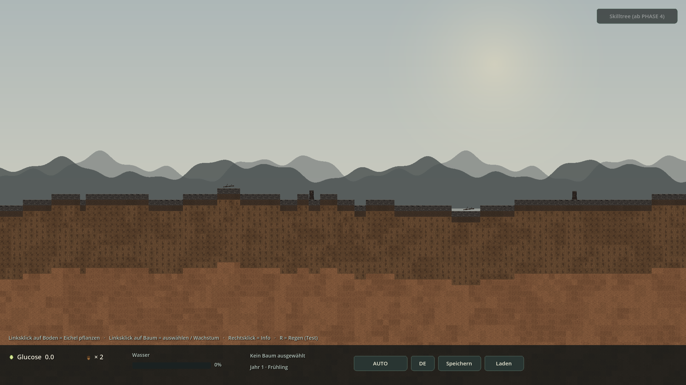
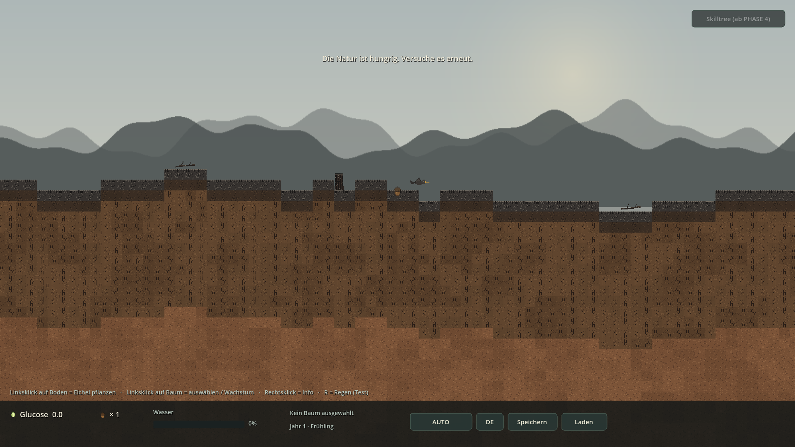
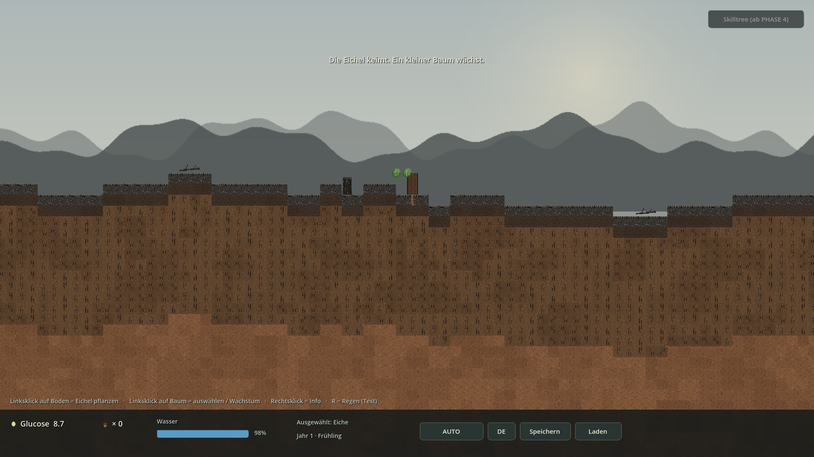
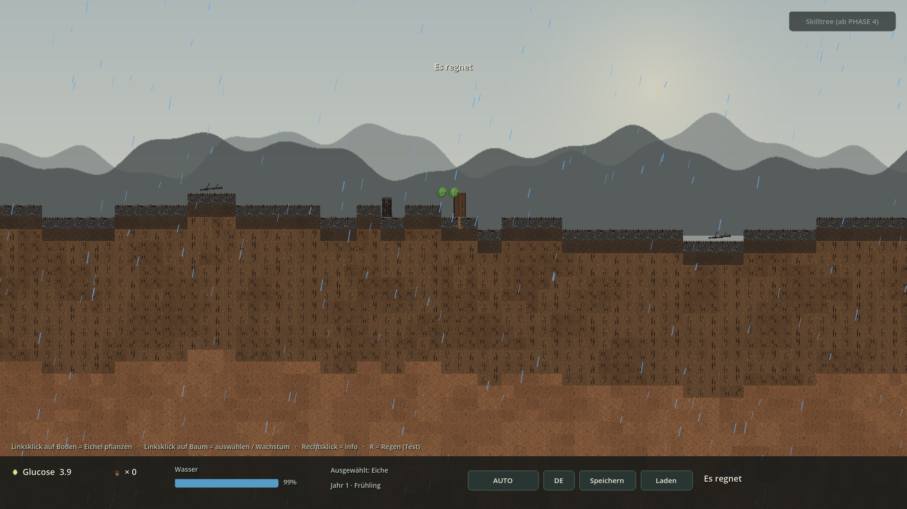

# PHASE 1 — Ergebnis

> **Status:** ✅ abgeschlossen · lauffähig · getestet  
> **Engine:** Godot `4.7.2.stable.official.ed1daf0bf` (Forward+ / Vulkan) · GDScript  
> **Datum:** 2026-11-05 · **Nächster Schritt:** PHASE 2 **erst nach deinem OK**

**User-Entscheidungen umgesetzt:** ① Seed wird bei jedem Neustart neu gewürfelt (Save/Load hält ihn fest). ② Die zwei 404-Repos werden ignoriert; eigene `FastNoiseLite`-Logik + GDQuest / Tdead1 als Referenz, keine Addons.

---

## 1. Screenshots (echte Godot-Renders)



*Start: 2 Eicheln im Inventar, HUD, noch kein Baum — Seed 20261105 · Zoom 1.00x*



*Vogel-Event: „Die Natur ist hungrig. Versuche es erneut.“ — 1. Eichel · Vogel im Anflug · Inventar ×1*



*Keimling: 2 Stamm-Tiles, 2 Blätter, 1 Wurzel · Glucose 8.7 — 2. Eichel · AUTO · Wasser 98%*



*Regen-Event mit blauen Linien und 5x Wasser-Boost — Toast + HUD „Es regnet“*

## 2. Was PHASE 1 liefert

| Bereich | Datei |
|---|---|
| Zufalls-Seed / Settings / DE/EN | `src/autoload/Global.gd` |
| Signals | `src/autoload/EventBus.gd` |
| Baum-Basisklasse + Eiche | `src/plants/Tree.gd`, `src/plants/Oak.gd` |
| Art-Daten als Resource | `src/data/TreeSpeciesData.gd`, `data/species/oak.tres` |
| Fotosynthese / AUTO-Kauf | `src/systems/GrowthSystem.gd` |
| Wasser / Regen (5x) | `src/systems/WaterSystem.gd` |
| Zeit-Platzhalter | `src/systems/TimeManager.gd` |
| JSON-Savegame | `src/systems/SaveManager.gd` |
| Platzieren / Vogel / Auswahl / Info | `src/systems/InteractionController.gd` |
| HUD, Regen-Linien, Vogel-Animation | `src/ui/HUD.gd`, `RainEffect.gd`, `BirdEvent.gd` |
| Tests | `tests/Phase0Smoke.gd`, `tests/Phase1Smoke.gd` |

## 3. Code-Snippets (direkt aus dem Projekt)

### Global.gd — Seed wird bei jedem Neustart gewürfelt

```gdscript
## Zufalls-Seed pro Prozessstart; CLI-Override hat Vorrang.
func _resolve_seed() -> void:
	var args := OS.get_cmdline_args() + OS.get_cmdline_user_args()
	for arg in args:
		if arg.begins_with("--seed=") or arg.begins_with("--phase1-seed="):
			var raw := arg.split("=", true, 1)[1]
			if raw.is_valid_int():
				world_seed = int(raw)
				seed_is_random = false
				return
	# Globalen RNG mit Zeit + Mikrosekunden neu seeden => bei jedem Start anders.
	seed(int(Time.get_unix_time_from_system() * 1000.0) + Time.get_ticks_usec())
	world_seed = randi_range(1, 2147483646)
	seed_is_random = true
```

### InteractionController.gd — Tutorial: Vogel-Event + Keimung

```gdscript
func plant_seed_at(pos: Vector2, instant: bool = false) -> bool:
	if seed_count <= 0:
		return false
	seed_count -= 1
	EventBus.inventory_changed.emit(seed_count)
	EventBus.seed_placed.emit(pos)
	if not instant:
		_spawn_acorn_sprite(pos)

	# 1. Eichel: scripted Vogel-Event
	if not first_seed_eaten:
		first_seed_eaten = true
		EventBus.seed_eaten.emit(pos)
		if not instant:
			bird_layer.spawn_bird(pos, false)
		EventBus.toast.emit(tr("MSG_BIRD_EVENT"))
		return true

	# 2. Eichel: Keimung
	if trees_root.get_child_count() >= MAX_TREES:
		return false
	var tree := spawn_tree_at(pos, {})
	select_tree(tree)
	EventBus.toast.emit(tr("MSG_GERMINATED"))
	return true
```

### Tree.gd — Fotosynthese & Wasseraufnahme

```gdscript
## Punkt 4.2: glucose += leaves * efficiency * sunlight * dt; water -= rate * dt
## sunlight_factor = 1.0 (immer Tag, kein Tag/Nacht-Zyklus im MVP).
func photosynthesize(dt: float) -> void:
	if not _built or leaves_count <= 0 or water <= 10.0:
		return
	age += dt
	glucose += float(leaves_count) * species.photosynthesis_efficiency * 1.0 * dt
	water = maxf(water - species.water_consumption_rate * dt, 0.0)


## rate kommt von WaterSystem (Boden + Reservoir + Regen).
func absorb_water(dt: float, rate: float) -> void:
	if not _built:
		return
	water = clampf(water + rate * dt, 0.0, 100.0)
```

### WaterSystem.gd — Bodenwasser 0.1/s, Regen 5x

```gdscript
func tick(delta: float) -> void:
	if raining:
		rain_time_left -= delta
		if rain_time_left <= 0.0:
			_stop_rain()
	else:
		_next_rain -= delta
		if _next_rain <= 0.0:
			start_rain(randf_range(REGEN_DAUER_MIN, REGEN_DAUER_MAX))

	last_reservoir_rate = 0.0
	for tree in get_tree().get_nodes_in_group("trees"):
		var rate: float = tree.species.base_water_gain * float(tree.root_count)
		if raining:
			rate *= REGEN_FAKTOR
		# PHASE 2: jedes Wurzelsegment, das ein Reservoir-Tile beruehrt,
		# entnimmt dort Wasser. Danach ist das Tile leer und bleibt es auch.
		if world_state != null and generator != null:
			var bonus := 0.0
			for seg in tree.root_segments:
				var gt: Vector2i = seg.global_tile()
				if world_state.is_reservoir(gt.x, gt.y) and not world_state.is_dry(gt.x, gt.y):
					bonus += world_state.consume(gt.x, gt.y, RESERVOIR_GAIN * delta)
			if bonus > 0.0:
				rate += bonus / maxf(delta, 0.0001)
				last_reservoir_rate += bonus / maxf(delta, 0.0001)
		tree.absorb_water(delta, rate)


## Anteil des ausgewaehlten Baums am naechstgelegenen Reservoir (0..1) fuer HUD.
func reservoir_fraction(tree: BaseTree) -> float:
	if tree == null or world_state == null or generator == null:
		return -1.0
	var best := -1.0
	for seg in tree.root_segments:
		var gt: Vector2i = seg.global_tile()
		if world_state.is_reservoir(gt.x, gt.y):
			var cap := generator.reservoir_capacity_at(gt.x, gt.y)
			var f := world_state.remaining_at(gt.x, gt.y) / maxf(cap, 0.001)
			best = maxf(best, clampf(f, 0.0, 1.0))
	return best
```

### GrowthSystem.gd — AUTO-Verteilung

```gdscript
func tick(delta: float) -> void:
	for tree in get_tree().get_nodes_in_group("trees"):
		tree.photosynthesize(delta)
		if not Global.auto_mode or not auto_growth_enabled:
			continue
		# Prioritaet: Wurzeln bei Durst, sonst Blaetter (Stamm als Fallback).
		var part := "root" if tree.water < DURST_SCHWELLE else "leaf"
		if not tree.can_grow(part):
			part = "trunk"
		var cost: float = tree.species.growth_cost
		if part == "root":
			cost = GrowthCost.for_root(tree, generator)
			if cost < 0.0:
				part = "leaf"
				cost = tree.species.growth_cost
		if tree.glucose < cost:
			continue
		if tree.grow_part(part):
			tree.glucose -= cost
			EventBus.tree_grew.emit(tree, part)
```

### SaveManager.gd — JSON in user://savegame.json

```gdscript
func save_game() -> bool:
	var trees: Array[Dictionary] = []
	for tree in get_tree().get_nodes_in_group("trees"):
		trees.append(tree.to_dict())
	var data := {
		"version": FORMAT_VERSION,
		"seed": Global.world_seed,
		"auto_mode": Global.auto_mode,
		"locale": Global.locale,
		"inventory": interaction.get_seed_count(),
		"bird_event_done": interaction.first_seed_eaten,
		"trees": trees,
		"world_state": world_state.to_dict() if world_state != null else {},
	}
	var file := FileAccess.open(SAVE_PATH, FileAccess.WRITE)
	if file == null:
		EventBus.toast.emit(tr("MSG_SAVE_ERROR"))
		return false
	file.store_string(JSON.stringify(data, "\t"))
	file.close()
	EventBus.game_saved.emit()
	EventBus.toast.emit(tr("MSG_SAVED"))
	return true
```

### data/species/oak.tres — TreeSpeciesData als Resource

```ini
[gd_resource type="Resource" script_class="TreeSpeciesData" load_steps=2 format=3]

[ext_resource type="Script" path="res://src/data/TreeSpeciesData.gd" id="1"]

[resource]
script = ExtResource("1")
species_name = "Eiche"
photosynthesis_efficiency = 0.8
water_consumption_rate = 0.35
base_water_gain = 0.1
growth_cost = 10.0
starting_water = 100.0
root_type = "Pfahlwurzel + Herzwurzelsystem"
leaf_description = "Sommergrün, 2 Blätter beim Keimling"
root_side_every = 4
```

## 4. Testprotokoll

```bash
godot --headless --path . --import                  # 0 Fehler
godot --headless --path . --quit-after 120          # F5-Ersatz: 0 Fehler
godot --headless --path . -- --phase0-smoke         # Regression: Ergebnis OK
godot --headless --path . -- --phase1-smoke         # 25 Checks: Ergebnis OK, Exit 0
```

```text
[Global] seed=1497285583 (Zufall) | difficulty=NORMAL | auto=ON | Godot 4.7.2-stable (official)
[Main] PHASE 1 bereit: 2 Eicheln, Vogel-Event, Keimung, Glucose/Wasser, Regen, AUTO/MANUELL.
[SMOKE] === PHASE 1 ===
[SMOKE] Zufalls-Seed pro Neustart (seed=1497285583)    OK
[SMOKE] 2 Eicheln im Inventar                          OK
[SMOKE] Vogel-Event ausgeloest                         OK
[SMOKE] Inventar nach Vogel: 1                         OK
[SMOKE] Noch kein Baum                                 OK
[SMOKE] 1 Baum nach 2. Eichel                          OK
[SMOKE] Keimling: 2 Stamm-Tiles / 2 Blaetter / 1 Wurzel OK
[SMOKE] Baum ausgewaehlt (HUD)                         OK
[SMOKE] Glucose steigt / Wasser sinkt                  OK
[SMOKE] Glucose 0.00 -> 8.00 | Wasser 100.00 -> 98.25
[SMOKE] Regen aktiv                                    OK
[SMOKE] Regen-Partikel (blaue Linien) sichtbar         OK
[SMOKE] Regen-Boost ~5x (normal 0.20 / Regen 1.00)     OK
[SMOKE] AUTO: Blatt-Wachstum, -10 Glucose              OK
[SMOKE] MANUELL: Wurzel-Wachstum, -10 Glucose          OK
[SMOKE] Speichern nach user://savegame.json            OK
[SMOKE] Baeume vor Load entfernt                       OK
[SMOKE] Laden erfolgreich                              OK
[SMOKE] 1 Baum wiederhergestellt                       OK
[SMOKE] Seed aus Spielstand wiederhergestellt          OK
[SMOKE] Inventar aus Spielstand                        OK
[SMOKE] Glucose aus Spielstand                         OK
[SMOKE] 5 Chunks nach Pan auf x=4300                   OK
[SMOKE] DE/EN-Umschaltung (TranslationServer)          OK
[SMOKE] Nearest + Forward+ weiterhin aktiv             OK
[SMOKE] Ergebnis: OK
```

Zusätzlich: 3 Neustarts → 3 unterschiedliche Seeds; 4 Xvfb-Screenshots ohne Fehler; DE/EN-`tr()`-Check und Save/Load-Roundtrip im Smoke-Test.

## 5. Abnahme PHASE 1

- [x] Seed wird bei jedem Neustart neu gewürfelt (3 Teststarts → 3 Seeds); `--seed=<int>` und Save/Load stellen ihn reproduzierbar wieder her
- [x] 2 Eicheln im Inventar, Linksklick auf Boden platziert sie
- [x] 1. Eichel: Vogel fliegt per Tween rein, frisst sie, Toast „Die Natur ist hungrig. Versuche es erneut.“, kein Baum
- [x] 2. Eichel: Keimung zu Mini-Baum mit 2 Stamm-Tiles, 2 Blättern, 1 Wurzel
- [x] `Tree.gd` (BaseTree) + `Oak.gd` + `TreeSpeciesData` als `oak.tres`; Glucose/Water/Health pro Instanz
- [x] Blätter produzieren Glucose (`leaves × 0.8 × 1.0 × dt`), Wasser sinkt um `0.35 × dt` – immer Tag
- [x] Wurzeln sammeln Wasser langsam (`roots × 0.1/s`), bei Regen 5x (`roots × 0.5/s`)
- [x] Regen-Event 120–300 s Intervall / 20–60 s Dauer, blaue Linien, Toast + HUD „Es regnet“
- [x] AUTO/MANUELL-Toggle funktioniert: AUTO kauft Wurzel/Blatt (10 Glucose), MANUELL per Klick
- [x] HUD: Glucose mit Icon, Wasserbalken, Inventar, Zeit-Platzhalter, Toggle, DE/EN, Speichern/Laden, Skilltree-Platzhalter, Toasts
- [x] Rechtsklick = Info (Baumwerte bzw. Bodenmaterial / Tiefe / Seed)
- [x] Speichern/Laden-Button: JSON in `user://savegame.json` inkl. Seed + Baumwerten (Roundtrip getestet)
- [x] PHASE 0 unverändert: 5 infinite Chunks, Hügel, Schichten, Fels, Zoom/Pan, Nearest, Forward+
- [x] Keine externen Addons, keine Tag/Nacht, keine 3D-Nodes, kein C#
- [x] Import, F5-Ersatz, `--phase0-smoke`, `--phase1-smoke`: Exit 0 / 0 rote Fehler

## 6. Hinweise / bewusste Grenzen

- **Historischer Bericht:** Diese Datei beschreibt den Stand bei Abschluss der genannten Phase. Inzwischen sind PHASE 1 und PHASE 2 fertig – aktueller Stand: `PHASE2-ERGEBNIS.html` / `DECISIONS.md`.
- **PHASE 2 wurde nicht begonnen.** Richtungsbasiertes Wurzelwachstum, Bodenhärte/Kosten, Ghost-Preview, endliche Wasserreservoirs, Höhlen, L-System, Jahreszeiten, Schwierigkeitsgrade, Skilltree-UI, Tiere, Pilze und Parasiten sind bewusst noch nicht drin.
- **MANUELL ist in PHASE 1 absichtlich minimal:** Klickhöhe entscheidet Wurzel (unter der Oberfläche) oder Blatt (darüber), Kosten 10 Glucose. PHASE 2 ersetzt das durch Wachstum in Erd-Richtung mit Boden-Kosten und Ghost-Preview.
- **Save/Load ist schon drin**, obwohl es keiner Phase explizit zugeordnet ist: wegen des Zufalls-Seeds wäre dieselbe Welt sonst nach einem Neustart nicht mehr erreichbar. Punkt 9 und die MVP-Akzeptanzkriterien verlangen es ohnehin.
- **404-Repos ignoriert** (vom Nutzer bestätigt, keine lokalen Kopien). Referenzen jetzt: `GDQuest/godot-procedural-generation` (Seed-/Sektor-Muster, weiter aktiv) und `Tdead1/GodotGeneration` (Godot 3, Nachbar-Smoothing → Notiz für PHASE 2/5). Chunk-/Height-Logik bleibt eigene `FastNoiseLite`-Implementierung wie in Punkt 3.1.
- Zeit-Anzeige „Jahr 1 · Frühling“ und der deaktivierte Skilltree-Button sind Platzhalter (PHASE 3 / PHASE 4). `R` löst Regen sofort aus (Dev-Hook); das echte 2–5-Minuten-Intervall bleibt unverändert.
- Screenshots: echtes Godot 4.7.2 unter Xvfb mit Software-Rendering, reproduzierbar via `--seed=20261105 --phase1-shot-{bird,tree,rain}`. `project.godot` steht weiterhin auf **Forward+ / Vulkan**.

---

**Ich stoppe hier.** Sag mir „Weiter mit PHASE 2“, dann kommen manuelles Wurzelwachstum in Erd-Richtung, Boden-Typen mit unterschiedlichen Kosten, endliche/austrocknende Wasserreservoirs und Höhlen.
