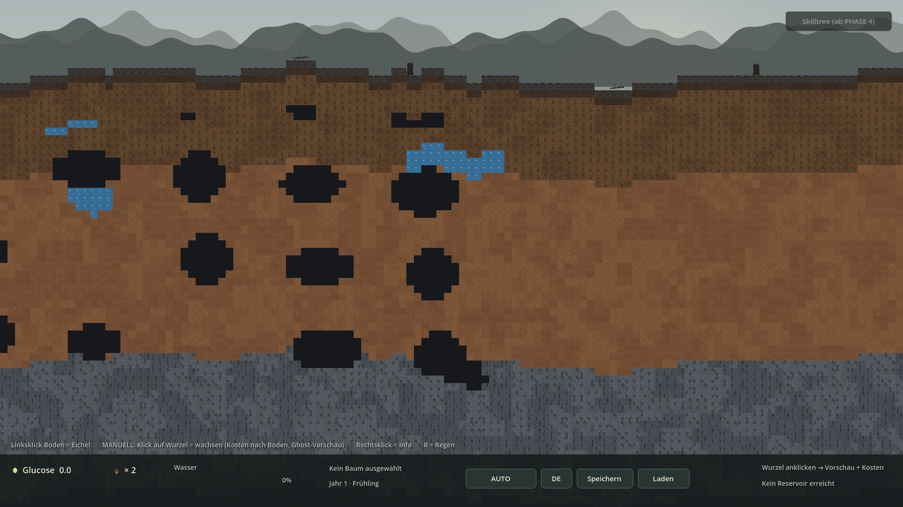
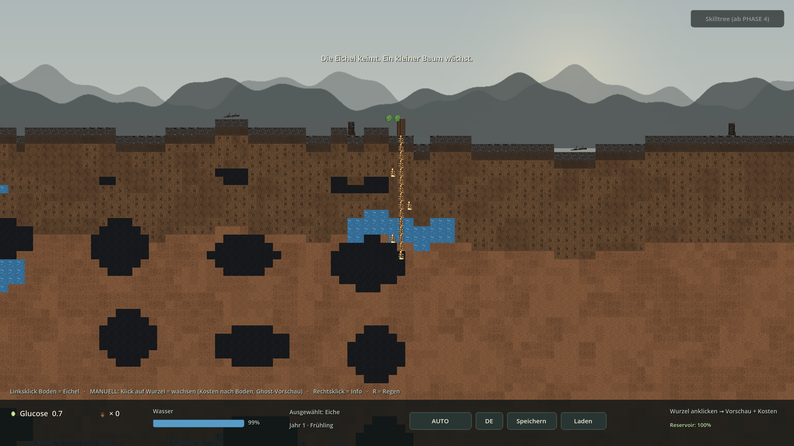
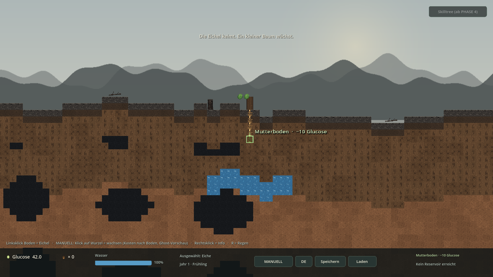
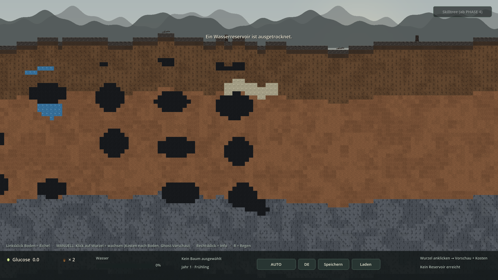

# PHASE 2 — Ergebnis

> **Status:** ✅ abgeschlossen · lauffähig · getestet  
> **Engine:** Godot `4.7.2.stable.official.ed1daf0bf` (Forward+ / Vulkan) · GDScript  
> **Datum:** 2026-11-05 · **Nächster Schritt:** PHASE 3 **erst nach deinem OK**

**Umgesetzt:** Manuelles Wurzelwachstum in Erd-Richtung, Boden-Typen mit unterschiedlichen Glucose-Kosten, endliche/austrocknende Wasserreservoirs, Höhlen – plus Ghost-Preview, echte RootTip-Hierarchie und Save-Format v2.

**Zusätzlich wie gewünscht:** eine vollständige, in Godot importierbare ZIP (`waldspiel-PHASE2.zip`).

---

## 1. Screenshots (echte Godot-Renders)



*Höhlen (dunkle Blasen) + blaue Wasserreservoirs — Seed 20261105 · Zoom 1.00x · Blick in die Tiefe*



*Pfahlwurzel + Seitenwurzeln bis ins Reservoir — HUD: Reservoir 100% · 22 RootSegmente*



*MANUELL: Ghost-Preview mit Bodenmaterial und Preis — „Mutterboden · −10 Glucose“ · Glucose 42.0*



*Ausgetrocknetes Reservoir wird optisch heller — Toast „Ein Wasserreservoir ist ausgetrocknet.“*

## 2. Neue / geänderte Dateien

| Datei | Aufgabe |
|---|---|
| `src/plants/RootSegment.gd` | ein Wurzel-Segment + `RootTip`-Marker auf dem 16px-Raster |
| `src/plants/Tree.gd`, `Oak.gd` | Segmente, `propose_next_tile()`, `grow_root_from()`, Pfahlwurzel + Herzwurzelsystem |
| `src/systems/GrowthCost.gd` | zentrale Boden-Kosten-Tabelle (Fels teurer) |
| `src/ui/GhostPreview.gd` | Ziel-Tile, Preis, affordability |
| `src/world/WorldGenerator.gd` | Höhlen/Reservoir-Blasen, `SLOT_CAVE/WATER/DRY_WATER`, Starter-Reservoir |
| `src/world/WorldState.gd` | endliche Kapazität, Austrocknen, Save/Load |
| `src/world/Chunk.gd`, `ChunkManager.gd` | Spezial-Slots, Trocken-Repaint, `get_chunk()` |
| `src/world/TerrainAtlas.gd` | 17 Atlas-Slots, Höhlen ohne Kollision |
| `src/systems/WaterSystem.gd` | 2.0/s Reservoir-Boost, Regen 5x bleibt |
| `src/systems/GrowthSystem.gd`, `InteractionController.gd`, `SaveManager.gd` | bodenabhängige Kosten, Wurzelklick, v2-Save |
| `src/ui/HUD.gd` | Wurzel-Kosten + Reservoir-Füllstand |
| `data/localization.csv`, `data/species/oak.tres` | DE/EN-Texte, `root_side_every` |
| `tests/Phase2Smoke.gd`, `tools/build_zip.py`, `GODOT-IMPORT.txt` | 24 Checks, ZIP, Import-Anleitung |

## 3. Code-Snippets (direkt aus dem Projekt)

### WorldGenerator.gd — kohärente Höhlen-/Reservoir-Blasen

```gdscript
func _blob_at(global_tile_x: int, tile_y: int, cell_w: int, cell_h: int,
		salt: int, radius_x: float, radius_y: float, density: int) -> bool:
	var cx := int(floor(float(global_tile_x) / float(cell_w)))
	var cy := int(floor(float(tile_y) / float(cell_h)))
	for ox in range(-1, 2):
		for oy in range(-1, 2):
			var ccx := cx + ox
			var ccy := cy + oy
			var h := _hash2(ccx, ccy, salt)
			if (h % 100) >= density:
				continue
			var h2 := _hash2(ccx, ccy, salt + 7919)
			var h3 := _hash2(ccx, ccy, salt + 15839)
			var bx := float(ccx * cell_w) + float(h2 % cell_w)
			var by := float(ccy * cell_h) + float(h3 % cell_h)
			var rx := radius_x * (0.75 + float(h % 7) * 0.07)
			var ry := radius_y * (0.75 + float(h3 % 7) * 0.07)
			var dx := (float(global_tile_x) - bx) / maxf(rx, 0.001)
			var dy := (float(tile_y) - by) / maxf(ry, 0.001)
			if dx * dx + dy * dy <= 1.0:
				return true
	return false


func _compute_cave(global_tile_x: int, tile_y: int) -> bool:
	if is_starter_reservoir(global_tile_x, tile_y):
		return false
	var d := depth_tiles_at(global_tile_x, tile_y)
	if d < 6 or d > 40 or tile_y > BOTTOM_TILE_Y:
		return false
	return _blob_at(global_tile_x, tile_y, CAVE_CELL_W, CAVE_CELL_H, 61, 4.2, 3.0, 62)


func cave_at(global_tile_x: int, tile_y: int) -> bool:
	var k := Vector2i(global_tile_x, tile_y)
	if _cave_cache.has(k):
		return _cave_cache[k]
	var v := _compute_cave(global_tile_x, tile_y)
	_cave_cache[k] = v
	return v


func _compute_reservoir(global_tile_x: int, tile_y: int) -> bool:
	if is_starter_reservoir(global_tile_x, tile_y):
		return true
	if cave_at(global_tile_x, tile_y):
		return false
	var d := depth_tiles_at(global_tile_x, tile_y)
	if d < 7 or d > 34 or tile_y > BOTTOM_TILE_Y:
		return false
	return _blob_at(global_tile_x, tile_y, RES_CELL_W, RES_CELL_H, 71, 2.8, 2.0, 45)


func reservoir_at(global_tile_x: int, tile_y: int) -> bool:
	var k := Vector2i(global_tile_x, tile_y)
	if _res_cache.has(k):
		return _res_cache[k]
	var v := _compute_reservoir(global_tile_x, tile_y)
	_res_cache[k] = v
	return v
```

### GrowthCost.gd — Wachstum kostet nach Bodenhärte

```gdscript
static func multiplier(kind: int) -> float:
	match kind:
		WorldGenerator.SoilKind.ASH:     return 0.8   # lockere Brandasche
		WorldGenerator.SoilKind.HUMUS:   return 0.9
		WorldGenerator.SoilKind.TOPSOIL: return 1.0   # Referenz = 10 Glucose
		WorldGenerator.SoilKind.CLAY:    return 1.3   # Lehm ist zaeh
		WorldGenerator.SoilKind.ROCK:    return 2.5   # Fels deutlich teurer
		WorldGenerator.SoilKind.STONE:   return 3.0   # Steinklumpen am teuersten
		WorldGenerator.SoilKind.WATER:   return 1.5   # nasses Reservoir
		WorldGenerator.SoilKind.CAVE:    return 0.4   # Hohlraum: fast frei
		WorldGenerator.SoilKind.AIR:     return 0.5
	return 1.0


static func for_tile(generator: WorldGenerator, global_tile_x: int, tile_y: int) -> float:
	return BASE * multiplier(generator.material_at(global_tile_x, tile_y))


## Kosten des naechsten Wurzelschritts (Ghost-Preview + Kauf identisch).
## Liefert -1.0, wenn kein Ziel-Tile mehr frei ist.
```

### RootSegment.gd — Tree → Roots → RootSegment → RootTip

```gdscript
func setup(p_tree: BaseTree, p_grid: Vector2i, p_dir: Vector2i,
		p_parent: RootSegment) -> void:
	tree_ref = p_tree
	grid = p_grid
	direction = p_dir
	parent_segment = p_parent
	name = "Root_%d_%d" % [grid.x, grid.y]
	position = Vector2(float(grid.x * WorldGenerator.TILE_SIZE),
		float(grid.y * WorldGenerator.TILE_SIZE))

	_sprite = Sprite2D.new()
	_sprite.name = "Sprite"
	_sprite.texture = load(ROOT_PATH)
	_sprite.centered = false
	_sprite.texture_filter = CanvasItem.TEXTURE_FILTER_NEAREST
	add_child(_sprite)

	_tip_marker = Marker2D.new()
	_tip_marker.name = "RootTip"
	_tip_marker.position = Vector2(8.0, float(WorldGenerator.TILE_SIZE))
	add_child(_tip_marker)
	refresh_sprite()
```

### Tree.gd — nächstes Erd-Tile + Seitenwurzeln

```gdscript
func propose_next_tile(tip: RootSegment) -> Vector2i:
	if tip == null or not can_grow("root"):
		return INVALID_TILE
	for delta in root_candidates(tip):
		var target: Vector2i = tip.grid + delta
		if _is_free(target):
			return target
	return INVALID_TILE


func has_next_root_tile(tip: RootSegment) -> bool:
	return propose_next_tile(tip) != INVALID_TILE


## Waechst vom angegebenen Tip. Bei der Eiche entsteht zusaetzlich alle
## root_side_every Tiles eine Seitenwurzel (Herzwurzelsystem), waehrend die
## Pfahlwurzel weiter nach unten laeuft.
func grow_root_from(tip: RootSegment, allow_branch: bool = true) -> RootSegment:
	if tip == null or not can_grow("root"):
		return null
	var target := propose_next_tile(tip)
	if target == INVALID_TILE:
		return null
	var seg := _add_root_segment(target, target - tip.grid, tip, false)
	if allow_branch and species != null and species.root_side_every > 0:
		var every: int = maxi(species.root_side_every, 1)
		if target.y > 0 and target.y % every == 0 and can_grow("root"):
			var side := 1 if (int(target.y / every) % 2 == 0) else -1
			var side_target: Vector2i = target + Vector2i(side, 0)
			if _is_free(side_target):
				_add_root_segment(side_target, Vector2i(side, 0), seg, true)
	return seg
```

### Oak.gd — Pfahlwurzel + Herzwurzelsystem

```gdscript
extends "res://src/plants/Tree.gd"
## Eiche (Startart) - extends Tree.gd, wie in Master-Punkt 9 gefordert.
## PHASE 2: Pfahlwurzel + Herzwurzelsystem (recherchiert, Punkt 4.3).
##   * Pfahlwurzel: Hauptachse waechst strikt nach unten (0,1).
##   * Herzwurzelsystem: alle `root_side_every` Tiles entsteht eine zusaetzliche
##     Seitenwurzel als weiterer anklickbarer Tip (siehe grow_root_from()).
##   * Buche (Flachwurzler) / Kiefer (sehr tiefe Pfahlwurzel) = PHASE 3.


func default_species() -> TreeSpeciesData:
	return load("res://data/species/oak.tres")


func build_mini() -> void:
	# 2 Stamm-Tiles, 2 Blätter, 1 kleine Wurzel
	super.build_mini()


## Erdsuche: Hauptachse bevorzugt senkrecht, Seitenwurzeln biegen nach unten.
func root_candidates(tip: RootSegment) -> Array[Vector2i]:
	if tip.direction.x != 0:
		var sx := tip.direction.x
		return [Vector2i(sx, 1), Vector2i(0, 1), Vector2i(sx, 0),
			Vector2i(-sx, 1)]
	# Pfahlwurzel: nur diagonale Ausweichziele, wenn (0,1) belegt ist.
	return [Vector2i(0, 1), Vector2i(-1, 1), Vector2i(1, 1),
		Vector2i(-1, 0), Vector2i(1, 0)]
```

### GhostPreview.gd — Vorschau + Kosten-Label

```gdscript
func show_at(world_pos: Vector2, cost: float, affordable: bool, material: String) -> void:
	_tile_pos = world_pos
	_affordable = affordable
	_sprite.position = world_pos
	_sprite.modulate = Color(0.72, 1.0, 0.68, 0.50) if affordable else Color(1.0, 0.55, 0.45, 0.50)
	_label.position = world_pos + Vector2(20.0, -20.0)
	_label.text = "%s  ·  −%.0f %s" % [material, cost, tr("HUD_GLUCOSE")]
	_label.modulate = Color.WHITE if affordable else Color(1.0, 0.68, 0.62)
	visible = true
	queue_redraw()


func hide_ghost() -> void:
	visible = false
	_affordable = true
```

### WaterSystem.gd — 0.1/s Boden, 2.0/s Reservoir, 5x Regen

```gdscript
func tick(delta: float) -> void:
	if raining:
		rain_time_left -= delta
		if rain_time_left <= 0.0:
			_stop_rain()
	else:
		_next_rain -= delta
		if _next_rain <= 0.0:
			start_rain(randf_range(REGEN_DAUER_MIN, REGEN_DAUER_MAX))

	last_reservoir_rate = 0.0
	for tree in get_tree().get_nodes_in_group("trees"):
		var rate: float = tree.species.base_water_gain * float(tree.root_count)
		if raining:
			rate *= REGEN_FAKTOR
		# PHASE 2: jedes Wurzelsegment, das ein Reservoir-Tile beruehrt,
		# entnimmt dort Wasser. Danach ist das Tile leer und bleibt es auch.
		if world_state != null and generator != null:
			var bonus := 0.0
			for seg in tree.root_segments:
				var gt: Vector2i = seg.global_tile()
				if world_state.is_reservoir(gt.x, gt.y) and not world_state.is_dry(gt.x, gt.y):
					bonus += world_state.consume(gt.x, gt.y, RESERVOIR_GAIN * delta)
			if bonus > 0.0:
				rate += bonus / maxf(delta, 0.0001)
				last_reservoir_rate += bonus / maxf(delta, 0.0001)
		tree.absorb_water(delta, rate)
```

### WorldState.gd — endliche Kapazität + Austrocknen

```gdscript
## Entnimmt Wasser; liefert die tatsaechlich entnommene Menge zurueck.
## Beim Uebergang auf 0 wird das Tile optisch umgeschaltet (EventBus).
func consume(global_tile_x: int, tile_y: int, amount: float) -> float:
	if amount <= 0.0 or not is_reservoir(global_tile_x, tile_y):
		return 0.0
	var k := key(global_tile_x, tile_y)
	if _dry.has(k):
		return 0.0
	var rem := remaining_at(global_tile_x, tile_y)
	var taken := minf(amount, rem)
	rem -= taken
	_remaining[k] = rem
	if rem <= 0.001:
		_dry[k] = true
		EventBus.reservoir_dried.emit(Vector2i(global_tile_x, tile_y))
		EventBus.toast.emit(tr("MSG_RESERVOIR_DRY"))
	else:
		EventBus.reservoir_consumed.emit(Vector2i(global_tile_x, tile_y), rem)
	return taken
```

## 4. Testprotokoll

```bash
godot --headless --path . --import                  # 0 Fehler
godot --headless --path . --quit-after 180          # F5-Ersatz: 0 Fehler
godot --headless --path . -- --phase0-smoke         # Regression: OK
godot --headless --path . -- --phase1-smoke         # Regression: OK (25 Checks)
godot --headless --path . -- --phase2-smoke         # 24 Checks: OK, Exit 0
python3 tools/build_zip.py PHASE2                   # ZIP + CRC-Test
```

```text
[Global] seed=1621027769 (Zufall) | difficulty=NORMAL | auto=ON | Godot 4.7.2-stable (official)
[Main] PHASE 2 bereit: 2 Eicheln, Kern-Loop, Wurzel-Segmente, Bodenhärte, Reservoirs, Höhlen.
[SMOKE] === PHASE 2 ===
[SMOKE] Hoehlen/Reservoirs deterministisch pro Seed          OK
[SMOKE] Hoehlen-Tiles in Chunk 0 vorhanden (82)              OK
[SMOKE] Starter-Reservoir unter dem Keimling (Tiefe 10)      OK
[SMOKE] Hoehlen-Tile ohne Kollision (Hohlraum)               OK
[SMOKE] Mutterboden = 10 Glucose (Akzeptanzkriterium)        OK
[SMOKE] Fels > Lehm > Mutterboden > Hoehle (Kosten)          OK
[SMOKE] Keimling: 1 RootSegment auf (0,0)                    OK
[SMOKE] Hierarchie Tree -> Roots -> RootSegment -> RootTip   OK
[SMOKE] Wurzelklick: laenger, −9 Glucose (Boden)             OK
[SMOKE] Wurzel waechst in Erd-Richtung (+y)                  OK
[SMOKE] Ghost-Preview sichtbar (MANUELL)                     OK
[SMOKE] Ghost zeigt naechstes freies Erd-Tile                OK
[SMOKE] Pfahlwurzel beruehrt Reservoir (22 Segmente)         OK
[SMOKE] Reservoir schneller als Boden (32.4 > 4.4 / 2s)      OK
[SMOKE] Kapazitaet nimmt ab (110 -> 106 von 110)             OK
[SMOKE] Reservoir ausgetrocknet                              OK
[SMOKE] Ausgetrocknet = heller Atlas-Slot 16                 OK
[SMOKE] Speichern (Format v2)                                OK
[SMOKE] Laden (Format v2)                                    OK
[SMOKE] Trockenzustand aus Savegame wiederhergestellt        OK
[SMOKE] Wurzel-Segmente + Tips aus Savegame                  OK
[SMOKE] 5 Chunks nach Pan auf x=4300                         OK
[SMOKE] Nearest + Forward+ weiterhin aktiv                   OK
[SMOKE] DE/EN: neue PHASE-2-Texte                            OK
[SMOKE] Ergebnis: OK
```

Zusätzlich: 4 Xvfb-Screenshots ohne Fehler, 18/18 PNGs mit `mipmaps/generate=false`, 3 Neustarts → 3 Seeds, ZIP-CRC-Test OK.

## 5. Abnahme PHASE 2

- [x] Klick auf ein Wurzel-Segment → Wurzel wird länger und wächst in Erd-Richtung
- [x] Kosten = 10 Glucose für Mutterboden (Akzeptanzkriterium), abhängig von Bodenhärte: Asche 8 / Humus 9 / Lehm 13 / Fels 25 / Stein 30 / Höhle 4 / Reservoir 15
- [x] Ghost-Preview zeigt Ziel-Tile, Bodenmaterial und Preis; rot bei zu wenig Glucose; Vorschau und Kauf nutzen dieselbe propose_next_tile()
- [x] Echte Wurzel-Segmente mit RootTip-Hierarchie (Tree → Roots → RootSegment → RootTip), max. 32 Segmente
- [x] Eiche: Pfahlwurzel strikt nach unten + Herzwurzelsystem (alle 4 Tiefen-Tiles eine Seitenwurzel als weiterer Tip)
- [x] Wasserreservoirs: 2.0/s pro berührtem Tile statt 0.1/s aus Boden – endlich, Kapazität 60–120 Einheiten
- [x] Ausgetrocknete Reservoirs werden optisch heller (Atlas-Slot 16) und bleiben über Chunk-Wechsel / Save/Load trocken
- [x] Höhlen: dunkle, kollisionsfreie Hohlraum-Blasen; Wurzelwachstum dort am billigsten
- [x] AUTO zahlt dieselben bodenabhängigen Kosten wie MANUELL; Blatt/Stamm kosten weiter 10
- [x] HUD: Wurzel-Kosten + Reservoir-Füllstand in %; alle neuen Texte DE/EN in localization.csv
- [x] Speichern v2: Wurzel-Segmente + Reservoir-Zustand; liest v1-Spielstände rückwärtskompatibel
- [x] Regression: PHASE 0 und PHASE 1 Smoke-Tests weiterhin Exit 0 / Ergebnis OK
- [x] 5 infinite Chunks, Zoom/Pan, Nearest, Forward+/Vulkan, 1920x1080, keine externen Addons
- [x] Import, F5-Ersatz und 3 Smoke-Tests: 0 rote Fehler; 4 Screenshots ohne Fehler

## 6. Hinweise / bewusste Grenzen

- **PHASE 3 wurde nicht begonnen.** Jahreszeiten/Zeitspulen, Herbst-Eichelfall, Samen finden/vergraben, Schwierigkeitsgrade, Buche/Kiefer, Skilltree-UI, Tiere, Pilze und Parasiten sind bewusst noch nicht drin.
- **10 Glucose bleibt der Referenzwert**, aber nur für Mutterboden. Der erste Noise-Ansatz für Höhlen/Reservoirs erzeugte 1-Tile-Sprenkel („Fernseh-Rauschen“) → ersetzt durch deterministische Ellipsen-Blasen auf einem Zellraster, memoisisiert pro Tile.
- **Ein garantiertes Starter-Reservoir** (Chunk 0, Tiles x −6…6, Tiefe 10–12) macht das Feature in Tutorial, Screenshots und Tests zuverlässig sichtbar; alle weiteren Reservoirs und Höhlen kommen aus dem Seed. Das ist eine dokumentierte Annahme, da der Master keine Verteilung vorgibt.
- **WorldState ist kein Autoload**, sondern ein RefCounted im Besitz des ChunkManager: Wo Wasser liegt = Seed, wie voll es ist = Spielzustand im Savegame. Sonst würde ein neu geladener Chunk endliches Wasser nachfüllen.
- **Höhlen sind Hohlraum-Tiles ohne Kollision**, kein Grab-/Abbau-Modus und keine begehbaren Tunnel (MVP-Rahmen).
- **ZIP ist ab jetzt fester Phasen-Abschluss** (User-Anweisung): `tools/build_zip.py PHASE2` → `waldspiel-PHASE2.zip` mit project.godot im Root. Gilt für alle kommenden Phasen.
- Screenshots: echtes Godot 4.7.2 unter Xvfb mit Software-Rendering, reproduzierbar via `--seed=20261105 --phase2-shot-{caves,roots,manual,dry}`. project.godot bleibt Forward+ / Vulkan.

---

**Ich stoppe hier.** Sag „Weiter mit PHASE 3“, dann kommen Jahreszeiten, Zeitspulen, Herbst-Eichelfall, Samen finden/vergraben und Schwierigkeitsgrade.
