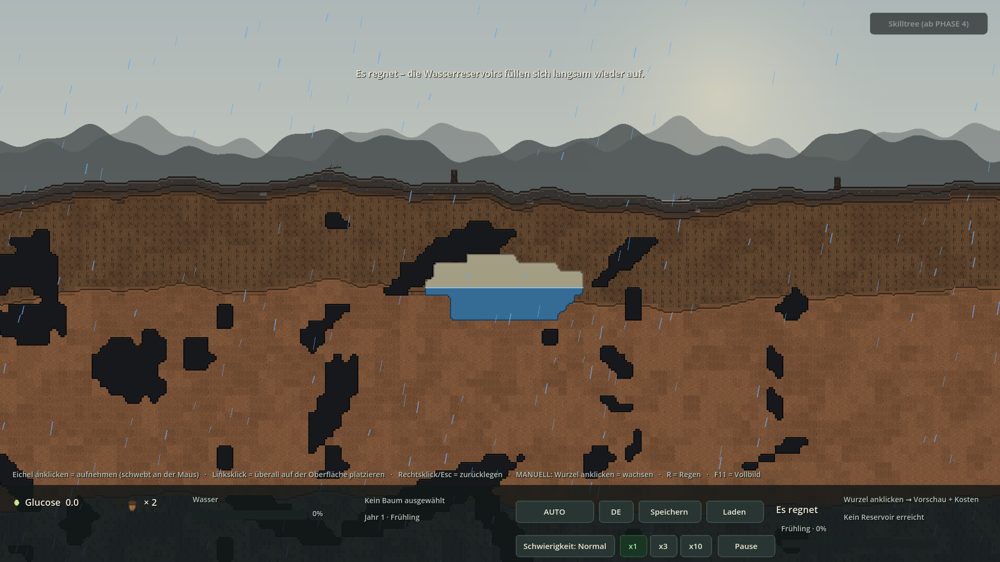
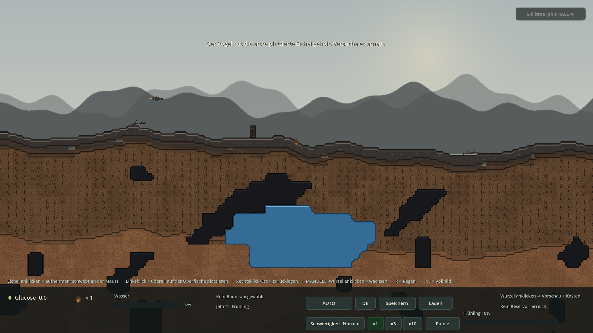
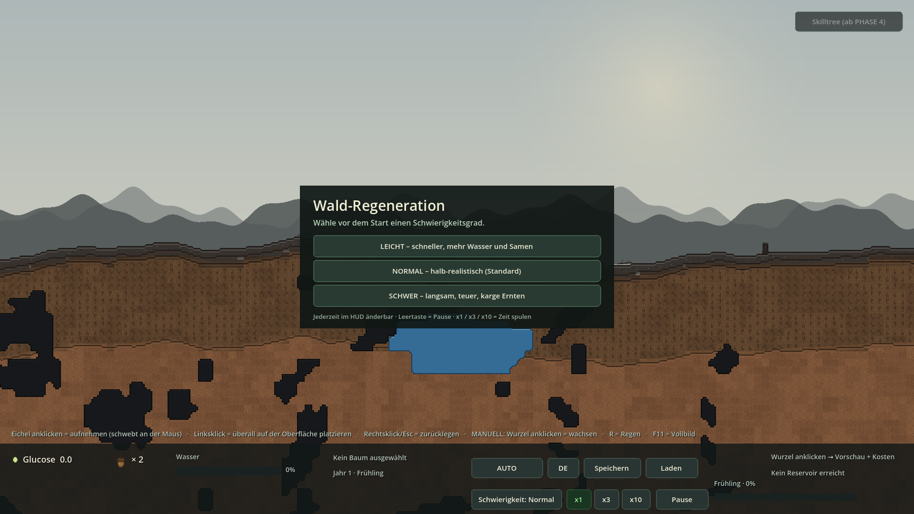
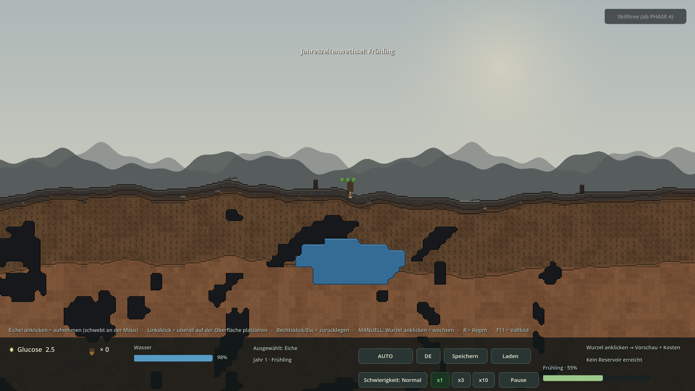
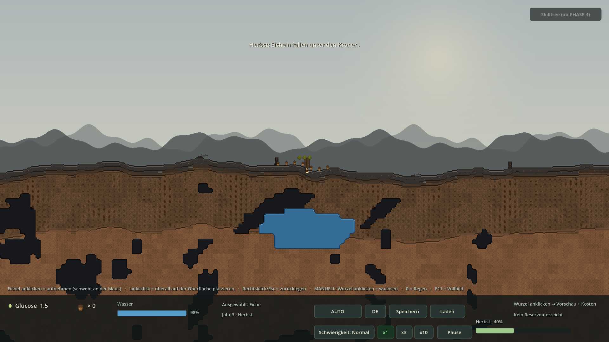
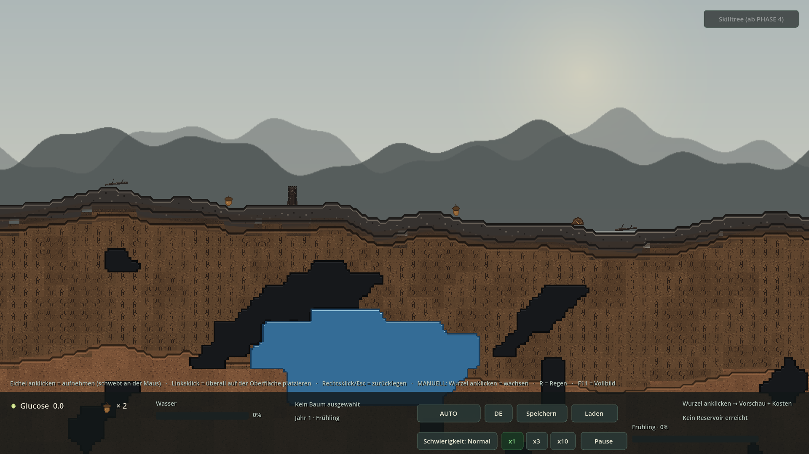
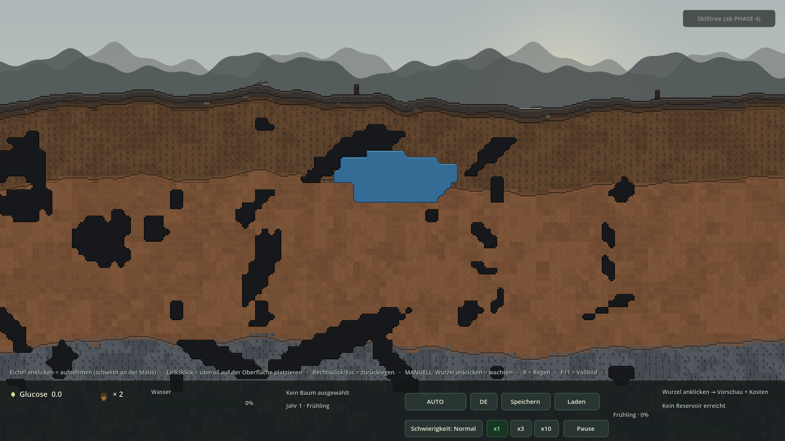

# PHASE 3 — Ergebnis (Zeit & Reproduktion)

**Godot 4.7.2 stable · GDScript · Forward+/Vulkan · 2026-11-07**  
Zwei Korrekturen vorab (Regen-Auffüllung, Vogel verlässt das Bild) **plus** die komplette PHASE 3 — ohne Zwischenlieferung, wie gewünscht.

## 1 · Screenshots (echte Godot-Renders)

### Korrektur 1: Regen füllt das Becken wieder auf
*Blau unter dem Pegel, heller trockener Leerboden darüber · Toast „Es regnet – die Wasserreservoirs füllen sich langsam wieder auf.*



### Korrektur 2a: Vogel mitten im Flug
*Erste platzierte Eichel geklaut · Vogel samt Beute sichtbar · kamera-/viewport-abhängiger Abflug*



### Korrektur 2b: Vogel verlässt das Bild links
*Sprite fliegt bis hinter die linke Bildkante, erst dann queue_free() · kein Verschwinden in der Luft mehr*


### Startmenü: LEICHT / NORMAL / SCHWER
*Vor Spielstart wählbar, nicht blockierend · jederzeit im HUD umschaltbar · CanvasLayer 20*



### Frühling · Jahr 1 · 55 % Saison-Fortschritt
*Wachstumsboost ×1.35, Sonne ×1.25 · HUD mit x1/x3/x10, Pause, Schwierigkeit, Balken*



### Herbst: Eicheln fallen unter der Krone
*Laub herbstlich getönt · 7 Eicheln am Boden · Reife ab ~3 Spiel-Jahren · Chance × Schwierigkeit*



### Winter: Wachstum stoppt, Laubbaum kahl
*Toast „Jahreszeitenwechsel: Winter“ · keine Fotosynthese · manuelles Wachstum blockiert*


### Samen finden & flach vergraben
*Zwei frei liegende Eicheln + ein kleiner Hügel (rechts) · Noise-Verteilung · Hügel erst mit Wurzel erreichbar*



### Zusatzfix: Vollbild 2560×1440
*Xvfb-Root-Capture · content_scale_factor = 1.0 statt 1.333 · HUD vollständig sichtbar, kein grauer Rand*


### Regression: weiche Kanten (REVISION 2)
*4px-Isolinien für Höhlen/Wasser/Erdschichten bleiben · alle fünf Legacy-Smokes weiterhin OK*



## 2 · Code-Snippets (aus den echten Projektdateien)

### project.godot — Vollbild, canvas_items/expand, Forward+

```ini
[display]

window/size/viewport_width=1920
window/size/viewport_height=1080
window/size/resizable=true
; Direkt im Vollbild starten: 3 = WINDOW_MODE_FULLSCREEN. F11 schaltet um.
; Tests/Screenshots koennen mit --windowed in den Fenstermodus wechseln.
window/size/mode=3
window/stretch/mode="canvas_items"
; "expand" skaliert den 1920x1080-Viewport selbst auf JEDEN Monitor.
; Main._fit_display() haelt content_scale_factor bewusst auf 1.0 (PHASE 3:
; sonst doppelte Skalierung -> HUD bei 2560x1440 rechts abgeschnitten).
window/stretch/aspect="expand"

[layer_names]
```

### WorldState.gd — Korrektur 1: Auffüllen skaliert mit der Beckengröße

```gdscript
func refill(delta: float, factor: float = 1.0) -> void:
	if delta <= 0.0:
		return
	for id in _groups.keys():
		var g: Dictionary = _groups[id]
		var capacity := float(g["capacity"])
		if float(g["volume"]) >= capacity:
			continue
		var rate := RAIN_REFILL_PER_TILE \
			* float((g["tiles"] as Array).size()) * maxf(factor, 0.0)
		g["volume"] = minf(capacity, float(g["volume"]) + rate * delta)
		if float(g["volume"]) > 0.001:
			g["announced_empty"] = false
		_recompute_level(g, true)


func dry_count() -> int:
	return _dry.size()
```

### WaterSystem.gd — Regen nach der Wurzelentnahme, mit scaled_delta

```gdscript
func tick(delta: float) -> void:
	# Regen-Event bleibt in ECHTZEIT: auch bei x10 soll der Partikeleffekt
	# 20-60 s sichtbar bleiben (nur die Simulation wird gespult).
	if raining:
		rain_time_left -= delta
		if rain_time_left <= 0.0:
			_stop_rain()
	else:
		_next_rain -= delta
		if _next_rain <= 0.0:
			start_rain(randf_range(REGEN_DAUER_MIN, REGEN_DAUER_MAX))

	var dt := _sim_delta(delta)
	if dt <= 0.0:
		return                      # Pause: keine Entnahme, kein Auffuellen

	last_reservoir_rate = 0.0
	var soil_factor := Global.difficulty_factor("soil_water")
	for tree in get_tree().get_nodes_in_group("trees"):
		var rate: float = tree.species.base_water_gain * float(tree.root_count) \
			* soil_factor
		if raining:
			rate *= REGEN_FAKTOR * Global.difficulty_factor("rain_boost")
		# REVISION 2: jedes Wurzelsegment im NASSEN Teil entnimmt dem
		# GESAMTEN Becken Wasser (nicht nur seinem eigenen Tile).
		if world_state != null and generator != null:
			var bonus := 0.0
			for seg in tree.root_segments:
				var gt: Vector2i = seg.global_tile()
				if world_state.is_reservoir(gt.x, gt.y) and not world_state.is_dry(gt.x, gt.y):
					bonus += world_state.consume(gt.x, gt.y, RESERVOIR_GAIN * dt)
			if bonus > 0.0:
				rate += bonus / dt
				last_reservoir_rate += bonus / dt
		tree.absorb_water(dt, rate)

	# Absichtlich NACH der Wurzelentnahme: sonst frisst der Verbrauch den
	# Regen-Zuwachs wieder auf und der Spieler sieht "kein Auffuellen".
	if world_state != null:
		if raining:
			world_state.refill(dt, Global.difficulty_factor("rain_refill"))
		else:
```

### BirdEvent.gd — Korrektur 2: Ziel hinter der linken Bildkante

```gdscript
func screen_left_world_x() -> float:
	var vp := get_viewport().get_visible_rect().size
	var zoom := 1.0
	var cam_x := 0.0
	var cam := get_viewport().get_camera_2d()
	if cam != null:
		zoom = maxf(cam.zoom.x, 0.001)
		cam_x = cam.global_position.x
	return cam_x - vp.x / (2.0 * zoom)


func screen_right_world_x() -> float:
	var vp := get_viewport().get_visible_rect().size
	var zoom := 1.0
	var cam_x := 0.0
	var cam := get_viewport().get_camera_2d()
	if cam != null:
		zoom = maxf(cam.zoom.x, 0.001)
		cam_x = cam.global_position.x
	return cam_x + vp.x / (2.0 * zoom)


func is_offscreen_x(world_x: float) -> bool:
	return world_x < screen_left_world_x()


## Das Ziel des Abflugs: immer links ausserhalb des sichtbaren Bereichs.
func exit_world_x(_at: Vector2) -> float:
	return screen_left_world_x() - EXIT_MARGIN
```

### BirdEvent.gd — Abflug pro Frame, erst am Rand freigeben

```gdscript
## progress 0 = beim Picken, 1 = endgueltig aus dem Bild heraus.
func _set_exit_position(progress: float, sprite: Sprite2D,
		start: Vector2) -> void:
	if not is_instance_valid(sprite):
		return
	var target_x := screen_left_world_x() - EXIT_MARGIN
	last_exit_world_x = target_x
	var y := lerpf(start.y, start.y - 260.0, progress)
	sprite.position = Vector2(lerpf(start.x, target_x, progress), y)
	sprite.flip_h = true


func _finish(sprite: Sprite2D, flap: Tween) -> void:
	if flap.is_valid():
		flap.kill()
	if is_instance_valid(sprite):
		sprite.queue_free()
	if _active_sprite == sprite:
```

### TimeManager.gd — eine Zeitquelle für alle Systeme

```gdscript
const SCALES := [1.0, 3.0, 10.0]
const SEASON_COUNT := 4

@export var year_length_seconds: float = 900.0   # 15 Minuten / Jahr

func scaled_delta(delta: float) -> float:
	return 0.0 if paused else delta * time_scale


# --------------------------------------------------------------------------- #
# Klima (Master-Punkt 5)
# --------------------------------------------------------------------------- #
func season_name_key() -> String:

func growth_factor() -> float:
	match season:
		Season.SPRING: return 1.35
		Season.SUMMER: return 1.00
		Season.AUTUMN: return 0.80
	return 0.0
```

### GrowthSystem.gd — Winter blockiert, Sonne/Wachstum/Difficulty

```gdscript
func tick(delta: float) -> void:
	var dt := _sim_delta(delta)
	if dt <= 0.0:
		return                          # Pause
	var sun := time_manager.sunlight_factor() if time_manager != null else 1.0
	var growth := time_manager.growth_factor() if time_manager != null else 1.0
	var cost_scale := Global.difficulty_factor("growth_cost")
	for tree in get_tree().get_nodes_in_group("trees"):
		tree.photosynthesize(dt, sun, growth)
		if not Global.auto_mode or not auto_growth_enabled or growth <= 0.0:
			continue
		# Prioritaet: Wurzeln bei Durst, sonst Blaetter (Stamm als Fallback).
		var part := "root" if tree.water < DURST_SCHWELLE else "leaf"
		if not tree.can_grow(part):
			part = "trunk"
		var cost: float = tree.species.growth_cost * cost_scale
		if part == "root":
			cost = GrowthCost.for_root(tree, generator, cost_scale)
			if cost < 0.0:
				part = "leaf"
				cost = tree.species.growth_cost * cost_scale
		if tree.glucose < cost:
			continue
		if tree.grow_part(part):
			tree.glucose -= cost
			EventBus.tree_grew.emit(tree, part)
```

### SeasonSystem.gd — Reife ~3 Jahre, Eichelfall unter der Krone

```gdscript
const MATURE_AGE_YEARS := 3.0          # Master: "z.B. 3 Spiel-Jahre"

func _autumn_drops() -> void:
	if _drops_this_autumn >= MAX_DROPS_PER_AUTUMN:
		return
	var trees := get_tree().get_nodes_in_group("trees")
	if trees.is_empty():
		return
	var year_len := maxf(time_manager.year_length_seconds, 1.0)
	for tree in trees:
		var age_years := float(tree.age) / year_len
		var maturity := clampf(age_years / MATURE_AGE_YEARS, 0.0, 1.0)
		var chance := DROP_CHANCE * (0.20 + 0.80 * maturity) \
			* Global.difficulty_factor("acorn_chance") * (1.0 + spread_bonus)
		if _rng.randf() > chance:
			continue
		_drops_this_autumn += 1
		spawn_falling_acorn(tree.global_position.x
			+ _rng.randf_range(-40.0, 40.0), tree.global_position.y - 48.0)
		if _drops_this_autumn >= MAX_DROPS_PER_AUTUMN:
			break
```

### SeasonSystem.gd — Keimung nur bei Licht + Nicht-Winter

```gdscript
func _land(rec: Dictionary) -> void:
	_falling.erase(rec)
	var sprite: Sprite2D = rec.get("sprite", null)
	if sprite != null and is_instance_valid(sprite):
		sprite.queue_free()
	var x := float(rec.get("x", 0.0))
	var ground_y := float(rec.get("ground_y", 0.0))
	EventBus.acorn_dropped.emit(Vector2(x, ground_y))

	var sunlight := time_manager.sunlight_factor() if time_manager != null else 1.0
	var chance := GERMINATION_CHANCE * Global.difficulty_factor("germination") \
		* (1.0 + spread_bonus)
	var can_germinate := (sunlight > 0.4
		and (time_manager == null or not time_manager.is_winter())
		and get_tree().get_nodes_in_group("trees").size() < MAX_TREES)
	if can_germinate and not debug_no_germination and _rng.randf() < chance:
		interaction.spawn_tree_at(Vector2(x, ground_y), {})
		return
	# Sonst bleibt die Eichel als einsammelbares Boden-Item liegen.
	var chunk_idx := int(floor(x / float(WorldGenerator.CHUNK_WIDTH_PX)))
	var id := "drop:%d" % _drop_counter
	var entry := {
		"id": id, "chunk": chunk_idx,
		"x": x - float(chunk_idx * WorldGenerator.CHUNK_WIDTH_PX),
		"y": ground_y,
		"gx": int(floor(x / 16.0)), "ty": generator.surface_tile_y_at(x) + 2,
		"buried": false, "roll": 0.0, "dropped": true,
	}
```

### WorldGenerator.gd — Noise-verteilte Samen pro Chunk

```gdscript
func ground_seeds_for_chunk(chunk_index: int) -> Array[Dictionary]:
	var out: Array[Dictionary] = []
	var rng := RandomNumberGenerator.new()
	rng.seed = ("%d_seeds_%d" % [world_seed, chunk_index]).hash() & 0x7fffffff
	var cluster := _seed_noise.get_noise_1d(float(chunk_index) * 9.0 + 17.0)
	var count := 3 + int(roundf(cluster * 2.0))        # 1..5 pro Chunk
	var used: Array[int] = []
	for i in count:
		var tx := _spread_x(rng, used)
		used.append(tx)
		var lx := float(tx * TILE_SIZE)
		var wx := float(chunk_index * CHUNK_WIDTH_PX) + lx
		var n := _seed_noise.get_noise_1d(wx / 260.0)
		var sy := roundf(height_smooth_at(wx) / 4.0) * 4.0
		var buried := n > 0.05 and rng.randf() < 0.55
		out.append({
			"id": "%d:%d:%d" % [chunk_index, tx, i],
			"chunk": chunk_index,
			"x": lx,
			"y": sy,
			"gx": chunk_index * CHUNK_TILES_X + tx,
			"ty": surface_tile_y_at(wx) + 2,
			"buried": buried,
			"roll": float(rng.randi_range(0, 1000)) / 1000.0,
		})
	return out
```

### Global.gd — Schwierigkeit: Faktoren + vorbereitete Schalter

```gdscript
func difficulty_toggle(key: String) -> bool:
	match difficulty:
		Difficulty.LEICHT:
			return false
		Difficulty.NORMAL:
			return key == "disasters" or key == "parasites"
		Difficulty.SCHWER:
			return true
	return false


func difficulty_name_key() -> String:
	match difficulty:
```

### SaveManager.gd — Format v4 (difficulty / time / seeds)

```gdscript
func save_game() -> bool:
	var trees: Array[Dictionary] = []
	for tree in get_tree().get_nodes_in_group("trees"):
		trees.append(tree.to_dict())
	var data := {
		"version": FORMAT_VERSION,
		"seed": Global.world_seed,
		"auto_mode": Global.auto_mode,
		"locale": Global.locale,
		# Eine schwebende Eichel gehoert weiterhin dem Spieler.
		"inventory": interaction.get_seed_count() + (1 if interaction.carrying else 0),
		"bird_event_done": interaction.first_seed_eaten,
		"difficulty": int(Global.difficulty),
		"time": time_manager.to_dict() if time_manager != null else {},
		"seeds": season_system.to_dict() if season_system != null else {},
		"trees": trees,
		"world_state": world_state.to_dict() if world_state != null else {},
	}
	var file := FileAccess.open(SAVE_PATH, FileAccess.WRITE)
	if file == null:
```

### Main.gd — Zusatzfix: keine doppelte Vollbild-Skalierung

```gdscript
func _fit_display() -> void:
	var ws := DisplayServer.window_get_size()
	if ws.x <= 0 or ws.y <= 0 or ws == _last_fit:
		return
	_last_fit = ws
	# PHASE 3: "canvas_items" + "expand" skaliert den 1920x1080-Viewport
	# bereits selbst auf die Fenstergroesse. Ein zusaetzlicher Faktor wuerde
	# DOPPELT skalieren (bei 2560x1440: sichtbar nur 1440x810 -> HUD rechts
	# abgeschnitten). Deshalb bewusst 1.0: kein grauer Rand, volle HUD-Breite.
	get_tree().root.content_scale_factor = 1.0
```

### tests/Phase3Smoke.gd — die zwei Vorab-Korrekturen als Test

```gdscript
	# --- 1) BUGFIX: Regen fuellt Reservoirs sichtbar auf ---------------------
	world_state.debug_set_fill(0, ty, 0.20)
	var f0 := world_state.fill_fraction(0, ty)
	var line0 := world_state.waterline_px(0, ty)
	water.force_rain(60.0)
	water.tick(20.0)
	var f1 := world_state.fill_fraction(0, ty)
	var line1 := world_state.waterline_px(0, ty)
	_check(f1 > f0 + 0.05,
		"Regen fuellt Becken sichtbar auf (%.0f%% -> %.0f%%)" % [f0 * 100.0, f1 * 100.0])
	_check(line1 < line0, "Wasserspiegel steigt wieder (Pegelzeile %d -> %d)" % [int(line0 / 16), int(line1 / 16)])
	world_state.consume(0, ty, 200.0)
	var f2 := world_state.fill_fraction(0, ty)
	water.tick(5.0)
	var f3 := world_state.fill_fraction(0, ty)
	_check(f3 > f2, "Auffuellung ueberwiegt Wurzelentnahme (%.1f%% -> %.1f%%)" % [f2 * 100.0, f3 * 100.0])
	_check(tr("MSG_RAIN_REFILL").contains("fullen") or tr("MSG_RAIN_REFILL").contains("füllen"),
		"Regen-Feedback nennt das Auffuellen")
	water.raining = false

	# --- 2) BUGFIX: Vogel fliegt AUS DEM BILD heraus ------------------------
	bird_layer.spawn_bird(Vector2(320.0, 320.0), false)
```

## 3 · Testprotokoll

```text
WALD-REGENERATION — PHASE 3 — TESTPROTOKOLL
============================================
Datum:       2026-11-07 (Europe/Berlin)
Engine:      Godot 4.7.2.stable.official.ed1daf0bf, GDScript, Forward+/Vulkan
Aufrufe:     /tmp/godot/Godot_v4.7.2-stable_linux.x86_64
Hinweis:     P0/P1/P2/REV1/REV2-Smokes OHNE --seed (Phase1Smoke.gd:47-48
             verlangt ausdruecklich einen zufaelligen Welt-Seed).
             Reproduzierbare Screenshots/Presets verwenden --seed=20261105.

1) IMPORT + START
   --headless --path . --import                       exit=0 / 0 Fehler
   --headless --path . --quit-after 180              exit=0 / 0 Fehler

2) HEADLESS-SMOKES (alle ohne --seed)
   --phase0-smoke                                    exit=0   [SMOKE] Ergebnis: OK
   --phase1-smoke                                    exit=0   [SMOKE] Ergebnis: OK
   --phase2-smoke                                    exit=0   [SMOKE] Ergebnis: OK
   --rev1-smoke                                      exit=0   [SMOKE] Ergebnis: OK
   --rev2-smoke                                      exit=0   [SMOKE] Ergebnis: OK
   --p3-smoke                                        exit=0   [SMOKE] Ergebnis: OK
                                                     55Checks / 0 FEHLER / 0 Errors

   Auszug --p3-smoke (die zwei Korrekturen VOR PHASE 3):
     Regen fuellt Becken sichtbar auf (20% -> 40%)              OK
     Wasserspiegel steigt wieder (Pegelzeile 34 -> 32)          OK
     Auffuellung ueberwiegt Wurzelentnahme (38.1% -> 43.1%)     OK
     Abflugziel liegt links ausserhalb (-1279 < -1039)          OK
     Vogel am Ende tatsaechlich ausserhalb des Bildes           OK
   Auszug Zeit / Reproduktion / Schwierigkeit / Save v4:
     scaled_delta(1s) = 10s bei x10 / Pause stoppt Simulation  OK
     1 Spiel-Jahr = 15 Echtzeit-Minuten                         OK
     Winter: Laubbaum kahl / keine Fotosynthese / blockiert    OK
     Natuerliche Vermehrung ab ~3 Spiel-Jahren                  OK
     LEICHT/NORMAL/SCHWER: Kosten, Samen, Regen, Katastrophen  OK
     Boden-Eichel +1 Inventar / Wurzel legt Huegel frei        OK
     Herbst: 5 Eicheln fallen unter der Krone                  OK
     Savegame v4: difficulty / time / seeds zurueckgesetzt      OK
     Keine Doppelskalierung: HUD bei Vollbild vollstaendig      OK

3) VISUELLE PRUEFUNG (Xvfb + --rendering-driver opengl3 + --write-movie)
   --p3-shot-difficulty      exit=0 / 0 Fehler   Startmenue LEICHT/NORMAL/SCHWER
   --p3-shot-spring          exit=0 / 0 Fehler   Jahr 1 · Fruehling · 55%
   --p3-shot-autumn          exit=0 / 0 Fehler   Herbst, 7 Eicheln unter der Krone
   --p3-shot-winter          exit=0 / 0 Fehler   kahler Baum, Jahreszeitenwechsel
   --p3-shot-seeds           exit=0 / 0 Fehler   2 Eicheln + 1 vergrabener Huegel
   --p3-shot-rain-refill     exit=0 / 0 Fehler   REGEN: Becken sichtbar voll werdend
   --p3-shot-bird-mid        exit=0 / 0 Fehler   Vogel MITTEN im Flug, sichtbar
   --p3-shot-bird-exit       exit=0 / 0 Fehler   Vogel am LINKEN BILDRAND, fliegt raus
   --rev2-shot-edges         exit=0 / 0 Fehler   Regression: weiche Kanten
   Root-Capture 2560x1440    exit=0 / 0 Fehler   Vollbild, HUD vollstaendig, kein Rand
   Root-Capture 3440x1440    exit=0 / 0 Fehler   Ultrawide, grauer Rand 0.26% (Berge)
   Alle 1920x1080-Presets: 1920x1080, 60 FPS, Movie-Maker, je 25 Frames.

4) STABILISIERUNG EINES LEGACY-SMOKES (beim ZIP-Extrakt-Test gefunden)
   --rev1-smoke fiel bei einem unguenstigen Zufalls-Seed mit 2 FEHLERN auf:
   "Hoehlen (26) + Reservoirs (171) vorhanden" und
   "Unregelmaessige Kammern (1 Komponenten / 1 Groessen)".
   Ursache: Revision1Smoke.gd scannte nur ty = top+5..top+31 (26 Zeilen),
   waehrend Phase2Smoke.gd und Revision2Smoke.gd bereits top+5..top+45
   (40 Zeilen) nutzen. Nach REVISION 2 (Hoehlenflaeche ~50% kleiner) reichte
   das bei manchen Seeds nicht fuer die Schwellwerte >40 Kacheln / >=3 Kammern.
   Fix: Suchbereich auf top+5..top+45 vereinheitlicht. Danach:
     8 deterministische Seeds (1, 7, 42, 20261105, 777, 99991, 314159,
     271828): je Exit 0 / OK, 250-579 Hoehlenkacheln, 15-33 Komponenten.
     5 weitere Laeufe OHNE --seed: je Exit 0 / OK, 241-366 Kacheln.
   Es wurde KEIN Schwellwert aufgeweicht und KEIN Spielsound-Code geaendert.

5) ZUSATZBEFUND / BEHOBEN: Vollbild-Skalierung
   Bei 2560x1440 war der sichtbare Viewport nur 1440x810, weil
   Main._fit_display() content_scale_factor=1.333 zusaetzlich zur
   automatischen canvas_items/expand-Skalierung setzte -> HUD rechts
   abgeschnitten ("F11 = Voll..." / "Pau..."). Fix: Faktor 1.0.
   Danach: visible=(1920,1080), scale=1.0 bei window=(2560,1440).
   Regressionstest in --p3-smoke enthalten.

6) ZIP
   python3 tools/build_zip.py PHASE3  -> /home/user/waldspiel-PHASE3.zip
   CRC-Test, project.godot im Root, .godot ausgeschlossen; Extrakt-Import
   und alle 6 Smokes aus der entpackten ZIP: je Exit 0 / Ergebnis: OK.
   Der Extrakt-Import verwendet eine frisch entpackte, unveraenderte ZIP.

ERGEBNIS: 0 rote Fehler, alle 6 Smokes OK, 11 visuelle Pruefungen OK,
          PHASE 3 abgeschlossen (Skilltree-UI bleibt PHASE 4).
```

## 4 · Abnahme

- ✅ **Korrektur 1 — Regen füllt Reservoirs auf:** `0.9 × Becken-Tiles × difficulty` Einheiten/s, **nach** der Wurzelentnahme, mit `TimeManager.scaled_delta()`. Smoke: 20 % → 40 % in 20 s, Pegelzeile 34 → 32. Screenshot `phase3_rain_refill.png` zeigt blau werdendes Becken + Toast.
- ✅ **Korrektur 2 — Vogel fliegt aus dem Bild:** Ziel = Kamera-Mitte − Viewport-Breite/(2·Zoom) − 240 px, Bewegung pro Frame, `queue_free()` erst hinter der linken Kante. Zwei Screenshots (Mitte / Rand) + 3 Smoke-Checks.
- ✅ **Zeit:** 1 Spiel-Jahr = 900 s (15 Echtzeit-Minuten, konfigurierbar), Frühling ×1.35 / Sommer ×1.00 / Herbst ×0.80 / **Winter ×0.00**, kahle Laubbäume, kein Tag/Nacht-Zyklus. `x1 / x3 / x10` + Pause (Leertaste), alle Systeme über `scaled_delta()`.
- ✅ **Samen:** Noise-Verteilung pro Chunk, frei liegende Eicheln und flach vergrabene Hügel (`surface_tile_y_at + 2`), nur mit Wurzel in Reichweite erreichbar, Linksklick sammelt ein, Rechtsklick informiert, gesammelte IDs überleben Chunk-Reload.
- ✅ **Herbst-Eichelfall:** Tween-Fall unter die Krone ab ~3 Spiel-Jahren, Keimung bei Licht + Nicht-Winter (22 % × Schwierigkeit × reservierter Skill „Verbreitung“), max. 14 Eicheln/Herbst und 100 Bäume.
- ✅ **Schwierigkeitsgrade:** Startmenü vor Spielstart + HUD-Umschalter; Fotosynthese, Bodenwasser, Regen, Kosten, Verbrauch, Samendichte, Eichel-/Keimchance je LEICHT/NORMAL/SCHWER.
- ✅ **Save v4:** `difficulty`, `time`, `seeds` zusätzlich; v3/v2/v1 weiter lesbar. Runde Reise im Smoke geprüft.
- ✅ **Regression:** P0-, P1-, P2-, REV1-, REV2-Smoke alle `Ergebnis: OK`; weiche Kanten, 5 Chunks, Nearest + Forward+, DE/EN, Vogel-Timing, Eichel-Schwebe unverändert.
- ✅ **Zusatzfix Vollbild:** bei 2560×1440 schnitt `content_scale_factor = 1.333` die HUD ab (Viewport nur 1440×810). Jetzt 1.0 → sichtbar 1920×1080, HUD vollständig, kein grauer Rand (2560×1440 und 3440×1440 geprüft).

## 5 · Hinweise / bewusste Grenzen

- pH-Wert, N-P-K, Mykorrhiza und Dürre/Sturm/Borkenkäfer sind laut Master-Punkt 4.2 Teil der „vollen Simulation“. PHASE 3 liefert alle Schalter (difficulty_toggle) und Faktoren (disaster_rate, soil_complexity) und speichert die Wahl; die Simulation selbst ist PHASE 5 zugeordnet. Der P3-Meilenstein (Zeile 153) nennt sie nicht.
- Skilltree-UI bleibt PHASE 4. Der Anschluss für den Skill „Verbreitung“ existiert bereits als SeasonSystem.set_spread_bonus() und geht in Eichel- und Keimwahrscheinlichkeit ein.
- Legacy-Smokes müssen ohne --seed laufen: Phase1Smoke.gd:47–48 verlangt ausdrücklich einen zufälligen Welt-Seed. Reproduzierbare Screenshots nutzen --seed=20261105.
- Regen-Partikel und UI-Tweens bleiben in Echtzeit; nur spielrelevante Simulation wird über scaled_delta() gespult bzw. pausiert.
- Keine externen Addons, keine Internet-Assets. Neu sind 2 Platzhalter-PNGs (seed_mound.png + .import/.uid), 17 Lokalisierungszeilen und 6 neue GDScript-/UI-Dateien bzw. Erweiterungen.
- Vor PHASE 3 wurde dem User absichtlich KEINE Zwischen-ZIP geschickt — die Lieferung erfolgt erst jetzt am Ende, wie gewünscht.

## 6 · Lieferumfang

- `waldspiel-PHASE3.zip` — vollständiges, Godot-importierbares Projekt (`project.godot` im ZIP-Root, `.godot` ausgeschlossen, CRC OK)
- `PHASE3-ERGEBNIS.html` / `.md`, `PHASE3-TESTPROTOKOLL.txt`, `DECISIONS.md` §§46–53, `README.md`, `GODOT-IMPORT.txt`
- `screenshots/phase3_*.png` (11 Renders), `tests/Phase3Smoke.gd`, `tools/build_phase3_report.py`
- Neue/erweiterte Quellen: `TimeManager.gd`, `SeasonSystem.gd`, `StartMenu.gd`, `Global.gd`, `SaveManager.gd` (v4), `WaterSystem.gd`, `BirdEvent.gd`, `HUD.gd`, `Main.gd/.tscn`, `localization.csv`

**PHASE 3 abgeschlossen · Nächster Schritt: PHASE 4 — Skilltree-UI.**
