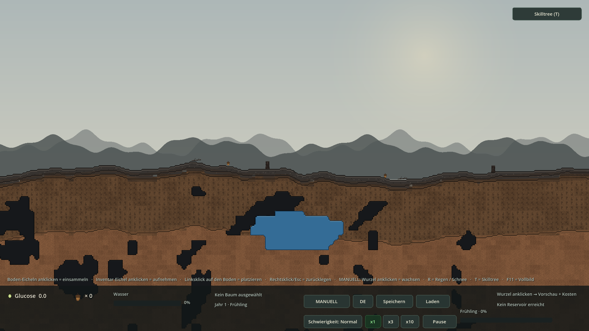
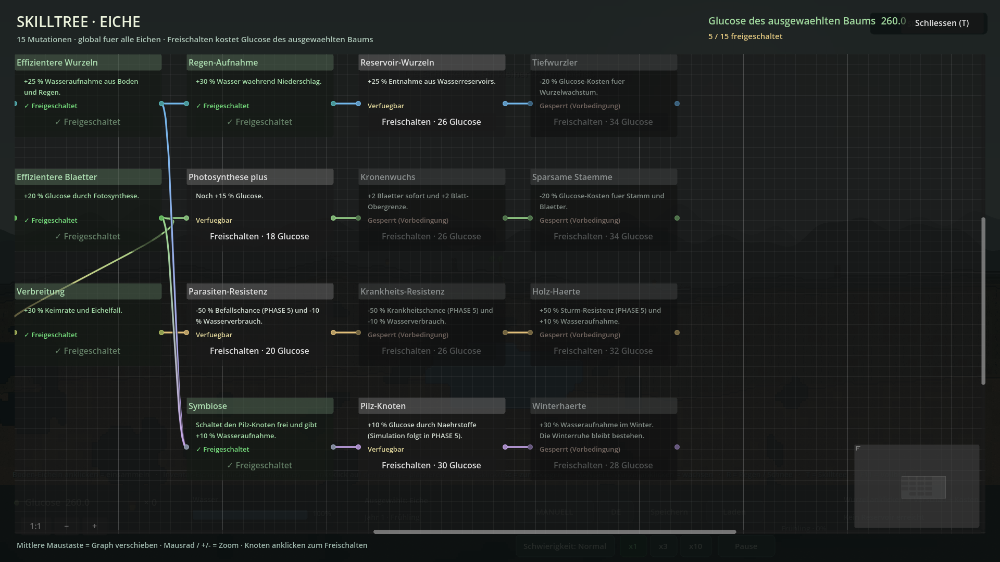
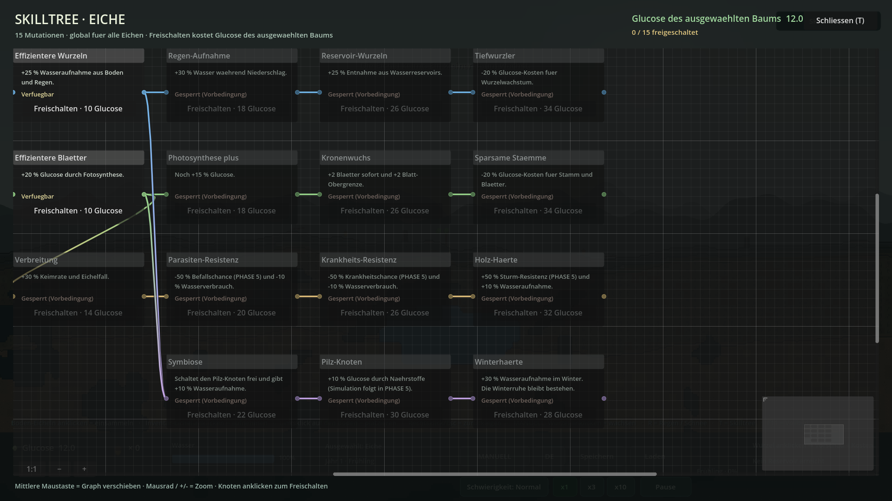
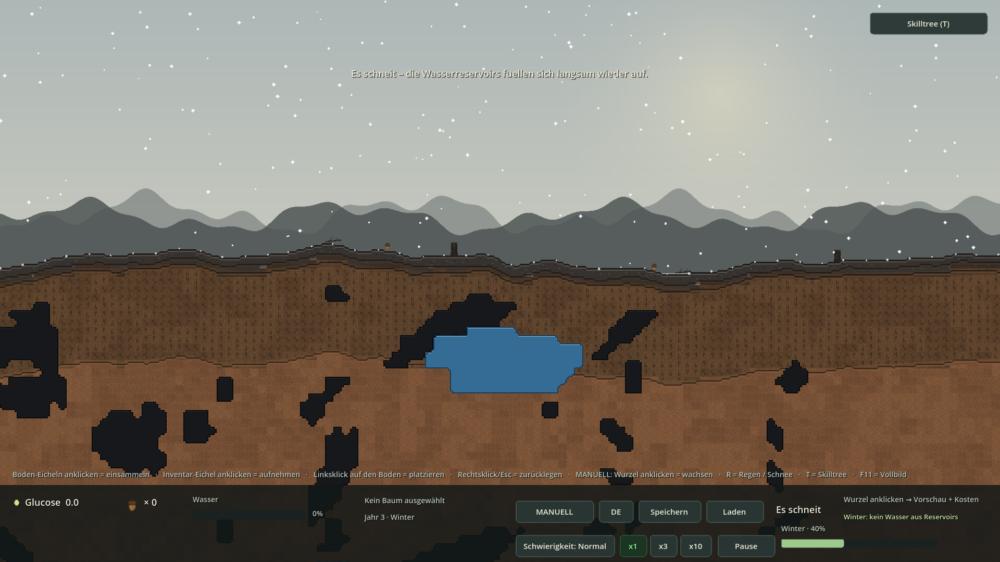
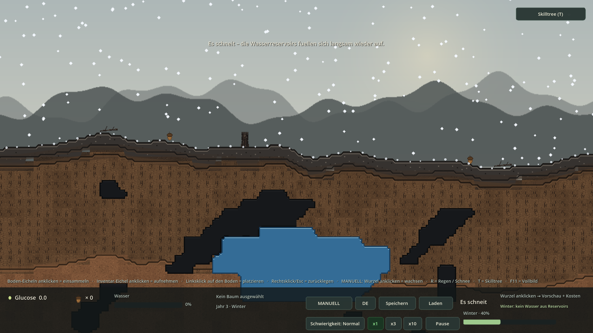
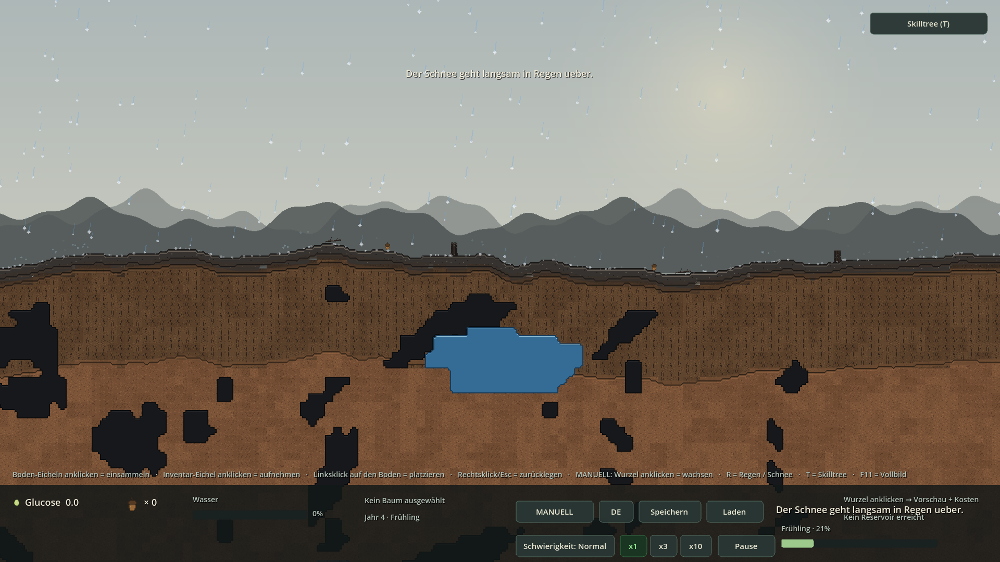

# PHASE 4 — Ergebnis + Fixrunde

**Godot 4.7.2 stable · GDScript · Forward+/Vulkan · 2026-11-05**  
15 GraphEdit-Knoten, echte Glucose-Kosten und Effekte, Save v5 — plus Fixrunde: AUTO aus, sichtbare Skill-Blätter, längerer Schnee und sanfter Übergang zu Regen. **PHASE 5 wurde nicht begonnen.**

## 1 · Screenshots (echte Godot-Renders)

### F5-Start: AUTO ist jetzt aus (MANUELL)
*Normaler Start ohne Preset · zwei Eicheln am Boden · HUD zeigt × 0 · Button „Skilltree (T)“ oben rechts · Modus MANUELL*



### GraphEdit-Skilltree: 5 von 15 Mutationen frei
*15 GraphNodes, 14 Verbindungslinien, Minimap, Zweigfarben, Status „Freigeschaltet / Verfügbar / Gesperrt“, 260,0 Glucose*



### Vorbedingungen und Glucose-Kosten sichtbar
*0/15 freigeschaltet · Startknoten verfügbar · alle Folgeknoten gesperrt · 12,0 Glucose*



### Winter: Schnee statt Regen
*Weiße, langsam schwingende Flocken · keine blauen Linien · keine Spritzer · HUD „Es schneit“*



### Detail: Flocken auf der echten Geländelinie
*Liegengebliebene Schneepunkte auf height_smooth_at(wx) · jetzt 5–9 s Lebensdauer · Wasserreservoir unverändert*



### Fix: sanfter Übergang Schnee → Regen
*Mitten im Ereignis wird es Frühling · Flocken UND erste blaue Regenlinien gleichzeitig · HUD „Der Schnee geht langsam in Regen ueber.“*



## 2 · Code-Snippets (aus den echten Projektdateien)

### SkillNodeData.gd — ein Knoten als echte Resource

```gdscript
@export var id: String = ""
@export var title_key: String = ""
@export var desc_key: String = ""
@export var cost: float = 10.0
@export var prerequisites: Array[String] = []
@export var effects: Dictionary = {}
@export var graph_position: Vector2 = Vector2.ZERO
@export var branch: String = "water"
```

### generate_skilltree.gd — Pflicht-Mutationen + grant_leaves

```gdscript
	d.nodes.append(_node("root_efficiency", "ROOT", "ROOT", 10.0, [],
		{"root_water": 0.25}, Vector2(0.0, 0.0), "water"))
	d.nodes.append(_node("rain_absorption", "RAIN", "RAIN", 18.0,
		["root_efficiency"], {"rain_boost": 0.30},
		Vector2(330.0, 0.0), "water"))

	d.nodes.append(_node("leaf_efficiency", "LEAF", "LEAF", 10.0, [],
		{"glucose": 0.20}, Vector2(0.0, 220.0), "leaf"))
	d.nodes.append(_node("photosynthesis_plus", "PHOTOSYN", "PHOTOSYN", 18.0,
		["leaf_efficiency"], {"glucose": 0.15},
		Vector2(330.0, 220.0), "leaf"))

	d.nodes.append(_node("crown_growth", "CROWN", "CROWN", 26.0,
		["photosynthesis_plus"], {"max_leaves": 2.0, "grant_leaves": 2.0},
		Vector2(660.0, 220.0), "leaf"))
	d.nodes.append(_node("trunk_saver", "TRUNK", "TRUNK", 34.0,
```

### SkillTree.gd — Kosten + Vorbedingung prüfen

```gdscript
func can_unlock(id: String, payer: BaseTree) -> bool:
	if unlocked.has(id) or not is_available(id) or payer == null:
		return false
	var nd := node_data(id)
	return nd != null and payer.glucose >= nd.cost


func cost_of(id: String) -> float:
	var nd := node_data(id)
```

### SkillTree.gd — Glucose abziehen und global anwenden

```gdscript
func unlock(id: String, payer: BaseTree) -> bool:
	if not can_unlock(id, payer):
		if not is_available(id):
			EventBus.toast.emit(tr("MSG_SKILL_PREREQ"))
		elif payer == null:
			EventBus.toast.emit(tr("MSG_SKILL_NO_TREE"))
		else:
			EventBus.toast.emit(tr("MSG_SKILL_NO_GLUCOSE"))
		return false
	var nd := node_data(id)
	payer.glucose -= nd.cost
	unlocked[id] = true
	_recompute_mods()
```

### SkillTree.gd — apply_effect() inkl. sofortiger Blätter

```gdscript
func apply_effect(_node_id: String, tree_instance: Node) -> void:
	if not (tree_instance is BaseTree):
		return
	var t := tree_instance as BaseTree
	t.skill_glucose_mult = modifier("glucose")
	t.skill_water_consumption_mult = modifier("water_consumption")
	t.skill_root_water_mult = modifier("root_water")
	t.skill_max_leaves_bonus = int(roundf(bonus("max_leaves")))
	# PHASE-4-FIX: "Kronenwuchs" schenkt die +2 Blaetter sofort sichtbar.
	# Idempotent, weil apply_effect() bei jedem Refresh / Spielstand-Laden
	# erneut auf allen Baeumen laeuft.
	t.apply_skill_leaf_grants(int(roundf(bonus("grant_leaves"))))
```

### SkillTreeUI.gd — echtes GraphEdit ohne überlagerte Leiste

```gdscript
	_graph = GraphEdit.new()
	_graph.name = "SkillGraph"
	_graph.minimap_enabled = true
	_graph.right_disconnects = false
	_graph.zoom_min = 0.35
	_graph.zoom_max = 1.8
	_graph.zoom_step = 1.15
	_graph.zoom = 1.0
	# Die eingebaute GraphEdit-Leiste liegt sonst ueber Titel/Zeile 1.
	# Stattdessen die eigenen +/-/1:1-Buttons unten links verwenden.
	_graph.show_menu = false
	_graph.show_zoom_buttons = false
	_graph.show_grid_buttons = false
	_graph.show_minimap_button = false
	_graph.show_arrange_button = false
	_graph.show_zoom_label = false
	_graph.scroll_offset = Vector2(40.0, 20.0)
	add_child(_graph)
```

### SkillTreeUI.gd — 15 Knoten und 14 Verbindungslinien

```gdscript
func _build_nodes() -> void:
	var st := SkillTree.instance
	if st == null:
		return
	for nd in st.all_nodes():
		var gn := GraphNode.new()
		gn.name = nd.id
		gn.title = tr(nd.title_key)
		gn.position_offset = nd.graph_position
		gn.draggable = false
		gn.resizable = false
		gn.selectable = false
		gn.custom_minimum_size = Vector2(268.0, 132.0)

	for pair in st.connection_pairs():
		var from := String(pair[0])
		var to := String(pair[1])
		if _graph.has_node(from) and _graph.has_node(to):
			_graph.connect_node(from, 0, to, 0)
```

### Tree.gd — Skill-Multiplikatoren und Fotosynthese

```gdscript
var skill_glucose_mult: float = 1.0
var skill_water_consumption_mult: float = 1.0
var skill_root_water_mult: float = 1.0
var skill_max_leaves_bonus: int = 0
## PHASE-4-FIX: wie viele Skill-Blaetter dieser Instanz bereits gutgeschrieben
## wurden. Verhindert, dass apply_effect() bei jedem Refresh erneut Blaetter
## erzeugt (und macht Save/Load doppelter Boni sicher).

func photosynthesize(dt: float, sunlight: float = 1.0,
		growth: float = 1.0) -> void:
	if not _built or leaves_count <= 0 or water <= 10.0:
		return
	age += dt
	# Winter: sunlight = 0 und growth = 0 -> Winterruhe (nichts passiert).
	if sunlight <= 0.0 or growth <= 0.0:
		return
	glucose += float(leaves_count) * species.photosynthesis_efficiency \
		* sunlight * growth * Global.difficulty_factor("photosynthesis") \
		* skill_glucose_mult * dt
	water = maxf(water - species.water_consumption_rate \
```

### WaterSystem.gd — Winterruhe + echte Skill-Faktoren

```gdscript
	var winter := time_manager != null and time_manager.is_winter()
	var st := SkillTree.instance
	var soil_factor := Global.difficulty_factor("soil_water") \
		* (st.modifier("winter_water") if st != null and winter else 1.0)
	var rain_mult: float = st.modifier("rain_boost") if st != null else 1.0
	var reservoir_mult: float = st.modifier("reservoir_gain") if st != null else 1.0
	for tree in get_tree().get_nodes_in_group("trees"):
		var rate: float = tree.species.base_water_gain * float(tree.root_count) \
			* soil_factor
		if raining:
			rate *= REGEN_FAKTOR * Global.difficulty_factor("rain_boost") \
				* rain_mult
		# REVISION 2: jedes Wurzelsegment im NASSEN Teil entnimmt dem
```

### SeasonSystem.gd — „Verbreitung“ setzt spread_bonus

```gdscript
func _sync_skills() -> void:
	var st := SkillTree.instance
	set_spread_bonus(st.bonus("spread") if st != null else 0.0)
```

### RainEffect.gd — längere Liegezeit + weicher Modus-Wechsel

```gdscript
const SNOW_SETTLE_MIN := 5.0
const SNOW_SETTLE_MAX := 9.0
const SETTLE_MELT_MULTIPLIER := 3.0
const MODE_FADE_SECONDS := 3.5
const SNOW_COLOR := Color(0.95, 0.97, 1.0, 0.92)

var raining: bool = false

func _sync_mode(snap: bool) -> void:
	var winter := time_manager != null and time_manager.is_winter()
	snow_mode = winter
	_target_blend = 1.0 if winter else 0.0
	if snap or not raining:
		snow_blend = _target_blend
		_transitioning = false
	else:
		_transitioning = absf(snow_blend - _target_blend) > 0.001
	_emit_blend(true)

func _on_season_changed(_year: int, _season: int) -> void:
	var was_winter := snow_mode
	_sync_mode(false)
	if raining and _transitioning:
		# WICHTIG: _settle / _splashes NICHT loeschen. Der liegende Schnee
		# schmilzt in _update_landing() beschleunigt, waehrend Flocken zu
		# Regentropfen ueberblenden.
		if was_winter and not snow_mode:
			EventBus.toast.emit(tr("MSG_SNOW_MELT"))
	_emit_blend(true)
```

### SaveManager.gd — Format v5 mit skills

```gdscript
		"skills": SkillTree.instance.to_dict() if SkillTree.instance != null else {},
		"trees": trees,
		"world_state": world_state.to_dict() if world_state != null else {},
	}

		SkillTree.instance.from_dict(data.get("skills", {}))

	interaction.clear_carrying(false)
```

### FIX: Global.gd — AUTO startet aus

```gdscript
## PHASE-4-FIX: Standard = MANUELL. Der Spieler schaltet AUTO bewusst im HUD ein.
## Grund: sonst kauft AUTO bei ~10 Glucose sofort Wachstum und setzt den Zaehler
## fuer den Spieler ueberraschend auf 0 zurueck.
var auto_mode: bool = false
```

### FIX: Tree.gd — add_leaf() respektiert Cap 14

```gdscript
func add_leaf() -> bool:
	# PHASE-4-FIX: dieselbe Obergrenze wie can_grow("leaf") verwenden!
	# Vorher blockte diese Funktion bei 12, waehrend can_grow() mit dem
	# Skill "Kronenwuchs" bereits 14 erlaubte. grow_part() meldete trotzdem
	# Erfolg -> AUTO zahlte Glucose, ohne dass ein Blatt sichtbar wurde.
	if leaves_count >= MAX_LEAVES + skill_max_leaves_bonus:
		return false
	var i := leaves_count
	var col := i % 4
	var row := int(i / 4)
	var pos := Vector2((float(col) - 1.5) * 16.0, -40.0 - float(row) * 16.0)
	_sprite(LEAF_PATH, pos, _leaves)
	leaves_count += 1
	_refresh_growth_visuals()
	return true

func grow_part(part: String) -> bool:
	if not can_grow(part):
		return false
	# PHASE-4-FIX: nur bei ECHTEM Zuwachs true zurueckgeben. Sonst zieht
	# GrowthSystem.glucose ab, obwohl z.B. kein freies Wurzel-Tile existiert.
	if part == "root":
		return add_root()
	if part == "leaf":
		return add_leaf()
	if part == "trunk":
		return add_trunk_tile()
	return false
```

### FIX: Tree.gd — Kronenwuchs gibt +2 Blätter sofort

```gdscript
func apply_skill_leaf_grants(total: int) -> void:
	var want := clampi(total, 0, skill_max_leaves_bonus)
	while skill_leaf_grants < want and add_leaf():
		skill_leaf_grants += 1
```

### FIX: GrowthSystem.gd — nur bei echtem Zuwachs zahlen

```gdscript
		if tree.grow_part(part):
			tree.glucose -= cost
			EventBus.tree_grew.emit(tree, part)
```

### FIX: Phase4Smoke.gd — regressionssichere checks

```gdscript
	# --- 4b) PHASE-4-FIX: AUTO / Blatt-Cap / ausgewachsener Baum -------------
	var loaded_tree: BaseTree = interaction.selected_tree
	_check(loaded_tree != null and loaded_tree.skill_leaf_grants == 2,
		"Save v5 stellt Skill-Blaetter ohne Duplikate wieder her")
	if loaded_tree != null:
		var leaves_loaded := loaded_tree.leaves_count
		skill_tree._apply_to_all()
		_check(loaded_tree.leaves_count == leaves_loaded,
			"apply_effect() erzeugt keine doppelten Skill-Blaetter")

	# Cap-Test: mit Bonus muessen 13 + 14 entstehen, 15 muss scheitern.
	var cap_tree: BaseTree = interaction.spawn_tree_at(Vector2(800.0, 0.0), {})
	cap_tree.skill_max_leaves_bonus = 2
	cap_tree.leaves_count = 12
	var ok13 := cap_tree.grow_part("leaf")
	var ok14 := cap_tree.grow_part("leaf")
	var ok15 := cap_tree.grow_part("leaf")
	_check(ok13 and ok14 and not ok15 and cap_tree.leaves_count == 14,
		"add_leaf() respektiert Cap 14; grow_part() luegt nicht mehr")

	# Ausgewachsener Baum darf in AUTO keine Glucose mehr verbrauchen.
	time_manager.debug_set_season(TimeManager.Season.SPRING, 1, 0.20)
	time_manager.set_paused(false)
	time_manager.set_time_scale(1.0)
```

## 3 · Testprotokoll

```text
WALD-REGENERATION — PHASE 4 + FIXRUNDE — TESTPROTOKOLL
Godot 4.7.2.stable.official.ed1daf0bf · 2026-11-05 · Europe/Berlin
Xvfb 1920x1080x24 · --rendering-driver opengl3 (llvmpipe Software-Rasterizer)
Ziel-Renderer des Projekts: Forward+ / Vulkan

======================================================================
1) IMPORT / F5 / DAUERLAUF
======================================================================
--headless --path . --import                         Exit 0 / 0 Fehler
F5 ohne Preset (Xvfb, 1920x1080, 25 Frames)          Exit 0 / 0 Fehler
--headless --path . --quit-after 180
    -- --seed=20261105 --windowed                     Exit 0 / 0 Fehler
Godot-Import aller neuen .tres/.gd/.uid-Dateien       0 Parse/Load-Fehler

======================================================================
2) SMOKE-TESTS (headless, ohne --seed, Legacy-Seed bleibt zufaellig)
======================================================================
--phase0-smoke       Exit 0  Ergebnis: OK    3 OK-Zeilen   0 Fehler
--phase1-smoke       Exit 0  Ergebnis: OK   26 OK-Zeilen   0 Fehler
--phase2-smoke       Exit 0  Ergebnis: OK   25 OK-Zeilen   0 Fehler
--rev1-smoke         Exit 0  Ergebnis: OK   32 OK-Zeilen   0 Fehler
--rev2-smoke         Exit 0  Ergebnis: OK   27 OK-Zeilen   0 Fehler
--p3-smoke           Exit 0  Ergebnis: OK   56 OK-Zeilen   0 Fehler
--rev3-smoke         Exit 0  Ergebnis: OK   20 OK-Zeilen   0 Fehler
--rev4-smoke         Exit 0  Ergebnis: OK   32 OK-Zeilen   0 Fehler
--phase4-smoke       Exit 0  Ergebnis: OK   63 OK-Zeilen   0 Fehler
----------------------------------------------------------------------
9 / 9 Smokes OK · 284 OK-Zeilen (inkl. je 1 Ergebniszeile) · 0 FEHLER · 0 SCRIPT ERROR

PHASE4-Checks im Detail:
[SMOKE] === PHASE 4: Skilltree + Winter-Schnee ===
[SMOKE] AUTO standardmaessig aus (MANUELL)                         OK
[SMOKE] SkillTree + data/skilltrees/oak.tres geladen               OK
[SMOKE] Genau 15 MVP-Knoten                                        OK
[SMOKE] Alle 7 Pflicht-Mutationen aus Master-Punkt 6               OK
[SMOKE] 14 Vorbedingungs-Verbindungen                              OK
[SMOKE] Start: nichts freigeschaltet, alle Modifikatoren = 1.0     OK
[SMOKE] Baum fuer Glucose-Bezahlung vorhanden                      OK
[SMOKE] can_unlock(): Wurzel-Knoten bezahlbar                      OK
[SMOKE] Vorbedingung sperrt Tiefwurzler                            OK
[SMOKE] Freischalten erfolgreich                                   OK
[SMOKE] Genau 10 Glucose abgezogen                                 OK
[SMOKE] +25 % Wasseraufnahme im Skilltree                          OK
[SMOKE] apply_effect() wirkt auf die Baum-Instanz                  OK
[SMOKE] Echter Wert: 10 Wasser/s werden zu 12,5                    OK
[SMOKE] Skilltree pro Art synchron (neuer Baum uebernimmt Effekt)  OK
[SMOKE] Effizientere Blaetter freigeschaltet                       OK
[SMOKE] +20 % Glucose am Baum                                      OK
[SMOKE] Echter Wert: Fotosynthese erzeugt 1.92 Glucose             OK
[SMOKE] Verbreitung freigeschaltet (Voraussetzung Blaetter)        OK
[SMOKE] P3-Anschluss set_spread_bonus() = +30 %                    OK
[SMOKE] Ketten-Freischaltung bis Kronenwuchs                       OK
[SMOKE] +2 Blaetter: can_grow('leaf') real erweitert               OK
[SMOKE] Kronenwuchs enthaelt grant_leaves = 2                      OK
[SMOKE] Kronenwuchs: +2 Blaetter SOFORT gutgeschrieben             OK
[SMOKE] +2 Blaetter auch auf allen anderen Eichen (global synchron) OK
[SMOKE] Symbiose mit ZWEI Vorbedingungen                           OK
[SMOKE] Parasiten-Resistenz freigeschaltet                         OK
[SMOKE] Resistenzwert -50 % gespeichert (PHASE-5-Anschluss)        OK
[SMOKE] Resistenz wirkt jetzt schon auf den Wasserverbrauch        OK
[SMOKE] 7 Knoten freigeschaltet                                    OK
[SMOKE] GraphEdit: 15 GraphNodes                                   OK
[SMOKE] GraphEdit: 14 Linien                                       OK
[SMOKE] Skilltree-UI oeffnet ueber HUD-Signal / T                  OK
[SMOKE] Zoom veraenderbar                                          OK
[SMOKE] Skilltree-UI schliesst wieder                              OK
[SMOKE] Speichern (Format v5)                                      OK
[SMOKE] Savegame version = 5                                       OK
[SMOKE] Skill-Fortschritt im Savegame (7 IDs)                      OK
[SMOKE] Zurueckgesetzt vor dem Laden                               OK
[SMOKE] Laden (Format v5)                                          OK
[SMOKE] Skill-Fortschritt nach Laden wiederhergestellt             OK
[SMOKE] Save v5 stellt Skill-Blaetter ohne Duplikate wieder her    OK
[SMOKE] apply_effect() erzeugt keine doppelten Skill-Blaetter      OK
[SMOKE] add_leaf() respektiert Cap 14; grow_part() luegt nicht mehr OK
[SMOKE] Ausgewachsener Baum: AUTO verbraucht KEINE Glucose         OK
[SMOKE] Winter: Niederschlag ist SCHNEE                            OK
[SMOKE] HUD zeigt „Es schneit“                                     OK
[SMOKE] Schnee erzeugt KEINE Regen-Spritzer                        OK
[SMOKE] Flocken bleiben auf der Oberflaeche liegen                 OK
[SMOKE] Schnee bleibt 5-9 s liegen (statt 1,6-3,2 s)               OK
[SMOKE] Keine Flocken unter der Geländelinie                       OK
[SMOKE] Schnee fuellt Reservoirs weiter auf (R3 erhalten)          OK
[SMOKE] Winter: weiterhin KEINE Reservoir-Entnahme (R3)            OK
[SMOKE] Saisonwechsel startet WEICHEN Uebergang (kein harter Schnitt) OK
[SMOKE] Liegender Schnee bleibt beim Uebergang erhalten            OK
[SMOKE] HUD zeigt Tau-Meldung waehrend des Uebergangs              OK
[SMOKE] Uebergang endet nach 3,5 s bei reinem Regen                OK
[SMOKE] Fruehling: wieder Regen                                    OK
[SMOKE] Schnee ist sanft geschmolzen (nicht hart geloescht)        OK
[SMOKE] Regen-Spritzer im Fruehling weiter aktiv (REV3)            OK
[SMOKE] Alle 51 P4-Schluessel in DE + EN uebersetzt                OK
[SMOKE] Weiterhin 5 geladene Chunks                                OK
[SMOKE] Ergebnis: OK

======================================================================
3) REPRODUZIERBARE RENDERS (Xvfb + opengl3, --quit-after 25)
======================================================================
Ohne Preset / F5            Exit 0 / 25 Frames / 0 Fehler -> p4_f5.png
--phase4-shot-skilltree     Exit 0 / 25 Frames / 0 Fehler -> p4_skilltree.png
--phase4-shot-skilltree-locked
                            Exit 0 / 25 Frames / 0 Fehler -> p4_skilltree-locked.png
--phase4-shot-snow          Exit 0 / 25 Frames / 0 Fehler -> p4_snow.png
--phase4-shot-snow-detail   Exit 0 / 25 Frames / 0 Fehler -> p4_snow-detail.png
--phase4-shot-thaw (--fixed-fps 10)
                            Exit 0 / 25 Frames / 0 Fehler -> p4_thaw.png
Sichtpruefung: F5 zeigt MANUELL; Skilltree 15 Knoten / 14 Linien;
Winter zeigt weisse Flocken ohne Spritzer; Tau-Bild zeigt GLEICHZEITIG
Flocken + erste blaue Regenlinien und HUD "Der Schnee geht langsam
in Regen ueber." bei Jahr 4 · Fruehling.

======================================================================
4) FIXRUNDE — AKZEPTANZ
======================================================================
AUTO standardmaessig AUS (Global.auto_mode = false)         OK
Ausgewachsener Baum: AUTO verbraucht 0 Glucose              OK
crown_growth: grant_leaves=2 -> +2 SICHTBARE Blaetter       OK
add_leaf() Cap = 14; grow_part() nur bei echtem Zuwachs     OK
Save v5: skill_leaf_grants verhindert Duplikate              OK
Schnee bleibt 5-9 s liegen (vorher 1,6-3,2 s)               OK
Saisonwechsel waehrend Schnee: 3,5 s snow_blend 1 -> 0      OK
HUD/Toast "Der Schnee geht langsam in Regen ueber."          OK
Liegender Schnee schmilzt beschleunigt, nicht hart geloescht OK
R3: Winter keine Entnahme, Auffuellen laeuft weiter          OK

======================================================================
5) DATEN / SAVE / LOKALISIERUNG
======================================================================
data/skilltrees/oak.tres     15 Knoten, 14 Vorbedingungen, grant_leaves=2
tools/generate_skilltree.gd  Godot-4.7-ResourceSaver, err=0
SaveManager.FORMAT_VERSION   5; skills vor trees wiederhergestellt
data/localization.csv        137 Zeilen, 58 PHASE-4-Zeilen (DE+EN)
Phase3Smoke                  version >= 4 (v5 kompatibel)

======================================================================
6) ZIP / EXTRAKT-VERIFIKATION
======================================================================
deliverables/waldspiel-PHASE4-FIX.zip: project.godot im Root, CRC OK,
keine .godot-Dateien, keine .zip-in-.zip, alle neuen FIX-Dateien drin.
Extrakt -> --headless --import -> alle 9 Smokes: Exit 0 / Ergebnis: OK.

======================================================================
7) BEWUSSTE GRENZE
======================================================================
PHASE 5 wurde NICHT begonnen: keine Tiere, kein Mistel-Befall,
keine Pilz-Simulation, keine pH-/N-P-K-/Mykorrhiza-/Katastrophen-Ereignisse.
```

## 4 · Abnahme PHASE 4 + Fixrunde

- ✅ **GraphEdit-Skilltree mit 15 Knoten:** `data/skilltrees/oak.tres` enthält 15 `SkillNodeData`-Resources und **14 Vorbedingungs-Linien**. `SkillTreeUI.gd` zeigt sie zoombar (0,35×–1,8×), pannbar, mit Minimap und eigenen +/−/1:1-Buttons. Die eingebaute GraphEdit-Leiste ist ausgeblendet, damit sie Titel und erste Zeile nicht überdeckt.
- ✅ **Alle 7 Pflicht-Mutationen:** Effizientere Wurzeln (+25 % Wasser), Effizientere Blätter (+20 % Glucose), Symbiose/Pilz-Knoten, Parasiten-Resistenz, Krankheits-Resistenz, Holz-Härte/Sturm-Resistenz, Verbreitung (+30 % Keimrate). Dazu 8 weitere Knoten als MVP-Grundgerüst.
- ✅ **Freischalten kostet Glucose:** `can_unlock()` prüft Vorbedingung + Kontostand, `unlock()` zieht exakt die Kosten ab. Gemäß Master 4.2 bleibt Glucose pro Baum-Instanz, der Skilltree-Fortschritt **global pro Art**: alle Eichen — auch neu gespawnte — teilen ihn.
- ✅ **Effekte wirken auf echte Werte:** 10 Wasser/s werden nach `root_efficiency` zu **12,5**; Fotosynthese × **1,20**; `spread_bonus = 0,30`; −20 % Wurzel-/Stammkosten; echte Regen-, Reservoir- und Winter-Wasserfaktoren; −10 % Wasserverbrauch; Resistenzwerte **0,5** (−50 %) gespeichert.
- ✅ **FIX — keine unsichtbaren Blätter mehr:** `add_leaf()` nutzt jetzt dieselbe Obergrenze wie `can_grow()` (`MAX_LEAVES + skill_max_leaves_bonus`). `crown_growth` enthält `grant_leaves = 2` und schenkt die **+2 Blätter sofort sichtbar** auf allen Eichen; `skill_leaf_grants` verhindert Duplikate bei Refresh und Save/Load.
- ✅ **FIX — Glucose bleibt stehen:** `Global.auto_mode` startet **aus** (MANUELL); AUTO funktioniert nach bewusstem Umschalten weiter wie vorher. `grow_part()` gibt nur noch bei **echtem Zuwachs** `true` zurück — ein ausgewachsener Baum oder ein blockiertes Wurzel-Tile verbraucht keine Glucose mehr. Smoke: 50,0 → **50,0**.
- ✅ **HUD, Tasten, DE/EN:** Button „Skilltree (T)“ oben rechts, `T` öffnet/schließt, `Esc` schließt, mittlere Maustaste pannt. 58 Lokalisierungszeilen; der Smoke prüft **51** P4-Schlüssel in DE und EN. Events aktualisieren UI nach Freischalten, Baumwahl, Laden und Sprachwechsel.
- ✅ **Save/Load v5:** Skill-Fortschritt und `skill_leaf_grants` liegen im JSON und werden **vor** den Bäumen wiederhergestellt. v4/v3/v2/v1 bleiben lesbar; `Phase3Smoke` akzeptiert `version >= 4`.
- ✅ **Winter-Schnee statt Regen:** dasselbe Niederschlags-Event, aber 240 langsame weiße Flocken mit Sinus-Drift, **keine blauen Linien, keine Spritzer, keine Rippen**, dafür liegende Schneepunkte auf `height_smooth_at(wx)`. HUD/Toast „Es schneit“. Frühling stellt Regen + Spritzer wieder her.
- ✅ **FIX — Schnee bleibt länger liegen:** Lebensdauer **5–9 s** statt 1,6–3,2 s, Puffer von 220 auf 320 Punkte erhöht. Beim Saisonwechsel werden die Punkte nicht mehr hart gelöscht.
- ✅ **FIX — sanfter Übergang:** wird es **mitten im Schneefall** Frühling, läuft `snow_blend` in **3,5 s** von 1,0 nach 0,0. Flocken, Regenlinien, Spritzer und HUD-Text werden überblendet; liegender Schnee schmilzt beschleunigt. Toast/HUD: „Der Schnee geht langsam in Regen ueber.“ Screenshot `p4_thaw.png`.
- ✅ **REVISION 3 erhalten:** Winter ohne Reservoir-Entnahme und ohne passive Versickerung, aber Niederschlag füllt weiter auf (`last_reservoir_rate = 0`). Smoke misst steigenden Füllstand bei Schnee.
- ✅ **Regression & F5:** Import, F5 ohne Preset, 180-Frame-Dauerlauf und **9/9 Smokes** (P0/P1/P2/REV1/REV2/P3/REV3/REV4/PHASE4) laufen mit Exit 0 / **284 OK-Zeilen** / 0 Fehlern. 6 Xvfb-Renders 1920×1080 sind fehlerfrei und visuell geprüft.

## 5 · Hinweise / bewusste Grenzen

- Die Ereignis-Simulation für Parasiten, Krankheit, Sturm, Pilz-Symbiose sowie pH/N-P-K/Mykorrhiza/Katastrophen bleibt PHASE 5. Die Resistenz- und Symbiose-Werte sind bereits echte Zahlen, aber es spawnen noch keine Tiere oder Misteln.
- Xvfb + opengl3/llvmpipe ist ein Software-Rasterizer und nur für reproduzierbare Renders genutzt; Ziel-Renderer des Projekts bleibt Forward+ / Vulkan. Das Tau-Bild verwendet --fixed-fps 10, damit der 3,5-s-Übergang in 25 Frames sichtbar wird.
- Keine neuen externen Assets, Addons oder C#-Dateien. Schneeflocken, GraphNodes und Linien werden zur Laufzeit gezeichnet; alle Pfade sind relativ.
- Die ZIP im Ordner deliverables/ ist der eingefrorene Lieferstand der Fixrunde. Die vorherige waldspiel-PHASE4.zip bleibt als historischer Stand erhalten.

## 6 · Lieferumfang

- `deliverables/waldspiel-PHASE4-FIX.zip` — vollständiges, Godot-importierbares Projekt (`project.godot` im ZIP-Root, `.godot` ausgeschlossen, CRC OK)
- `deliverables/waldspiel-PHASE4.zip` — historischer Stand vor der Fixrunde
- `PHASE4-ERGEBNIS.html` / `.md`, `PHASE4-TESTPROTOKOLL.txt`, `DECISIONS.md` §§64–69, `README.md`, `GODOT-IMPORT.txt`
- `screenshots/p4_*.png` (6 Renders), `tests/Phase4Smoke.gd`, `tools/generate_skilltree.gd`, `tools/build_phase4_report.py`
- Neue/geänderte Quellen der Fixrunde: `Global.gd`, `GrowthSystem.gd`, `Tree.gd`, `SkillTree.gd`, `tools/generate_skilltree.gd`, `data/skilltrees/oak.tres`, `RainEffect.gd`, `HUD.gd`, `EventBus.gd`, `Main.gd`, `localization.csv`

**Nächster Schritt: PHASE 5 — Tiere, Parasiten, Pilz-Symbiose, pH/Katastrophen (noch nicht begonnen).**
