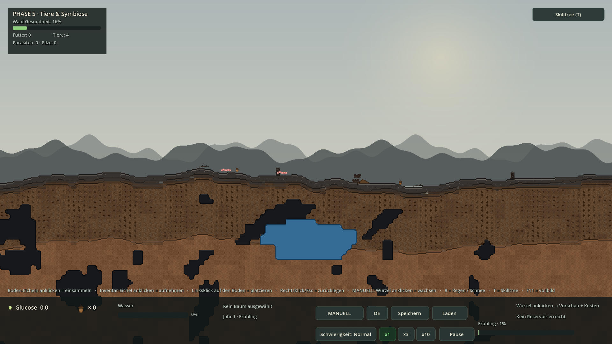
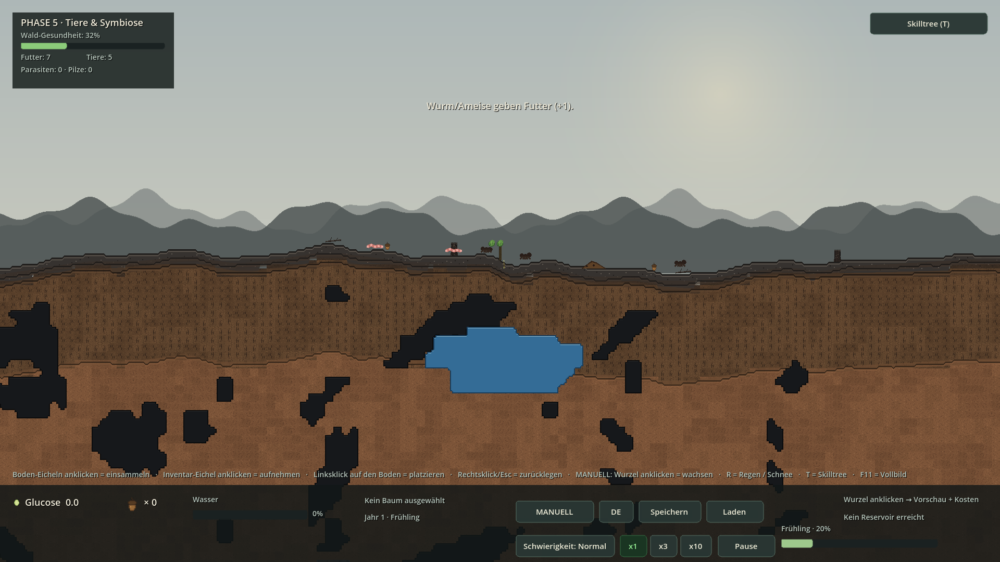
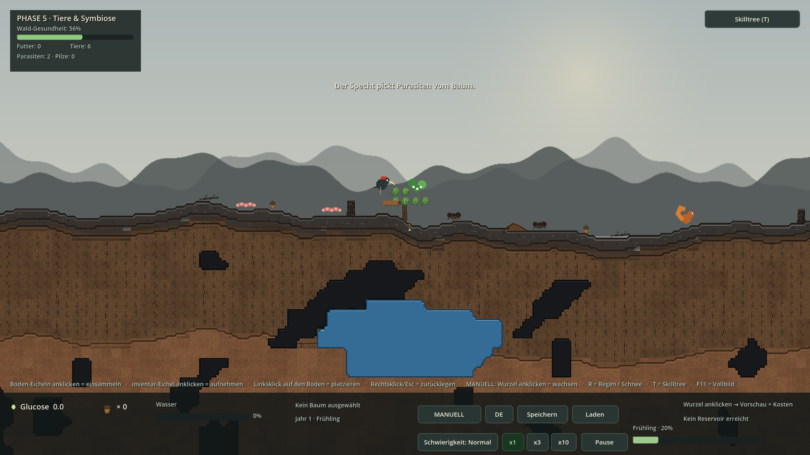
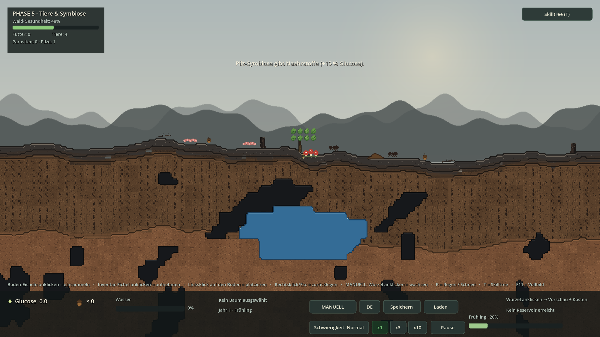
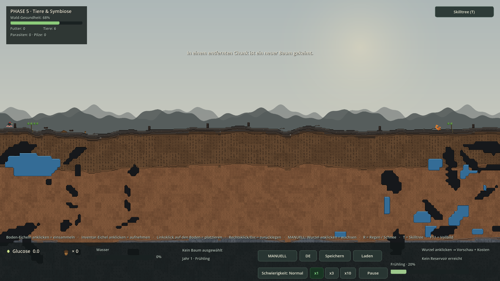

# PHASE 5 — Tiere & Symbiose

**Godot 4.7.2 stable · GDScript · Forward+/Vulkan · 2026-11-05**

Wurm/Ameise als immer vorhandene Basis, Specht/Eichhörnchen ab Wald-Gesundheit > 50 %, Mistel/Wurm-Befall, echte Pilz-Symbiose, StateMachine, Kollision, Interaktion, Save v6. **10/10 Smokes · 341 OK-Zeilen · 0 Fehler.**

## 1 · Screenshots (echte Godot-Renders)

### F5-Start — PHASE 5 unverändert lauffähig
*Ohne Preset · 4 Basis-Tiere · Wald-Gesundheit 16 % · AUTO aus (MANUELL) · neues Ökologie-Panel oben links*



### Wurm/Ameise geben automatisch Futter
*StateMachine läuft ohne Klick: WANDER → IDLE → EAT → Futter: 7 · 2 Würmer, Ameisen und Erd-Pixelhaufen sichtbar*



### Wald-Gesundheit > 50 % lockt Specht & Eichhörnchen an
*100 % Gesundheitsbalken · 3 Bäume mit Blättern · Specht links, orangenes Eichhörnchen rechts · Toast zur Ansiedlung*


### Mistel + Wurmbefall, Specht hilft
*Rot-weiße Mistel und Wurm-Befall am Baum · Specht in HELP_TREE · Parasiten: 2 · Toast „Der Specht pickt Parasiten vom Baum.“*



### Pilz-Symbiose gibt echte Nährstoffe
*Rote Fungus-Patches an der Eiche · Pilze: 1 · +15 % Glucose durch BaseTree.nutrient_mult · HUD-Panel aktualisiert*



### Eichhörnchen pflanzt einen Baum in Chunk 1
*Weit entfernte Kamera · Eichhörnchen in CARRY · neuer Baum bei x = +2304 px · Gelände/Chunks unverändert*



## 2 · Code-Snippets (aus den echten Projektdateien)

### ForestHealth.gd — gewichtete Metrik und Gesundheits-Signal

```gdscript
const THRESHOLD := 0.5
const LEAF_WEIGHT := 0.02
const TREE_WEIGHT := 0.12
const SPECIES_WEIGHT := 0.08
const FUNGUS_WEIGHT := 0.04

func recompute() -> float:
	var trees := get_tree().get_nodes_in_group("trees")
	var total_leaves := 0
	for t in trees:
		if t is BaseTree:
			total_leaves += (t as BaseTree).leaves_count
	var species := 0
	if _biodiversity_override >= 0:
		species = _biodiversity_override
	elif wildlife != null and wildlife.has_method("species_count"):
		species = int(wildlife.species_count())
	var fungi := 0
	if parasite_system != null and parasite_system.has_method("fungus_count"):
		fungi = int(parasite_system.fungus_count())
	var raw := float(total_leaves) * LEAF_WEIGHT \
		+ float(trees.size()) * TREE_WEIGHT \
		+ float(species) * SPECIES_WEIGHT \
		+ float(fungi) * FUNGUS_WEIGHT
	value = clampf(raw, 0.0, 1.0)
	biodiversity = species + fungi
	# Nur bei echter Aenderung senden: verhindert eine Signalschleife mit
	# WildlifeSystem, das beim Gesundheitswechsel neue Arten spawnt.
```

### EventBus.gd — 13 neue, entkoppelte PHASE-5-Signale

```gdscript
# --- PHASE 5: Tiere, Symbiose, Parasiten -----------------------------------
signal forest_health_changed(value: float)
signal wildlife_changed
signal animal_spawned(species: String)
signal animal_state_changed(animal: Node, state: int)
signal animal_clicked(animal: Node)
signal food_changed(count: int)
signal anthill_built(position: Vector2)
signal colony_grown(size: int)
signal parasite_spawned(tree: Node, kind: int)
signal parasite_removed(tree: Node, kind: int, by: String)
signal fungus_patch_spawned(tree: Node)
signal seed_carried(from_pos: Vector2, to_pos: Vector2)
signal seed_planted_remote(position: Vector2)
```

### Main.tscn — drei neue modulare System-Nodes

```gdscript
[ext_resource type="Script" path="res://src/systems/ForestHealth.gd" id="19"]
[ext_resource type="Script" path="res://src/systems/WildlifeSystem.gd" id="20"]
[ext_resource type="Script" path="res://src/systems/ParasiteSystem.gd" id="21"]

[node name="Wildlife" type="Node2D" parent="World"]
z_index = 40
script = ExtResource("20")

[node name="Parasites" type="Node2D" parent="World"]
z_index = 45
script = ExtResource("21")
```

### Animal.gd — echte StateMachine mit fünf Zuständen

```gdscript
enum State { IDLE, WANDER, EAT, HELP_TREE, CARRY }

const SPEED := {

func _set_state(new_state: int) -> void:
	state = new_state
	match state:
		State.IDLE:
			timer = 0.8
		State.WANDER:
			_pick_target()
		State.EAT:
			timer = FOOD_TIME
		State.HELP_TREE:
			timer = 0.0
		State.CARRY:
			timer = 0.0
	EventBus.animal_state_changed.emit(self, state)
	queue_redraw()
```

### Animal.gd — automatischer EAT-Zyklus, HELP_TREE und CARRY

```gdscript
func tick(dt: float) -> void:
	phase += dt
	timer -= dt
	position.y = base_y + sin(phase * 6.0) * 1.2
	match state:
		State.IDLE:
			if timer <= 0.0:
				_idle_count += 1
				# Wurm/Ameise geben regelmaessig Futter: jede zweite
				# Ruhephase geht in EAT statt in WANDER.
				if (species == "worm" or species == "ant") \
						and _idle_count % 2 == 1:
					_set_state(State.EAT)
				else:
					_set_state(State.WANDER)
		State.WANDER:
			_move_toward(target_x, speed() * dt)
			if absf(position.x - target_x) < 4.0:
				_set_state(State.IDLE)
		State.EAT:
			if timer <= 0.0:
				_eat()
		State.HELP_TREE:
			_help(dt)
		State.CARRY:
			_carry(dt)
	queue_redraw()
```

### Animal.gd — Baum-Kollision und anklickbare Info

```gdscript
func _blocked(next_x: float) -> bool:
	# Specht und Eichhoernchen duerfen fuer ihre Aufgabe direkt an den Baum.
	if state == State.HELP_TREE or state == State.CARRY:
		return false
	var p := Vector2(next_x, base_y - 8.0)
	for t in get_tree().get_nodes_in_group("trees"):
		if t is BaseTree and (t as BaseTree).get_bounds_rect().has_point(p):
			return true
	return false


func _eat() -> void:

func get_info_text() -> String:
	var name_key := "ANIMAL_" + species.to_upper()
	return tr("MSG_ANIMAL_INFO") % [tr(name_key), tr(state_key())]


func hit_rect() -> Rect2:
	return Rect2(global_position + Vector2(-18.0, -30.0), Vector2(36.0, 34.0))


func click() -> void:
	EventBus.animal_clicked.emit(self)
```

### Anthill.gd — Erd-Pixelhaufen wächst mit der Kolonie

```gdscript
func grow(amount: int = 1) -> void:
	colony_size += maxi(amount, 1)
	growth = clampf(growth + 0.12 * float(amount), 1.0, 3.0)
	queue_redraw()

func _draw() -> void:
	var h := 12.0 * growth
	var w := 20.0 * growth
	var pts := PackedVector2Array([
		Vector2(-w, 0.0),
		Vector2(-w * 0.55, -h * 0.55),
		Vector2(-w * 0.15, -h),
		Vector2(w * 0.20, -h * 0.82),
		Vector2(w * 0.62, -h * 0.42),
		Vector2(w, 0.0),
	])
	draw_colored_polygon(pts, Color(0.36, 0.25, 0.15, 1.0))
	draw_polyline(pts, Color(0.22, 0.15, 0.10, 1.0), 2.0)
	var n := colony_size
	if n > 7:
		n = 7
```

### WildlifeSystem.gd — Basisbesatzung und Reset

```gdscript
const BASE_WORMS := 2
const BASE_ANTS := 2
const MAX_ANTS := 8
const MAX_ANIMALS := 20
const COLONY_INTERVAL := 10.0
const CARRY_INTERVAL := 22.0
const REMOTE_OFFSET := 2304.0

func reset() -> void:
	_clear()
	food = 0
	colony = 0
	colony_timer = 0.0
	carry_timer = 0.0
	for x in BASELINE_WORM_X:
		_spawn_animal("worm", float(x), true)
	for x in BASELINE_ANT_X:
		_spawn_animal("ant", float(x), true)
	_spawn_anthill(180.0, 1)
	colony = count_species("ant")
	EventBus.food_changed.emit(food)
	EventBus.wildlife_changed.emit()
```

### WildlifeSystem.gd — Gesundheits-Gate für Specht/Eichhörnchen

```gdscript
func _sync_advanced(health: float) -> void:
	var want := health > ForestHealth.THRESHOLD
	var changed := false
	if want:
		if not has_species("woodpecker"):
			_spawn_animal("woodpecker", ADVANCED_WOODPECKER_X, true)
			changed = true
		if not has_species("squirrel"):
			_spawn_animal("squirrel", ADVANCED_SQUIRREL_X, true)
			changed = true
		if changed:
			EventBus.wildlife_changed.emit()
			EventBus.toast.emit(tr("MSG_WILDLIFE_ARRIVED"))
	else:
		for a in animals.duplicate():
			if is_instance_valid(a) and ADVANCED.has(a.species):
				_remove_animal(a)
				changed = true
		if changed:
			EventBus.wildlife_changed.emit()
			EventBus.toast.emit(tr("MSG_WILDLIFE_LEFT"))


func _assign_woodpecker(tree: Node) -> void:
```

### WildlifeSystem.gd — Kolonie und Samen-Transport im Zeittakt

```gdscript
func _tick(dt: float) -> void:
	for a in animals.duplicate():
		if is_instance_valid(a):
			a.tick(dt)
	for h in anthills.duplicate():
		if is_instance_valid(h):
			h.tick(dt)
	colony_timer += dt
	if colony_timer >= COLONY_INTERVAL and count_species("ant") > 0 \
			and count_species("ant") < MAX_ANTS and animals.size() < MAX_ANIMALS:
		colony_timer = 0.0
		var x := _rng.randf_range(-300.0, 300.0)
		_spawn_animal("ant", x, false)
		colony += 1
		for h in anthills:
			if is_instance_valid(h):
				h.grow(1)
		EventBus.colony_grown.emit(colony)
		EventBus.wildlife_changed.emit()
		EventBus.toast.emit(tr("MSG_ANTHILL_GROWN"))
		if colony >= 6 and anthills.size() < 3:
			_spawn_anthill(180.0 + float(anthills.size()) * 420.0, colony)
	carry_timer += dt
	if carry_timer >= CARRY_INTERVAL and has_species("squirrel"):
		carry_timer = 0.0
		var sq := _first_animal("squirrel")
		if sq != null and sq.state != Animal.State.CARRY:
			var base_x := 0.0
			var t0 := _first_tree()
			if t0 != null:
				base_x = t0.global_position.x
			var target := base_x + REMOTE_OFFSET
```

### WildlifeSystem.gd — Specht-Hilfe und Baum in entferntem Chunk

```gdscript
func on_woodpecker_help(a: Animal) -> int:
	if parasite_system == null or a == null or a.host_tree == null:
		return 0
	var removed := parasite_system.remove_parasites_at(a.host_tree, 1)
	if removed > 0:
		EventBus.toast.emit(tr("MSG_WOODPECKER_HELP"))
	return removed

func debug_force_remote_seed() -> BaseTree:
	if interaction == null or generator == null:
		return null
	var base_x := 0.0
	var t0 := _first_tree()
	if t0 != null:
		base_x = t0.global_position.x
	var x := base_x + REMOTE_OFFSET
	if x <= float(WorldGenerator.CHUNK_WIDTH_PX):
		x = float(WorldGenerator.CHUNK_WIDTH_PX) + 320.0
	var y := generator.height_smooth_at(x)
	var nt := interaction.spawn_tree_at(Vector2(x, y), {})
	EventBus.seed_carried.emit(Vector2(base_x, y), Vector2(x, y))
	EventBus.seed_planted_remote.emit(Vector2(x, y))
	EventBus.toast.emit(tr("MSG_TREE_PLANTED_REMOTE"))
	if forest_health != null:
		forest_health.recompute()
	return nt
```

### Parasite.gd — Mistel/Wurm ziehen echte Glucose ab

```gdscript
enum Kind { MISTLETOE, WORM }

const DRAIN := {
	Kind.MISTLETOE: 0.35,
	Kind.WORM: 0.22,
}

func tick(dt: float) -> void:
	phase += dt
	if host == null or not is_instance_valid(host):
		return
	host.glucose = maxf(host.glucose - float(DRAIN[kind]) * drain_scale * dt, 0.0)
	queue_redraw()
```

### ParasiteSystem.gd — Schwierigkeit und Resistenz steuern Spawns

```gdscript
func _try_spawn(force: bool) -> bool:
	if not Global.difficulty_toggle("parasites"):
		return false
	if not force and debug_spawns_frozen:
		return false
	var trees := get_tree().get_nodes_in_group("trees")
	if trees.is_empty():
		return false
	var chance := BASE_SPAWN_CHANCE * Global.difficulty_factor("disaster_rate")
	if skill_tree != null:
		chance *= skill_tree.resistance("parasite_risk")
	if not force and _rng.randf() > chance:
		return false
	var tree: Node = trees[_rng.randi_range(0, trees.size() - 1)]
	var kind := Parasite.Kind.MISTLETOE if _rng.randf() < 0.6 \
		else Parasite.Kind.WORM
	return spawn_parasite(kind, tree, false) != null
```

### ParasiteSystem.gd — Specht und Resistenz entfernen Befall

```gdscript
func remove_parasites_at(tree: BaseTree, max_count: int) -> int:
	var removed := 0
	for p in parasites.duplicate():
		if removed >= max_count:
			break
		if is_instance_valid(p) and p.host == tree:
			if remove_parasite(p, "woodpecker"):
				removed += 1
	return removed


func _remove_by_resistance(kind: int, by: String) -> int:
	var removed := 0
	for p in parasites.duplicate():
		if is_instance_valid(p) and p.kind == kind:
			if remove_parasite(p, by):
				removed += 1
```

### FungusPatch.gd — sichtbare, anklickbare Pilz-Symbiose

```gdscript
func _draw() -> void:
	var stem := Color(0.88, 0.84, 0.70, 1.0)
	var cap := Color(0.72, 0.24, 0.20, 1.0)
	var dot := Color(0.96, 0.92, 0.82, 1.0)
	for i in range(3):
		var x := -12.0 + float(i) * 12.0
		var h := 7.0 + float(i % 2) * 3.0
		draw_rect(Rect2(x - 2.0, -h, 4.0, h), stem)
		draw_circle(Vector2(x, -h), 6.0, cap)
		draw_circle(Vector2(x - 2.0, -h - 2.0), 1.4, dot)
		draw_circle(Vector2(x + 2.0, -h - 1.0), 1.1, dot)
	draw_line(Vector2(-18.0, 2.0), Vector2(18.0, 2.0),
		Color(0.32, 0.42, 0.24, 0.8), 2.0)
```

### generate_skilltree.gd — Pilz-Knoten liefert +15 % Nährstoffe

```gdscript
	d.nodes.append(_node("mushroom_node", "MUSHROOM", "MUSHROOM", 30.0,
		["symbiosis"], {"glucose": 0.10, "nutrients": 0.15},
		Vector2(660.0, 660.0), "symbiosis"))
```

### SkillTree.gd / Tree.gd — Nährstoffe wirken in der Fotosynthese

```gdscript
func apply_effect(_node_id: String, tree_instance: Node) -> void:
	if not (tree_instance is BaseTree):
		return
	var t := tree_instance as BaseTree
	t.skill_glucose_mult = modifier("glucose")
	t.skill_water_consumption_mult = modifier("water_consumption")
	t.skill_root_water_mult = modifier("root_water")
	t.skill_max_leaves_bonus = int(roundf(bonus("max_leaves")))
	# PHASE 5: Pilz-Knoten gibt echte Naehrstoffe (+15 % Fotosynthese).
	t.nutrient_mult = modifier("nutrients")
	# PHASE-4-FIX: "Kronenwuchs" schenkt die +2 Blaetter sofort sichtbar.
	# Idempotent, weil apply_effect() bei jedem Refresh / Spielstand-Laden
	# erneut auf allen Baeumen laeuft.
	t.apply_skill_leaf_grants(int(roundf(bonus("grant_leaves"))))

func photosynthesize(dt: float, sunlight: float = 1.0,
		growth: float = 1.0) -> void:
	if not _built or leaves_count <= 0 or water <= 10.0:
		return
	age += dt
	# Winter: sunlight = 0 und growth = 0 -> Winterruhe (nichts passiert).
	if sunlight <= 0.0 or growth <= 0.0:
		return
	glucose += float(leaves_count) * species.photosynthesis_efficiency \
		* sunlight * growth * Global.difficulty_factor("photosynthesis") \
		* skill_glucose_mult * nutrient_mult * dt
	water = maxf(water - species.water_consumption_rate \
```

### InteractionController.gd — Tiere/Parasiten/Pilze sind interaktiv

```gdscript
func _left_click(pos: Vector2) -> void:
	# REVISION 4: Eine schwebende Eichel wird NUR noch auf dem Boden platziert.
	# Ein Klick in den Himmel / ins HUD verbraucht sie nicht mehr.
	if carrying:
		var surface := generator.height_smooth_at(pos.x)
		if pos.y < surface - 8.0:
			EventBus.toast.emit(tr("MSG_ACORN_GROUND_ONLY"))
			get_viewport().set_input_as_handled()
			return
		_place_carried(pos)
		get_viewport().set_input_as_handled()
		return
	# PHASE 5: Tiere / Ameisenhuegel / Parasiten / Pilze sind interaktiv.
	if wildlife != null and wildlife.click_at(pos):
		get_viewport().set_input_as_handled()
		return
	if parasite_system != null and parasite_system.click_at(pos):
		get_viewport().set_input_as_handled()
		return
	# PHASE 3: eine herumliegende Eichel aufsammeln (Samen finden).
	if season_system != null and season_system.collect_at(pos):
		get_viewport().set_input_as_handled()
```

### HUD.gd — kollisionsfreies Ökologie-Panel oben links

```gdscript
	# --- PHASE 5: Wald-Gesundheit, Futter, Tiere, Parasiten, Pilze -----------
	_p5_panel = ColorRect.new()
	_p5_panel.name = "Phase5Panel"
	_p5_panel.color = Color(0.07, 0.10, 0.09, 0.82)
	_p5_panel.mouse_filter = Control.MOUSE_FILTER_IGNORE
	add_child(_p5_panel)
	_p5_title = _label("PHASE 5", _settings)
	_p5_health = _label("", _small)
	_p5_health_bar = ProgressBar.new()
	_p5_health_bar.min_value = 0.0
	_p5_health_bar.max_value = 100.0
	_p5_health_bar.value = 0.0
	_p5_health_bar.show_percentage = false
	_p5_health_bar.mouse_filter = Control.MOUSE_FILTER_IGNORE
```

### SaveManager.gd — Format v6 mit wildlife + parasites

```gdscript
const FORMAT_VERSION := 6

var interaction: InteractionController

func save_game() -> bool:
	var trees: Array[Dictionary] = []
	for tree in get_tree().get_nodes_in_group("trees"):
		trees.append(tree.to_dict())
	var data := {
		"version": FORMAT_VERSION,
		"seed": Global.world_seed,
		"auto_mode": Global.auto_mode,
		"locale": Global.locale,
		# Eine schwebende Eichel gehoert weiterhin dem Spieler.
		"inventory": interaction.get_seed_count() + (1 if interaction.carrying else 0),
		"bird_event_done": interaction.first_seed_eaten,
		"difficulty": int(Global.difficulty),
		"time": time_manager.to_dict() if time_manager != null else {},
		"seeds": season_system.to_dict() if season_system != null else {},
		"skills": SkillTree.instance.to_dict() if SkillTree.instance != null else {},
		"wildlife": wildlife.to_dict() if wildlife != null else {},
		"parasites": parasite_system.to_dict() if parasite_system != null else {},
		"trees": trees,
		"world_state": world_state.to_dict() if world_state != null else {},
```

### Main.gd — reproduzierbare PHASE-5-Screenshot-Presets

```gdscript
	if args.has("--phase5-shot-wildlife"):
		_p5_reset_world()
		_camera.set_zoom_immediate(1.0)
		_camera.teleport_to(Vector2(0.0, 360.0))
		_p5_grow_tree(0.0, 2)
		_wildlife.debug_step(12.0)
		_forest_health.recompute()
		_hud.refresh()
		EventBus.toast.emit(tr("MSG_FOOD_GAINED"))
	elif args.has("--phase5-shot-health"):
		_p5_reset_world()
		_camera.set_zoom_immediate(1.0)
```

### Phase5Smoke.gd — automatischer Futterzyklus ist regressionsgeprüft

```gdscript
	# --- 3) StateMachine / Futter / Ameisenkolonie ---------------------------
	# Erst OHNE Klick und OHNE debug_force_state(): die StateMachine muss
	# selbststaendig von WANDER/IDLE nach EAT wechseln und Futter erzeugen.
	wildlife.debug_step(12.0)
	var food_auto := wildlife.debug_food()
	_check(wildlife.debug_force_state("worm", Animal.State.EAT),
		"StateMachine: Zustand EAT gesetzt")
	_check(wildlife.debug_state_count("worm", Animal.State.EAT) > 0,
		"StateMachine: EAT ist am Tier gespeichert")
	wildlife.debug_step(3.0)
	_check(food_auto > 0 and wildlife.debug_food() > food_auto,
		"Automatischer Zyklus UND EAT geben Futter (+%d)" % wildlife.debug_food())
```

### localization.csv — DE/EN für HUD und Pilz-Beschreibung

```csv
HUD_PHASE5,PHASE 5 · Tiere & Symbiose,PHASE 5 · Wildlife & symbiosis
HUD_FOREST_HEALTH,Wald-Gesundheit,Forest health
HUD_FOOD,Futter,Food

SKILL_MUSHROOM_DESC,+10 % Glucose und +15 % Naehrstoffe durch Pilz-Symbiose (PHASE 5 aktiv).,+10 % glucose and +15 % nutrients from fungus symbiosis (active in PHASE 5).
```

## 3 · Testprotokoll

```text
WALD-REGENERATION — PHASE 5 — TIERE & SYMBIOSE — TESTPROTOKOLL
Godot 4.7.2.stable.official.ed1daf0bf · 2026-11-05 · Europe/Berlin
Xvfb 1920x1080x24 · --rendering-driver opengl3 (llvmpipe Software-Rasterizer)
Ziel-Renderer des Projekts: Forward+ / Vulkan
Alle Smokes OHNE --seed (P1 verlangt Zufalls-Seed); F5/Dauerlauf mit --seed=20261105.

======================================================================
1) IMPORT / F5 / DAUERLAUF
======================================================================
  godot --headless --path . --import                    Exit 0  0 Fehler
  godot --headless --path . --quit-after 180           Exit 0  0 Fehler
  [Main] PHASE 5 bereit: 0 Eicheln, 4 Tiere, Gesundheit 16%, AUTO aus (MANUELL).
  AUTO bleibt aus (MANUELL); 0 Eicheln im Inventar, 4 Basis-Tiere,
  Wald-Gesundheit 16 %, 5 Chunks, DE/EN, Skilltree 15 Knoten.

======================================================================
2) ALLE 10 SMOKES — REGRESSION P0–P4/REV + PHASE 5
======================================================================
  P0       --phase0-smoke      3 OK-Zeilen  Exit 0  OK  0 Fehler
  P1       --phase1-smoke     26 OK-Zeilen  Exit 0  OK  0 Fehler
  P2       --phase2-smoke     25 OK-Zeilen  Exit 0  OK  0 Fehler
  REV1     --rev1-smoke       32 OK-Zeilen  Exit 0  OK  0 Fehler
  REV2     --rev2-smoke       27 OK-Zeilen  Exit 0  OK  0 Fehler
  P3       --p3-smoke         56 OK-Zeilen  Exit 0  OK  0 Fehler
  REV3     --rev3-smoke       20 OK-Zeilen  Exit 0  OK  0 Fehler
  REV4     --rev4-smoke       32 OK-Zeilen  Exit 0  OK  0 Fehler
  PHASE4   --phase4-smoke     63 OK-Zeilen  Exit 0  OK  0 Fehler
  PHASE5   --phase5-smoke     57 OK-Zeilen  Exit 0  OK  0 Fehler
  --------------------------------------------------------------------
  10 / 10 Smokes OK · 341 OK-Zeilen · 0 FEHLER · 0 SCRIPT ERROR

======================================================================
3) --phase5-smoke — 57 EINZELCHECKS (vollstaendiger Logauszug)
======================================================================
[SMOKE] === PHASE 5: Tiere, Symbiose, Parasiten ===
[SMOKE] Start: Wald-Gesundheit unter 50 %                              OK
[SMOKE] 2 Regenwuermer sind IMMER vorhanden                            OK
[SMOKE] 2 Ameisen sind IMMER vorhanden                                 OK
[SMOKE] Ameisenhuegel als Erd-Pixelhaufen vorhanden                    OK
[SMOKE] Specht/Eichhoernchen bei schwachem Wald noch abwesend          OK
[SMOKE] Basis-Biodiversitaet = 2 Tierarten                             OK
[SMOKE] Keimling fuer PHASE-5-Tests vorhanden                          OK
[SMOKE] Wald-Gesundheit 0.80 > 0.50 durch Blaetter + Baeume            OK
[SMOKE] Specht siedelt sich ab > 50 % Gesundheit an                    OK
[SMOKE] Eichhoernchen siedelt sich ab > 50 % Gesundheit an             OK
[SMOKE] Jetzt 4 Tierarten (Biodiversitaet steigt)                      OK
[SMOKE] Gesundheits-Metrik zaehlt Biodiversitaet mit                   OK
[SMOKE] StateMachine: Zustand EAT gesetzt                              OK
[SMOKE] StateMachine: EAT ist am Tier gespeichert                      OK
[SMOKE] Automatischer Zyklus UND EAT geben Futter (+10)                OK
[SMOKE] Ameisenkolonie vermehrt sich langsam                           OK
[SMOKE] Neue Ameise wurde gespawnt                                     OK
[SMOKE] Ameisenhuegel bleibt bestehen                                  OK
[SMOKE] HUD zeigt Futter-Zaehler                                       OK
[SMOKE] Eichhoernchen pflanzt einen neuen Baum                         OK
[SMOKE] Neuer Baum liegt in Chunk 1 (nicht Start-Chunk)                OK
[SMOKE] Mistel UND Wurmbefall am Baum sichtbar                         OK
[SMOKE] Parasiten ziehen echte Glucose ab (48.86)                      OK
[SMOKE] parasite_spawned schickt den Specht zum Baum                   OK
[SMOKE] Specht pickt einen Parasiten weg                               OK
[SMOKE] Entfernung ist als 'woodpecker' protokolliert                  OK
[SMOKE] Voraussetzung: Effizientere Blaetter                           OK
[SMOKE] Voraussetzung: Verbreitung                                     OK
[SMOKE] Parasiten-Resistenz freigeschaltet                             OK
[SMOKE] Resistenz -50 % wirkt auf Spawn-/Entzugs-Risiko                OK
[SMOKE] Resistenz befreit den Baum von der Mistel                      OK
[SMOKE] Entfernung ist als 'resistance' protokolliert                  OK
[SMOKE] LEICHT: ueberhaupt keine Parasiten-Spawns                      OK
[SMOKE] Voraussetzung fuer Symbiose: Wurzel-Knoten                     OK
[SMOKE] Symbiose-Knoten mit zwei Vorbedingungen                        OK
[SMOKE] Pilz-Knoten freigeschaltet                                     OK
[SMOKE] Pilz-Symbiose erzeugt sichtbare Fungus-Patches                 OK
[SMOKE] Pilze geben +15 % Naehrstoffe (echter Multiplikator)           OK
[SMOKE] Pilz-Patches erhoehen die Wald-Gesundheit                      OK
[SMOKE] Fotosynthese nutzt Naehrstoff-Multiplikator (7.18)             OK
[SMOKE] HUD zeigt Wald-Gesundheit in Prozent                           OK
[SMOKE] HUD zeigt Parasiten- und Pilz-Zaehler                          OK
[SMOKE] Alle 35 PHASE-5-Schluessel in DE + EN uebersetzt               OK
[SMOKE] Speichern (Format v6)                                          OK
[SMOKE] Savegame version = 6                                           OK
[SMOKE] Tiere/Futter und Parasiten liegen im Savegame                  OK
[SMOKE] Laden (Format v6)                                              OK
[SMOKE] Tiere/Futter nach Laden wiederhergestellt                      OK
[SMOKE] Futter-Zaehler nach Laden identisch                            OK
[SMOKE] Parasiten nach Laden wiederhergestellt                         OK
[SMOKE] Pilz-Patches nach Laden wiederhergestellt                      OK
[SMOKE] Baeume nach Laden wiederhergestellt                            OK
[SMOKE] Naehrstoff-Multiplikator nach Laden erhalten                   OK
[SMOKE] AUTO bleibt standardmaessig aus (P4-Fix)                       OK
[SMOKE] Skilltree bleibt bei 15 Knoten                                 OK
[SMOKE] Weiterhin 5 geladene Chunks                                    OK
[SMOKE] Ergebnis: OK

======================================================================
4) SECHS XVFB-RENDERS — 1920x1080, --fixed-fps 10, 25 FRAMES
======================================================================
  p5_f5.png  <- ohne Preset                  Exit 0  25 Frames  1920x1080  0 Fehler
  p5_wildlife.png  <- --phase5-shot-wildlife       Exit 0  25 Frames  1920x1080  0 Fehler
  p5_health.png  <- --phase5-shot-health         Exit 0  25 Frames  1920x1080  0 Fehler
  p5_parasite.png  <- --phase5-shot-parasite       Exit 0  25 Frames  1920x1080  0 Fehler
  p5_fungus.png  <- --phase5-shot-fungus         Exit 0  25 Frames  1920x1080  0 Fehler
  p5_remote.png  <- --phase5-shot-remote         Exit 0  25 Frames  1920x1080  0 Fehler
  Visuell geprueft: Oekologie-Panel oben links mit gruenem Gesundheitsbalken;
  Wurm/Ameise/Ameisenhuegel; Specht + Eichhoernchen ab 100 %; Mistel/
  Wurmbefall + Specht; sichtbare rote Fungus-Patches; neuer Baum in
  Chunk 1 beim Ferntransport; F5-Start zeigt weiterhin MANUELL.
  p5_wildlife.png zeigt nach dem automatischen StateMachine-Zyklus
  "Futter: 7" (nicht nur einen per Klick ausgeloesten Wert).

======================================================================
5) DATEN / LOKALISIERUNG / SAVE
======================================================================
  data/skilltrees/oak.tres            15 Knoten, "nutrients": 0.15, err=0
  data/localization.csv               171 Zeilen, 35 neue DE/EN-Schluessel
  SaveManager.FORMAT_VERSION         6, wildlife + parasites im JSON
  Alte v5/v4/v3/v2/v1-Saves         weiter lesbar (Defaults)
  Wald-Gesundheit                    0.02*Blatt + 0.12*Baum + 0.08*Art
                                    + 0.04*Pilz-Patch, clamp 0..1, >0.5
  Basis                              2 Wurm + 2 Ameise + 1 Huegel (immer)
  Specht/Eichhoernchen               nur bei Gesundheit > 50 %
  Parasiten                          Mistel 0.35 / Wurm 0.22 Glucose pro s
  Pilz-Symbiose                     BaseTree.nutrient_mult = 1.15

======================================================================
6) LIEFER-ZIP / FRISCHER EXTRAKT
======================================================================
  python3 tools/build_zip.py PHASE5
    -> deliverables/waldspiel-PHASE5.zip
    project.godot im ZIP-Root · src/Main.tscn im ZIP-Root-Pfad
    .godot/ ausgeschlossen · keine verschachtelten ZIPs · CRC OK
  Frischer Extrakt nach /tmp/zip5final:
    --headless --import                                  Exit 0 / 0 Fehler
    10 / 10 Smokes                                       Exit 0 / OK / 0 Fehler
  Hinweis: Xvfb/opengl3/llvmpipe ist nur der reproduzierbare Software-
  Rasterizer fuer Screenshots; das Projekt selbst bleibt Forward+/Vulkan.

======================================================================
7) BEWUSSTE GRENZE / DOKUMENTIERTE ENTSCHEIDUNGEN
======================================================================
  Widerspruch "Tiere spawnen nur wenn Wald gesund" vs. "Wurm/Ameise immer
  vorhanden" ist per User-Entscheidung in DECISIONS.md §70 festgehalten:
  Wurm/Ameise = Basis-Biodiversitaet; Specht/Eichhoernchen = Gesundheits-Gate.
  "Wurmbefall" wird als Borkenlarve interpretiert, damit frei lebende
  Würmer weiterhin nuetzliche Futter-Tiere bleiben.
  Sturm-/Duerr-/Borkenkaefer-Ereignisse sowie pH-/N-P-K-/Mykorrhiza-
  Simulation bleiben der spaeteren "vollen Simulation" (Master 4.2)
  vorbehalten; ihre Schalter/Faktoren sind weiterhin vorbereitet.
  Keine PHASE 6 begonnen. Keine 3D-Nodes, kein C#, keine fremden Assets,
  keine unerklaerten Addons; alle Tiere/Pilze/Parasiten sind zur Laufzeit
  gezeichnete Platzhalter. Alle Pfade sind relativ.
```

## 4 · Abnahme PHASE 5

- ✅ **Master-Milestone erfüllt:** Wurm/Ameise spawnen, Specht hilft bei Befall, Pilz-Symbiose ist ein echter Node und die Mistel ist da. Alle vier Tiergruppen, StateMachine, Kollision, Interaktion, Ameisenhügel und Ferntransport sind zusätzlich umgesetzt.
- ✅ **Wald-Gesundheit ist eine echte Metrik:** `0.02 × Blätter + 0.12 × Bäume + 0.08 × Tierarten + 0.04 × Pilz-Patches`, geklemmt auf 0..1. Das HUD zeigt Prozent und Balken; ab **> 50 %** siedeln sich Specht und Eichhörnchen an, darunter ziehen sie wieder weiter.
- ✅ **Dokumentierter Widerspruch:** Wurm + Ameise bleiben als **Basis-Biodiversität immer** vorhanden (2 + 2 Tiere + 1 Hügel); nur die beiden fortgeschrittenen Arten hängen am Gesundheits-Gate. Diese User-Entscheidung steht in `DECISIONS.md` §70.
- ✅ **StateMachine statt statischer Sprites:** `IDLE / WANDER / EAT / HELP_TREE / CARRY`. Wurm/Ameise wechseln **automatisch** in `EAT` und geben Futter; der Smoke prüft erst ohne Klick/Force und danach zusätzlich den erzwungenen Zustand. Tiere weichen `BaseTree.get_bounds_rect()` aus; Specht im Hilfsflug und Eichhörnchen beim Transport dürfen gezielt an den Baum.
- ✅ **Ameisenhügel und Kolonie:** Der Erd-Pixelhaufen ist anklickbar, zeigt seine Größe und wächst mit. Alle 10 simulierten Sekunden kommt eine Ameise dazu (Maximum 8); ab Koloniegröße 6 entsteht ein weiterer Hügel.
- ✅ **Specht:** `parasite_spawned` schickt ihn in `HELP_TREE`; bei Ankunft ruft er `remove_parasites_at(..., 1)`. Entfernung wird als `woodpecker` protokolliert und per Toast gemeldet.
- ✅ **Eichhörnchen / Vogel:** Nach 22 simulierten Sekunden trägt es eine Eichel in `CARRY` zu **+2304 px = Chunk 1** und pflanzt dort über `InteractionController.spawn_tree_at()` einen echten Baum. Screenshot `p5_remote.png`.
- ✅ **Parasiten:** Mistel (0,35 Glucose/s) und Wurm-Befall (0,22 Glucose/s) ziehen echte Glucose ab. Spawn-Chance = `0.15 × disaster_rate × resistance(parasite_risk)`; Wurm-Entzug nutzt `resistance(disease_risk)`. LEICHT bleibt befallfrei. `parasite_res` / `disease_res` befreien vorhandene Bäume.
- ✅ **Pilz-Symbiose:** `mushroom_node` liefert `nutrients = 0.15`; `SkillTree.apply_effect()` setzt `BaseTree.nutrient_mult = 1.15`. Fotosynthese multipliziert damit wirklich, sichtbare `FungusPatch`-Pilze erscheinen an allen Eichen und erhöhen die Gesundheit.
- ✅ **Interaktion & HUD:** Linksklick/Rechtsklick auf Tier, Hügel, Parasit oder Pilz geben eine lokalisierte Info, ohne die Eichel-Logik zu stören. Neues Panel oben links: Gesundheit, Futter, Tiere, Parasiten, Pilze; Toast liegt jetzt darunter bei y=190.
- ✅ **Save v6 & DE/EN:** Tiere, Futter, Kolonie, Hügel und Parasiten liegen im JSON; v5/v4/v3/v2/v1 bleiben lesbar. `data/localization.csv` hat 171 Zeilen; 35 neue PHASE-5-Schlüssel werden in DE und EN geprüft.
- ✅ **Regression & F5:** Import, F5 ohne Preset, 180-Frame-Dauerlauf und **10/10 Smokes** (P0/P1/P2/REV1/REV2/P3/REV3/REV4/PHASE4/PHASE5) laufen mit Exit 0 / **341 OK-Zeilen** / 0 Fehlern. AUTO bleibt aus, Skilltree bleibt bei 15 Knoten, 5 Chunks bleiben geladen.
- ✅ **Screenshots & ZIP:** Sechs neue 1920×1080-Godot-Renders sind visuell geprüft und offline eingebettet. `waldspiel-PHASE5.zip` hat `project.godot` im Root, CRC OK, keinen `.godot`-Cache und wurde als frischer Extrakt mit Import + allen 10 Smokes verifiziert.

## 5 · Hinweise / bewusste Grenzen

- „Specht hilft bei Wurmbefall“ wird so interpretiert, dass frei lebende Würmer nützliche Futter-Tiere bleiben und ein separater Borkenlarven-Befall (Parasite.Kind.WORM) gemeinsam mit der Mistel weggepickt wird. Siehe DECISIONS.md §70.
- Sturm-/Dürre-/Borkenkäfer-Ereignisse sowie pH-, N-P-K- und Mykorrhiza-Simulation bleiben der späteren vollen Simulation (Master-Punkt 4.2) vorbehalten; die vorhandenen Schalter/Faktoren werden nicht als implementierte Ereignisse ausgegeben. Es wurde keine PHASE 6 begonnen.
- Xvfb + opengl3/llvmpipe ist ein Software-Rasterizer für reproduzierbare Renders; Ziel-Renderer bleibt Forward+ / Vulkan. Alle P5-Renders nutzen --fixed-fps 10, damit zeitgesteuerte Zustandswechsel in 25 Frames sichtbar werden.
- Keine neuen externen Assets, Addons oder C#-Dateien. Wurm, Ameise, Specht, Eichhörnchen, Hügel, Mistel, Larve und Pilze werden zur Laufzeit gezeichnet; alle Pfade sind relativ.

## 6 · Lieferumfang

- `deliverables/waldspiel-PHASE5.zip` — vollständiges, Godot-importierbares Projekt (`project.godot` im ZIP-Root, `.godot` ausgeschlossen, CRC OK, frischer Extrakt geprüft)
- `PHASE5-ERGEBNIS.html` / `.md`, `PHASE5-TESTPROTOKOLL.txt`, `DECISIONS.md` §70, `README.md`, `GODOT-IMPORT.txt`, `deliverables/README.md`
- `screenshots/p5_*.png` (6 Renders), `tests/Phase5Smoke.gd`, `tools/build_phase5_report.py`, `tools/build_zip.py`
- Neue Quellen: `src/systems/ForestHealth.gd`, `WildlifeSystem.gd`, `ParasiteSystem.gd`, `src/animals/Animal.gd`, `Anthill.gd`, `src/symbiosis/Parasite.gd`, `FungusPatch.gd`
- Geänderte Integration: `EventBus.gd`, `Global.gd`, `Main.gd/.tscn`, `HUD.gd`, `InteractionController.gd`, `SaveManager.gd`, `SkillTree.gd`, `Tree.gd`, `localization.csv`, `oak.tres`

**PHASE 5 ist abgeschlossen. Keine PHASE 6 begonnen.**
