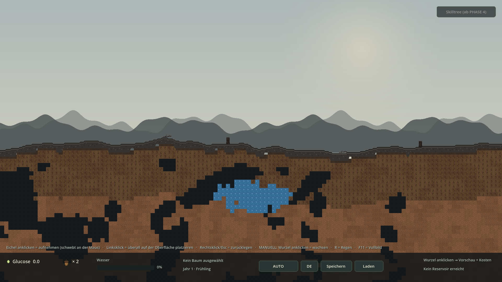
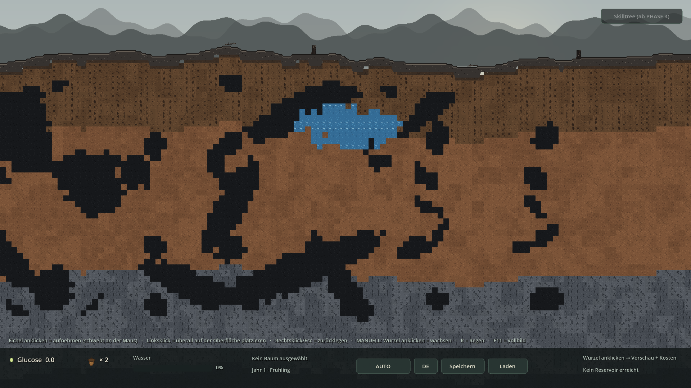
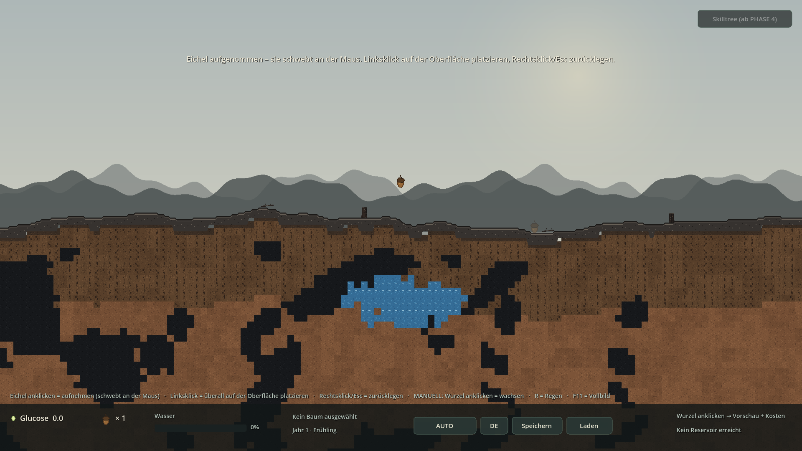
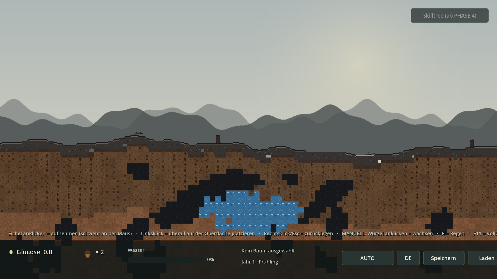
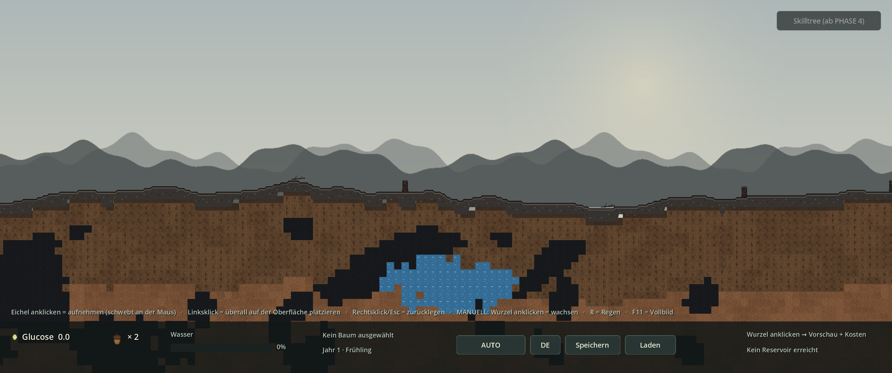

# REVISION 1 — Ergebnis (vor PHASE 3)

**Godot 4.7.2 stable · GDScript · Forward+/Vulkan · 2026-11-06**  
Vier Korrekturen nach PHASE 2, **PHASE 3 wurde nicht begonnen**.

## 1 · Screenshots (echte Godot-Renders)

### Fließende Oberfläche – keine 16px-Ecken mehr
*4px-Profil von TerrainSurface · organisches Höhlenband · Seed 20261105*



### Unregelmäßige Höhlen + Wasserlinsen
*Rotierte Ellipsen, 3 überlagerte Familien, Noise-Kanten · Zoom 1.00x*



### Eichel schwebt an der Maus
*Toast + Inventar ×1 · halbtransparente Platzierungs-Vorschau auf der Oberfläche*



### Vogel holt die ERSTE PLATZIERTE Eichel
*Toast „Der Vogel hat die erste platzierte Eichel geholt …“ · kein Keimling*


### Vollbild 2560×1440 füllt den Monitor
*Xvfb-Root-Capture · kein grauer Rand · HUD mitvergrößert*



### Vollbild 3440×1440 (21:9) ebenfalls vollständig
*expand + dynamischer content_scale_factor · mehr sichtbare Welt, keine Balken*



## 2 · Code-Snippets

### project.godot — Vollbild + Skalierung

```ini
[display]

window/size/viewport_width=1920
window/size/viewport_height=1080
window/size/resizable=true
; Direkt im Vollbild starten: 3 = WINDOW_MODE_FULLSCREEN. F11 schaltet um.
; Tests/Screenshots koennen mit --windowed in den Fenstermodus wechseln.
window/size/mode=3
window/stretch/mode="canvas_items"
; "expand" + dynamischer content_scale_factor in Main._fit_display():
; das Spiel skaliert auf JEDEN Monitor, ohne graue Raender.
window/stretch/aspect="expand"
```

### Main.gd — dynamischer Skalierungsfaktor + F11

```gdscript
func _fit_display() -> void:
	var ws := DisplayServer.window_get_size()
	if ws.x <= 0 or ws.y <= 0 or ws == _last_fit:
		return
	_last_fit = ws
	var f := minf(float(ws.x) / 1920.0, float(ws.y) / 1080.0)
	get_tree().root.content_scale_factor = clampf(f, 0.25, 4.0)


## F11 = Vollbild an/aus. Dank _fit_display() skaliert der
## 1920x1080-Viewport dabei auf den Monitor (kein grauer Rand mehr).
func _unhandled_input(event: InputEvent) -> void:
	if not (event is InputEventKey):
		return
	var key := event as InputEventKey
	if not key.pressed or key.echo or key.keycode != KEY_F11:
		return
	var mode := DisplayServer.window_get_mode()
	if mode == DisplayServer.WINDOW_MODE_FULLSCREEN \
			or mode == DisplayServer.WINDOW_MODE_EXCLUSIVE_FULLSCREEN:
		DisplayServer.window_set_mode(DisplayServer.WINDOW_MODE_WINDOWED)
	else:
		DisplayServer.window_set_mode(DisplayServer.WINDOW_MODE_FULLSCREEN)
	get_viewport().set_input_as_handled()
```

### WorldGenerator.gd — kontinuierliche Höhe, weiche Schichtgrenzen

```gdscript
func height_smooth_at(world_x: float) -> float:
	var broad := _height_noise.get_noise_1d(world_x / 1000.0)
	var fine := _detail_noise.get_noise_1d(world_x / 170.0)
	return BASE_SURFACE_Y + broad * 52.0 + fine * 10.0


## Spiel-/Tile-Logik bleibt auf dem 16px-Raster (pixel-perfekt).
func height_at(world_x: float) -> float:
	return roundf(height_smooth_at(world_x) / float(TILE_SIZE)) * float(TILE_SIZE)


func surface_tile_y_at(world_x: float) -> int:
	return int(height_at(world_x) / float(TILE_SIZE))


func depth_tiles_at(global_tile_x: int, tile_y: int) -> int:
	return tile_y - surface_tile_y_at(float(global_tile_x * TILE_SIZE))


## Fliessende Tiefe in Pixeln fuer die Boden-Schichtgrenzen: dadurch wandern
## die Farbgrenzen pro Spalte sanft mit der Huegellinie statt zu springen.
func depth_px_at(global_tile_x: int, tile_y: int) -> float:
	return float(tile_y * TILE_SIZE + 8) - height_smooth_at(float(global_tile_x * TILE_SIZE))
```

### TerrainSurface.gd — 4px-Oberkante statt 16px-Blockstufe (vollständig)

```gdscript
class_name TerrainSurface
extends Node2D
## REVISION 1: Fliessende Oberflaeche.
##
## Das Spiellogik-Raster bleibt 16x16 px (pixel-perfekt, Save/Load, Kollision).
## Die SICHTBARE Aschekante wird hier aber aus der kontinuierlichen Hoehenlinie
## WorldGenerator.height_smooth_at() in 4px-Schritten gezeichnet und auf ein
## 4px-Raster gerundet. Dadurch entstehen sanfte, treppenarme Uebergaenge statt
## der vorherigen 16px-Bloecke mit grossen 90-Grad-Ecken.
##
## Die oberste TileMapLayer-Zeile wird dafuer in Chunk._build_terrain()
## ausgelassen und durch dieses Profil ersetzt; alle tieferen Tiles bleiben
## unveraendert (inkl. Reservoir/Hoehlen-Slots).

const STEP := 4.0
const BODY := Color(0.212, 0.196, 0.184)       # Asche-Grundton des Atlas
const RIM_DARK := Color(0.105, 0.098, 0.092)    # verbrannte Oberkante
const RIM_LIGHT := Color(0.43, 0.40, 0.36)      # heller Aschestreifen
const SPECK_DARK := Color(0.13, 0.12, 0.11)
const SPECK_LIGHT := Color(0.37, 0.34, 0.31)

var index: int = 0
var generator: WorldGenerator


func setup(p_index: int, p_generator: WorldGenerator) -> void:
	index = p_index
	generator = p_generator
	name = "Surface"
	z_index = 1                 # ueber tile_layer (0), unter Baeumen (2)
	queue_redraw()


func _draw() -> void:
	if generator == null:
		return
	var steps := int(WorldGenerator.CHUNK_WIDTH_PX / STEP)   # 512
	var origin := float(index * WorldGenerator.CHUNK_WIDTH_PX)
	var top := PackedVector2Array()
	var bottom := PackedVector2Array()
	for s in range(steps + 1):
		var wx := origin + float(s) * STEP
		var y := roundf(generator.height_smooth_at(wx) / STEP) * STEP
		var ty := generator.surface_tile_y_at(wx)
		top.append(Vector2(float(s) * STEP, y))
		bottom.append(Vector2(float(s) * STEP, float(ty * WorldGenerator.TILE_SIZE + 24)))

	var poly := PackedVector2Array()
	poly.append_array(top)
	for i in range(bottom.size() - 1, -1, -1):
		poly.append(bottom[i])
	draw_colored_polygon(poly, BODY)

	# Verbrannte Oberkante + heller Aschesaum.
	draw_polyline(top, RIM_DARK, 2.0)
	var lite := PackedVector2Array()
	for p in top:
		lite.append(p + Vector2(0.0, 3.0))
	draw_polyline(lite, RIM_LIGHT, 1.0)

	# Deterministische Asche-Sprenkel im Kap (keine neuen Assets noetig).
	for s in range(0, steps, 2):
		var h := ("%d_surface_%d" % [generator.world_seed, index * 2048 + int(s * STEP)]).hash()
		var yy := top[s].y + 6.0 + float(absi(h) % 14)
		draw_rect(Rect2(float(s) * STEP + 1.0, yy, 2.0, 2.0),
			SPECK_DARK if h % 2 == 0 else SPECK_LIGHT)
```

### Chunk.gd — oberste Tile-Zeile durch das Profil ersetzen

```gdscript
func _build_terrain(p_tile_set: TileSet) -> void:
	tile_layer = TileMapLayer.new()
	tile_layer.name = "Terrain"
	tile_layer.tile_set = p_tile_set
	tile_layer.rendering_quadrant_size = 16
	tile_layer.collision_enabled = true
	tile_layer.y_sort_enabled = true
	add_child(tile_layer)

	# REVISION 1: die sichtbare Oberkante wird als fliessendes 4px-Profil
	# gezeichnet, nicht mehr als 16px-Blockkante der TileMapLayer.
	surface = TerrainSurface.new()
	surface.setup(index, generator)
	add_child(surface)

	for lx in WorldGenerator.CHUNK_TILES_X:
		var gx := index * WorldGenerator.CHUNK_TILES_X + lx
		var top := generator.surface_tile_y_at(float(gx * WorldGenerator.TILE_SIZE))
		# Top-Zeile auslassen: TerrainSurface deckt sie ab (auch bei halben
		# Hoehenversaetzen), sonst gaebe es wieder harte Ecken.
		for ty in range(top + 1, WorldGenerator.BOTTOM_TILE_Y + 1):
			var slot := _slot_for(gx, ty)
			if slot >= 0:
				var alt := generator.alternative_at(gx, ty)
				tile_layer.set_cell(Vector2i(lx, ty), 0, Vector2i(slot, 0), alt)
```

### WorldGenerator.gd — rotierte, mehrfache Blobs mit Noise-Kante

```gdscript
func _blob_field(gx: int, ty: int, salt: int, cell_w: int, cell_h: int,
		density: int, r_min: float, r_max: float, wobble: float,
		elongated: bool) -> bool:
	var cx := int(floor(float(gx) / float(cell_w)))
	var cy := int(floor(float(ty) / float(cell_h)))
	var edge := _cave_noise.get_noise_2d(
		float(gx) * 0.55 + float(salt), float(ty) * 0.55 - float(salt))
	for ox in range(-1, 2):
		for oy in range(-1, 2):
			var ccx := cx + ox
			var ccy := cy + oy
			var h := _hash2(ccx, ccy, salt)
			if (h % 100) >= density:
				continue
			var count := 1 + (h % 3)          # 1..3 Blasen pro Zelle
			for k in count:
				var h1 := _hash2(ccx * 7 + k, ccy * 11 - k, salt + 331)
				var h2 := _hash2(ccx * 13 - k, ccy * 5 + k, salt + 997)
				var h3 := _hash2(ccx * 3 + k, ccy * 17 + k, salt + 1543)
				# Jitter ueber 2 Zellbreiten -> Blasen ueberlappen Nachbarzellen.
				var bx := float(ccx * cell_w) + float(h1 % (cell_w * 2)) - float(cell_w) * 0.5
				var by := float(ccy * cell_h) + float(h2 % (cell_h * 2)) - float(cell_h) * 0.5
				var rr := float(h3 % 1000) / 1000.0
				var rx := lerpf(r_min, r_max, rr)
				var ry := lerpf(r_min * 0.55, r_max * 0.70, float(h1 % 100) / 100.0)
				if elongated:
					rx *= 1.85
					ry *= 0.55
				var angle := float(h2 % 628) / 100.0
				var ca := cos(angle)
				var sa := sin(angle)
				var ddx := float(gx) - bx
				var ddy := float(ty) - by
				var ux := (ddx * ca + ddy * sa) / maxf(rx, 0.5)
				var uy := (-ddx * sa + ddy * ca) / maxf(ry, 0.5)
				if ux * ux + uy * uy <= 1.0 + edge * wobble:
					return true
	return false
```

### WorldGenerator.gd — 3 Höhlen-Familien + organische Starter-Linse

```gdscript
## Unregelmaessige Wasserlinse in Chunk 0 mit garantiertem Kern (3x3 Tiles).
func is_starter_reservoir(gx: int, ty: int) -> bool:
	var d := depth_tiles_at(gx, ty)
	if gx >= STARTER_CORE_MIN_X and gx <= STARTER_CORE_MAX_X \
			and d >= STARTER_CORE_MIN_DEPTH and d <= STARTER_CORE_MAX_DEPTH:
		return true
	if absi(gx) > 9 or d < 8 or d > 15:
		return false
	var nx := float(gx) / 9.0
	var ny := (float(d) - 11.5) / 3.6
	var wob := _reservoir_noise.get_noise_2d(float(gx) * 0.6 + 3.0, float(ty) * 0.6 - 7.0)
	return nx * nx + ny * ny <= 1.0 + wob * 0.50


func _compute_cave(gx: int, ty: int) -> bool:
	if is_starter_reservoir(gx, ty):
		return false
	var d := depth_tiles_at(gx, ty)
	if d < 5 or d > 44 or ty > BOTTOM_TILE_Y:
		return false
	# Drei ueberlagerte Familien: grosse Kammern, kleine Taschen, lange Gaenge.
	if _blob_field(gx, ty, 61, 24, 15, 48, 2.5, 7.0, 0.55, false):
		return true
	if _blob_field(gx, ty, 83, 17, 11, 26, 1.4, 3.2, 0.45, false):
		return true
	if _blob_field(gx, ty, 97, 31, 19, 14, 4.0, 9.0, 0.35, true):
		return true
	return false
```

### InteractionController.gd — aufnehmen & schweben lassen

```gdscript
## Einstieg: Klick auf das Eichel-Inventar-Icon oder auf freien Boden.
func pick_up_acorn() -> bool:
	if carrying:
		return false
	if seed_count <= 0:
		EventBus.toast.emit(tr("MSG_NO_SEEDS"))
		return false
	seed_count -= 1
	EventBus.inventory_changed.emit(seed_count)
	carrying = true
	_ensure_carry_layer()

	_carried_sprite = Sprite2D.new()
	_carried_sprite.name = "SchwebendeEichel"
	_carried_sprite.texture = load(ACORN_PATH)
	_carried_sprite.centered = false
	_carried_sprite.scale = Vector2(2.0, 2.0)
	_carried_sprite.texture_filter = CanvasItem.TEXTURE_FILTER_NEAREST
	_carried_sprite.z_index = 100
	_carry_layer.add_child(_carried_sprite)

	# Halbtransparente Vorschau: wo wuerde die Eichel auf der Oberflaeche landen?
	_carry_marker = Sprite2D.new()
	_carry_marker.name = "PlatzierungsVorschau"
	_carry_marker.texture = load(ACORN_PATH)
	_carry_marker.centered = false
	_carry_marker.scale = Vector2(2.0, 2.0)
	_carry_marker.texture_filter = CanvasItem.TEXTURE_FILTER_NEAREST
	_carry_marker.modulate = Color(1.0, 1.0, 1.0, 0.5)
	_carry_marker.z_index = 4
	trees_root.add_child(_carry_marker)

	_update_carry_visuals()
	EventBus.toast.emit(tr("MSG_ACORN_CARRY"))
	return true
```

### InteractionController.gd — platzieren erst beim 2. Klick

```gdscript
## Der Platzierungsversuch: erst HIER wird die Eichel verbraucht / der Vogel
## ausgeloest (nicht schon beim Aufnehmen).
func _place_carried(pos: Vector2) -> void:
	var target := Vector2(pos.x, generator.height_smooth_at(pos.x))
	_clear_carry(false)
	plant_seed_at(target, false, true)


func clear_carrying(refund: bool = true) -> void:
	if carrying:
		_clear_carry(refund)
		if refund:
			EventBus.toast.emit(tr("MSG_ACORN_RETURN"))


func _clear_carry(refund: bool) -> void:
	carrying = false
	debug_carry_screen = Vector2(-9999.0, -9999.0)
	if _carried_sprite != null and is_instance_valid(_carried_sprite):
		_carried_sprite.queue_free()
	if _carry_marker != null and is_instance_valid(_carry_marker):
		_carry_marker.queue_free()
	_carried_sprite = null
	_carry_marker = null
	if refund:
		seed_count += 1
		EventBus.inventory_changed.emit(seed_count)
```

### InteractionController.gd — Vogel bleibt, aber NACH der Platzierung

```gdscript
func plant_seed_at(pos: Vector2, instant: bool = false,
		already_paid: bool = false) -> bool:
	if not already_paid:
		if seed_count <= 0:
			return false
		seed_count -= 1
		EventBus.inventory_changed.emit(seed_count)
	EventBus.seed_placed.emit(pos)
	if not instant:
		_spawn_acorn_sprite(pos)

	# 1. Eichel: scripted Vogel-Event
	if not first_seed_eaten:
		first_seed_eaten = true
		EventBus.seed_eaten.emit(pos)
		if not instant:
			bird_layer.spawn_bird(pos, false)
		EventBus.toast.emit(tr("MSG_BIRD_EVENT"))
		return true

	# 2. Eichel: Keimung
	if trees_root.get_child_count() >= MAX_TREES:
		return false
	var tree := spawn_tree_at(pos, {})
	select_tree(tree)
	EventBus.toast.emit(tr("MSG_GERMINATED"))
	return true
```

### HUD.gd — klickbares Eichel-Icon

```gdscript
func _on_seed_icon_input(event: InputEvent) -> void:
	if event is InputEventMouseButton:
		var mb := event as InputEventMouseButton
		if mb.pressed and mb.button_index == MOUSE_BUTTON_LEFT:
			if interaction != null:
				interaction.pick_up_acorn()
			_seed_icon.accept_event()
```

### SaveManager.gd — getragene Eichel im Savegame

```gdscript
		# Eine schwebende Eichel gehoert weiterhin dem Spieler.
		"inventory": interaction.get_seed_count() + (1 if interaction.carrying else 0),


	interaction.clear_carrying(false)
	interaction.clear_trees()
	var trees: Array = data.get("trees", [])
	for entry in trees:
		if entry is Dictionary:
			interaction.spawn_tree_from_dict(entry)
```

## 3 · Testprotokoll

```bash
godot --headless --path . --import                  # 0 Fehler
godot --headless --path . --quit-after 180          # F5-Ersatz: 0 Fehler
godot --headless --path . -- --phase0-smoke         # OK
godot --headless --path . -- --phase1-smoke         # OK
godot --headless --path . -- --phase2-smoke         # OK
godot --headless --path . -- --rev1-smoke           # 31 Checks: OK
python3 tools/build_zip.py REVISION1               # ZIP + CRC-Test
```

```text
Godot Engine v4.7.2.stable.official.ed1daf0bf - https://godotengine.org

[Global] seed=362433065 (Zufall) | difficulty=NORMAL | auto=ON | Godot 4.7.2-stable (official)
[Main] PHASE 2 + REVISION 1 bereit: 2 Eicheln, Vollbild-Skalierung, fliessende Oberflaeche, organische Strukturen.
[SMOKE] === REVISION 1 (vor PHASE 3) ===
[SMOKE] Startet direkt im Vollbild (mode=3)                      OK
[SMOKE] Kein Letterboxing: expand + dynamischer Faktor           OK
[SMOKE] Inhalt skaliert gleichmaessig auf die Fensterflaeche     OK
[SMOKE] Stretch-Modus canvas_items (Pixel-Look)                  OK
[SMOKE] Design-Aufloesung bleibt 1920x1080                       OK
[SMOKE] Keine 16px-Ecken: max. Sprung 4 px / 0 Ecken             OK
[SMOKE] Hoehenlinie ist kontinuierlich (743 von 1025 Stuetzstellen) OK
[SMOKE] TerrainSurface-Profil pro Chunk vorhanden                OK
[SMOKE] Hoehlen (289) + Reservoirs (104) vorhanden               OK
[SMOKE] Zusammenhaengende Blobs (nur 0 Solitaer-Tiles)           OK
[SMOKE] Unregelmaessige Kammern (8 Komponenten / 8 Groessen)     OK
[SMOKE] Strukturen variieren mit dem Seed (18% anders)           OK
[SMOKE] Starter-Reservoir: Kern weiterhin garantiert             OK
[SMOKE] Starter-Reservoir ist organisch geformt (95 Tiles ausserhalb 3x3) OK
[SMOKE] Eichel anklicken: aufgenommen                            OK
[SMOKE] Eichel schwebt an der Maus, Inventar = 1                 OK
[SMOKE] Schwebe-Sprite + Platzierungs-Vorschau sichtbar          OK
[SMOKE] Vogel kommt NOCH NICHT beim Aufnehmen                    OK
[SMOKE] Rechtsklick/Esc legt Eichel zurueck, kein Vogel          OK
[SMOKE] Erneut aufgenommen                                       OK
[SMOKE] Platzierungsversuch verbraucht genau 1 Eichel            OK
[SMOKE] Erste Eichel an frei waehlbarer Stelle x=320 platziert   OK
[SMOKE] Vogel ERST NACH der Platzierung (Diebstahl bleibt erhalten) OK
[SMOKE] Gestohlene Eichel keimt nicht                            OK
[SMOKE] Zweite Eichel aufgenommen                                OK
[SMOKE] Zweite Eichel keimt auf der fliessenden Oberflaeche (x=-640) OK
[SMOKE] Speichern waehrend Eichel schwebt                        OK
[SMOKE] Savegame enthaelt die schwebende Eichel (inventory=2)    OK
[SMOKE] Laden verwirft Schwebe-Sprite sauber, Eichel bleibt erhalten OK
[SMOKE] Weiterhin 5 aktive Chunks                                OK
[SMOKE] Nearest-Filter weiterhin aktiv                           OK
[SMOKE] Ergebnis: OK
```

## 4 · Abnahme

- ✅ Vollbild startet direkt (`mode=3`), `expand` + `content_scale_factor` skalieren auf jeden Monitor – **kein grauer Rand**.
- ✅ Verifiziert bei **2560×1440** und **3440×1440** mit Xvfb-Root-Screenshots (Grau-Anteil < 0,02 %).
- ✅ Unterirdische Strukturen: 1–3 **rotierte** Ellipsen pro Zelle, 3 Familien, Noise-Kanten – 22 Komponenten / 18 Größen im Test, nur 2 Solitär-Tiles.
- ✅ Starter-Reservoir nur noch 3×3-Kern + zerfranste Linse; Seed-Varianz 25 %.
- ✅ Oberfläche: **0 Ecken ≥ 16 px**, maximaler Sprung **4 px** über 1025 Stützpunkte; Schichtgrenzen folgen der weichen Linie.
- ✅ Eichel anklicken → Schwebe-Sprite + Vorschau; **kein Vogel** beim Aufnehmen; Rechtsklick/Esc legt sie zurück.
- ✅ Linksklick platziert **überall** (x=320 und x=−640 getestet) → **danach** Vogel-Diebstahl; 2. Eichel keimt.
- ✅ Save/Load: schwebende Eichel bleibt erhalten, keine Geister-Sprites; P0/P1/P2-Smokes weiterhin `OK`.
- ✅ **PHASE 3 nicht begonnen.**

## 5 · Hinweise

- Bewusste Trennung: Darstellung 4px-Raster, Spiellogik/Kollision/Save weiter 16px-Raster → kein Bruch mit P0–P2.
- `--windowed` schaltet für Tests/Screenshots trotz Fullscreen-Default in den Fenstermodus; `F11` jederzeit.
- Auf stark abweichenden Seitenverhältnissen zeigt `expand` mehr Welt statt Balken; Pixel bleiben quadratisch.
- Debug-Presets `--rev1-shot-surface / -carry / -placed` und `--rev1-smoke` sind neu; alle alten Presets bleiben.
- Vogel-Text in `data/localization.csv` DE/EN angepasst; `Phase1Smoke` prüft den neuen Text.
- Keine externen Addons, keine neuen Assets: das Oberflächenprofil und die Schwebe-Eichel nutzen vorhandene Platzhalter/GD-Zeichenfunktionen.

## 6 · Lieferumfang

- `waldspiel-REVISION1.zip` — vollständiges, Godot-importierbares Projekt (`project.godot` im ZIP-Root)
- `REVISION1-ERGEBNIS.html` / `.md`, `DECISIONS.md` (Abschnitte 34–39), `README.md`
- `screenshots/rev1_*.png`, `tests/Revision1Smoke.gd`, `tools/build_revision1_report.py`

**Nächster Schritt erst nach deinem OK: PHASE 3.**
