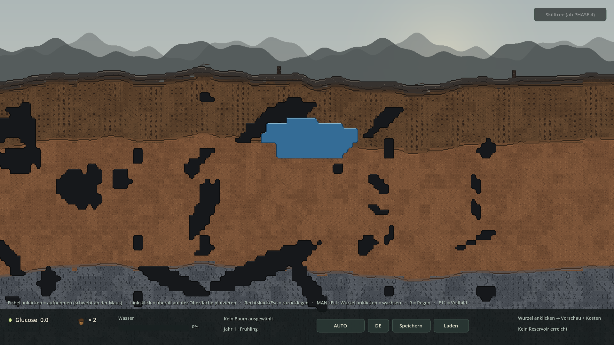
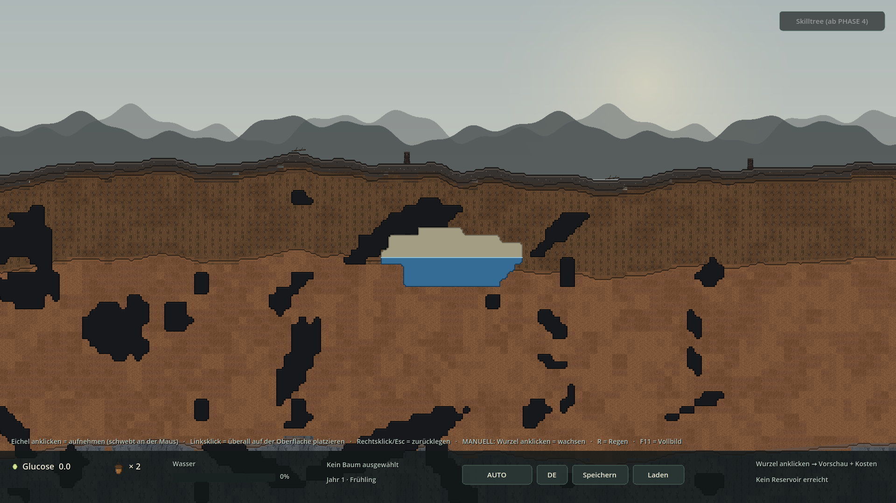
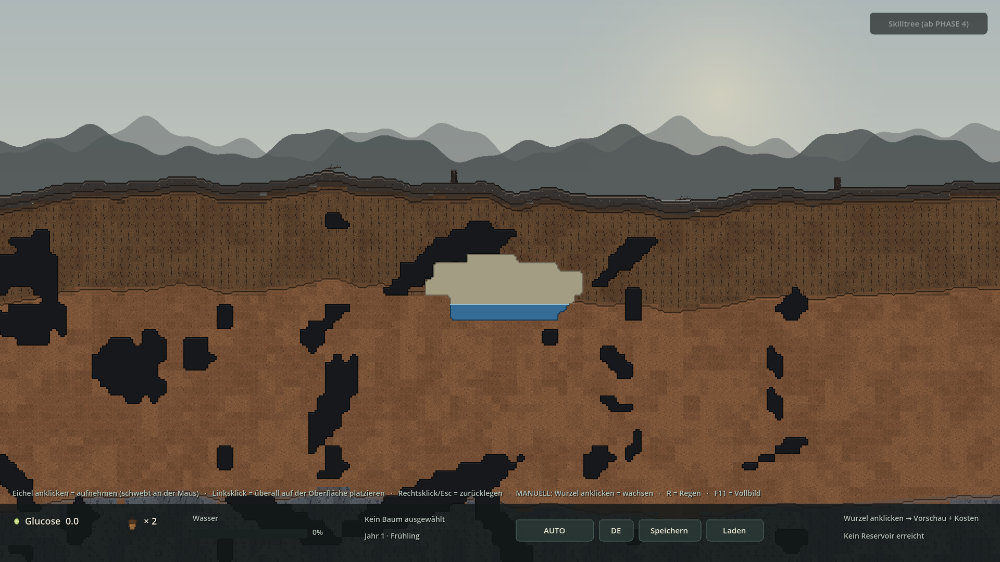
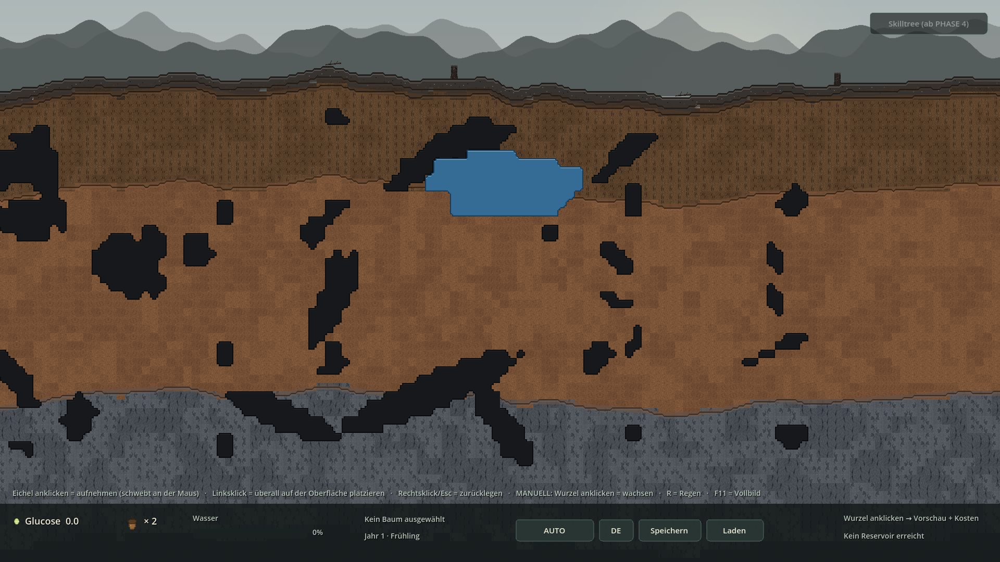
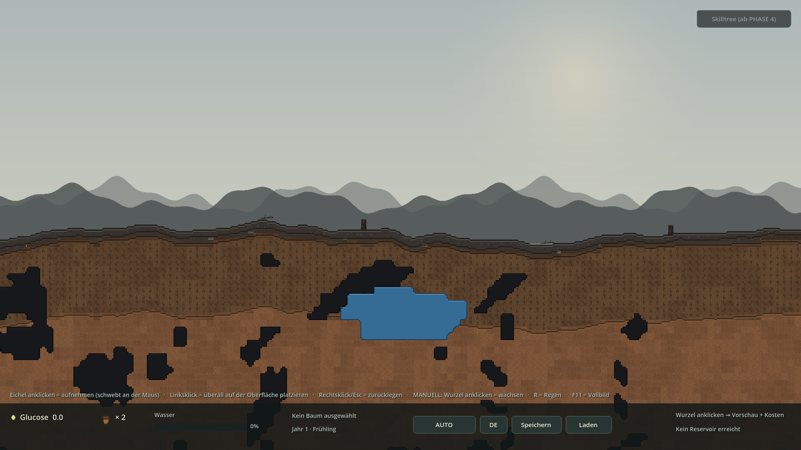
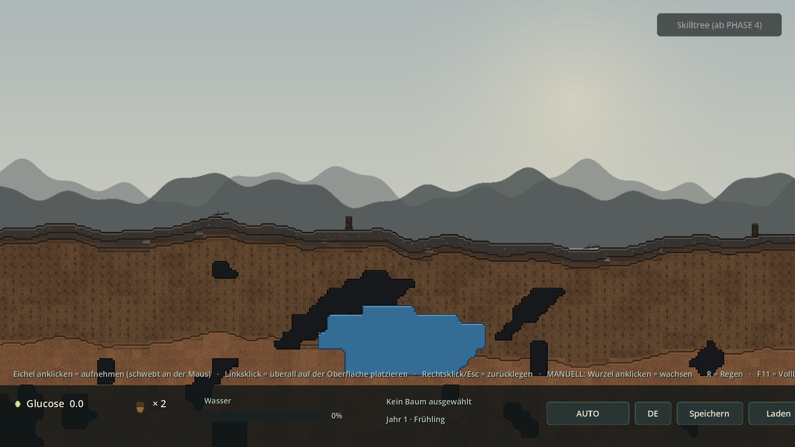

# REVISION 2 — Ergebnis (vor PHASE 3)

**Godot 4.7.2 stable · GDScript · Forward+/Vulkan · 2026-11-06**  
Drei Korrekturen nach REVISION 1, **PHASE 3 wurde nicht begonnen**.

## 1 · Screenshots (echte Godot-Renders)

### Weiche Kanten: Erdschichten, Höhlen, Wasser
*TerrainContours · 4px-Isolinien, Schicht-Rims, Wobble · Seed 20261105*



### Becken bei 45 % – Pegel von oben nach unten
*Trocken/hell oberhalb, blau darunter, helle Wasserspiegel-Linie · keine Chunk-Naht*



### Dasselbe Becken bei 18 %
*Der Pegel ist weiter gesunken · gemeinsames Volumen statt einzelner Tiles*



### Höhlen ~50 % seltener, weiterhin organisch
*Radien × √0.5 bei unveränderter Blob-Zellendichte · Seed 20261105*



### Regression: fließende Oberfläche (REVISION 1)
*4px-Profil bleibt, alle P0/P1/P2/REV1-Smokes weiterhin OK*



### Vollbild 2560×1440 füllt den Monitor
*Xvfb-Root-Capture · kein grauer Rand · HUD mitvergrößert*



## 2 · Code-Snippets (aus den echten Projektdateien)

### project.godot — Vollbild + Forward+ (unverändert)

```ini
[display]

window/size/viewport_width=1920
window/size/viewport_height=1080
window/size/resizable=true
; Direkt im Vollbild starten: 3 = WINDOW_MODE_FULLSCREEN. F11 schaltet um.
; Tests/Screenshots koennen mit --windowed in den Fenstermodus wechseln.
window/size/mode=3
window/stretch/mode="canvas_items"
; "expand" + dynamischer content_scale_factor in Main._fit_display():
; das Spiel skaliert auf JEDEN Monitor, ohne graue Raender.
window/stretch/aspect="expand"
```

### TerrainContours.gd — Übermalen + Zeichenreihenfolge

```gdscript
func _draw() -> void:
	if generator == null:
		return
	_erase_structure_tiles()
	_draw_layers()
	_draw_blobs(cave_tiles, 11.0, false)
	_draw_blobs(water_tiles, 29.0, true)


## Die alten 16px-Hoehlen-/Wasser-Tiles mit dem echten Boden-Atlas uebermalen.
func _erase_structure_tiles() -> void:
	if _atlas == null:
		return
	for tv in cave_tiles.keys():
		_erase_one(tv as Vector2i)
	for tv in water_tiles.keys():
		_erase_one(tv as Vector2i)


func _erase_one(t: Vector2i) -> void:
	var lx := float(t.x * int(TS)) - origin
	# REVISION 2: NUR Tiles des EIGENEN Chunks uebermalen. Wuerde ein
	# Rand-Tile des Nachbarn hier geloescht, aber (weil ausserhalb des
	# Zeichenbereichs) nicht neu gezeichnet, entstuende eine braune Naht
	# genau an der Chunk-Grenze.
	if lx < 0.0 or lx >= CHUNK_W:
		return
	var slot := generator.soil_slot_at(t.x, t.y)
	if slot < 0:
		return
	draw_texture_rect_region(_atlas,
		Rect2(lx, float(t.y * int(TS)), TS, TS),
		Rect2(float(slot * int(TS)), 0.0, TS, TS))
```

### TerrainContours.gd — globale Feldabfrage + Smoothstep-Isolinie

```gdscript
func _s(gx: int, gy: int, is_water: bool) -> float:
	var inside := (generator.reservoir_at(gx, gy) if is_water
		else generator.cave_at(gx, gy))
	return 1.0 if inside else -1.0


func _field(px: float, py: float, salt: float, is_water: bool) -> float:
	var tx := px / TS - 0.5
	var ty := py / TS - 0.5
	var gx0 := int(floor(tx))
	var gy0 := int(floor(ty))
	var fx := tx - float(gx0)
	var fy := ty - float(gy0)
	# Smoothstep -> leicht geschwungene statt geradlinige Isolinie.
	fx = fx * fx * (3.0 - 2.0 * fx)
	fy = fy * fy * (3.0 - 2.0 * fy)
	var v := lerpf(
		lerpf(_s(gx0, gy0, is_water), _s(gx0 + 1, gy0, is_water), fx),
		lerpf(_s(gx0, gy0 + 1, is_water), _s(gx0 + 1, gy0 + 1, is_water), fx),
		fy)
	return v + generator.edge_wobble_at(px, py, salt) * 0.85
```

### TerrainContours.gd — Wasserlöcher schließen („hängt zusammen“)

```gdscript
## Kleine horizontale Löcher schliessen -> das Wasser „haengt zusammen".
func _close_water_gaps(filled: Dictionary, rows: Dictionary) -> void:
	for sy in rows.keys():
		var xs: Array = rows[sy]
		xs.sort()
		for i in range(xs.size() - 1):
			var a: int = xs[i]
			var b: int = xs[i + 1]
			if b - a > 1 and b - a <= MAX_WATER_GAP:
				for sx in range(a + 1, b):
					var c := Vector2i(sx, sy)
					if not filled.has(c):
						filled[c] = true
						xs.append(sx)
```

### WorldGenerator.gd — Höhlenfläche halbieren, nicht Zellenzahl

```gdscript
var cave_area_scale: float = 0.5
var _cave_radius_scale: float = sqrt(0.5)

var _height_noise := FastNoiseLite.new()
var _detail_noise := FastNoiseLite.new()
var _variation_noise := FastNoiseLite.new()
var _stone_noise := FastNoiseLite.new()
var _biome_noise := FastNoiseLite.new()
var _cave_noise := FastNoiseLite.new()
var _reservoir_noise := FastNoiseLite.new()
var _cave_cache: Dictionary = {}
var _res_cache: Dictionary = {}


func _init(p_seed: int = 20261105) -> void:
	set_world_seed(p_seed)


func set_world_seed(p_seed: int) -> void:
	world_seed = p_seed
	_cave_cache.clear()
	_res_cache.clear()
	_configure(_height_noise, p_seed, 1, FastNoiseLite.TYPE_SIMPLEX_SMOOTH, 3, 0.50)
	_configure(_detail_noise, p_seed, 2, FastNoiseLite.TYPE_SIMPLEX, 2, 0.45)
	_configure(_variation_noise, p_seed, 3, FastNoiseLite.TYPE_VALUE, 2, 0.50)
	_configure(_stone_noise, p_seed, 4, FastNoiseLite.TYPE_CELLULAR, 1, 0.50)
	_configure(_biome_noise, p_seed, 5, FastNoiseLite.TYPE_SIMPLEX_SMOOTH, 2, 0.50)
	_configure(_cave_noise, p_seed, 6, FastNoiseLite.TYPE_SIMPLEX_SMOOTH, 2, 0.50)
	_configure(_reservoir_noise, p_seed, 7, FastNoiseLite.TYPE_SIMPLEX, 2, 0.45)


func set_cave_area_scale(value: float) -> void:
	cave_area_scale = clampf(value, 0.05, 2.0)
	_cave_radius_scale = sqrt(cave_area_scale)
	_cave_cache.clear()
	_res_cache.clear()


func _configure(n: FastNoiseLite, s: int, salt: int, type: int, octaves: int, gain: float) -> void:
	n.seed = s + salt * 7919
	n.noise_type = type
	n.frequency = 1.0
	n.fractal_type = FastNoiseLite.FRACTAL_FBM
	n.fractal_octaves = octaves
	n.fractal_gain = gain
	n.fractal_lacunarity = 2.0


# --------------------------------------------------------------------------- #
# Hoehenlinie: height_smooth_at = fliessend, height_at = auf 16px gerastet
# --------------------------------------------------------------------------- #
## Kontinuierliche Huegellinie. TerrainSurface zeichnet daraus die sichtbare
## Oberkante in 4px-Schritten -> keine grossen 90-Grad-Ecken mehr.
func height_smooth_at(world_x: float) -> float:
	var broad := _height_noise.get_noise_1d(world_x / 1000.0)
	var fine := _detail_noise.get_noise_1d(world_x / 170.0)
	return BASE_SURFACE_Y + broad * 52.0 + fine * 10.0


## Spiel-/Tile-Logik bleibt auf dem 16px-Raster (pixel-perfekt).
func height_at(world_x: float) -> float:
	return roundf(height_smooth_at(world_x) / float(TILE_SIZE)) * float(TILE_SIZE)


func surface_tile_y_at(world_x: float) -> int:
	return int(height_at(world_x) / float(TILE_SIZE))


func depth_tiles_at(global_tile_x: int, tile_y: int) -> int:
	return tile_y - surface_tile_y_at(float(global_tile_x * TILE_SIZE))


## Fliessende Tiefe in Pixeln fuer die Boden-Schichtgrenzen: dadurch wandern
## die Farbgrenzen pro Spalte sanft mit der Huegellinie statt zu springen.
func depth_px_at(global_tile_x: int, tile_y: int) -> float:
	return float(tile_y * TILE_SIZE + 8) - height_smooth_at(float(global_tile_x * TILE_SIZE))


# --------------------------------------------------------------------------- #
# Biome (PHASE 0-2: exakt 1 Biom, aber API + Noise fuer 3 Biome vorbereitet)
# --------------------------------------------------------------------------- #
func biome_at(_world_x: float) -> BiomeKind:
	return BiomeKind.TEMPERIERT


func biome_moisture_at(_world_x: float) -> float:
	return 0.5


func biome_noise_at(world_x: float) -> float:
	return _biome_noise.get_noise_1d(world_x / 6000.0)


# --------------------------------------------------------------------------- #
# REVISION 1: unregelmaessige Hoehlen + Wasserreservoirs
# --------------------------------------------------------------------------- #
func _hash2(a: int, b: int, salt: int) -> int:
	return ("%d_%d_%d_%d" % [world_seed, salt, a, b]).hash() & 0x7fffffff


## Mehrere ROTIERTE Ellipsen pro Zelle, mit stark variierenden Radien und
## Positions-Jitter ueber die Zellgrenzen hinaus. Eine Noise-Kante verformt
## den Rand zusaetzlich. Ergebnis: organisch, ohne sichtbares Raster.
```

### WorldGenerator.gd — 1-Tile-Dilatation verbindet Reservoirs

```gdscript
func _raw_reservoir(gx: int, ty: int) -> bool:
	if is_starter_reservoir(gx, ty):
		return true
	if cave_at(gx, ty):
		return false
	var d := depth_tiles_at(gx, ty)
	if d < 7 or d > 36 or ty > BOTTOM_TILE_Y:
		return false
	return _blob_field(gx, ty, 71, 19, 13, 34, 1.6, 3.6, 0.50, false)


## REVISION 2: 1-Tile-Dilatation. Ein Erd-Tile mit mindestens zwei nassen
## direkten Nachbarn wird mit Wasser gefuellt. Dadurch verbinden sich eng
## beieinander liegende Linsen zu EINEM Becken und Löcher verschwinden -
## genau das "Wasser haengt zusammen" aus der Anforderung.
const RES_NEIGHBORS := [Vector2i(1, 0), Vector2i(-1, 0),
	Vector2i(0, 1), Vector2i(0, -1)]


func reservoir_at(gx: int, ty: int) -> bool:
	var k := Vector2i(gx, ty)
	if _res_cache.has(k):
		return _res_cache[k]
	var v := _raw_reservoir(gx, ty)
	if not v and not cave_at(gx, ty):
		var wet_neighbors := 0
		for d in RES_NEIGHBORS:
			if _raw_reservoir(gx + d.x, ty + d.y):
				wet_neighbors += 1
		if wet_neighbors >= 2:
			v = true
	_res_cache[k] = v
	return v


# --------------------------------------------------------------------------- #
# REVISION 2: glatte Kanten fuer Erdschichten / Hoehlen / Wasser
# --------------------------------------------------------------------------- #
## Fliessende Schichtgrenze in Welt-Pixeln (4px-Raster wie die Oberflaeche).
## TerrainContours zeichnet daraus einen weichen Farbuebergang + Rim-Linie.
func layer_edge_y(world_x: float, depth_px: float, salt: float) -> float:
	var wob := _variation_noise.get_noise_1d(world_x / 340.0 + salt * 17.0) * 6.0
	var fine := _detail_noise.get_noise_1d(world_x / 95.0 - salt * 31.0) * 2.0
	return roundf((height_smooth_at(world_x) + depth_px + wob + fine) / 4.0) * 4.0


## Kleine organische Verformung der Blob-Isolinie in 4px-Aufloesung.
func edge_wobble_at(world_x: float, world_y: float, salt: float) -> float:
	return _cave_noise.get_noise_2d(world_x * 0.045 + salt * 13.0,
		world_y * 0.045 - salt * 7.0) * 0.22


## Start-Kapazitaet eines Reservoirs in Wasser-Einheiten (2.0/s Verbrauch).
func reservoir_capacity_at(gx: int, ty: int) -> float:
	var h := ("%d_res_%d_%d" % [world_seed, gx, ty]).hash() & 0x7fffffff
	return 60.0 + float(h % 61)   # 60 .. 120


# --------------------------------------------------------------------------- #
# Boden-Schichtung (Schichtgrenzen folgen der fliessenden Hoehe)
# --------------------------------------------------------------------------- #
```

### WorldState.gd — EIN Becken, EIN Volumen, Pegel von oben nach unten

```gdscript
func _build_group(gx: int, ty: int) -> Dictionary:
	var start := Vector2i(gx, ty)
	var queue: Array[Vector2i] = [start]
	var seen: Dictionary = {start: true}
	var tiles: Array[Vector2i] = []
	while not queue.is_empty() and tiles.size() < MAX_GROUP_TILES:
		var c: Vector2i = queue.pop_back()
		tiles.append(c)
		for d in NEIGHBORS:
			var nb: Vector2i = c + d
			if not seen.has(nb) and generator.reservoir_at(nb.x, nb.y):
				seen[nb] = true
				queue.append(nb)
	# Oben nach unten sortieren -> der Pegel faellt zeilenweise.
	tiles.sort_custom(func(a, b): return (a.y < b.y) if a.y != b.y else (a.x < b.x))
	var id := key(tiles[0].x, tiles[0].y)
	var capacity := float(tiles.size()) * PER_TILE_VOLUME
	var volume := clampf(float(_saved_volumes.get(id, capacity)), 0.0, capacity)
	for t in tiles:
		_tile_group[key(t.x, t.y)] = id
		if _legacy_dry.has(key(t.x, t.y)):
			volume = 0.0
	var group := {
		"id": id, "tiles": tiles, "capacity": capacity,
		"volume": volume, "level_row": tiles[0].y,
		"announced_empty": false,
	}
	_groups[id] = group
	_recompute_level(group, false)
	return group


func _recompute_level(group: Dictionary, notify: bool) -> bool:
	var tiles: Array[Vector2i] = group["tiles"]
	var n := tiles.size()
	var capacity := float(group["capacity"])
	var fill := clampf(float(group["volume"]) / maxf(capacity, 0.001), 0.0, 1.0)
	var dry_count := n - int(ceil(fill * float(n)))
	var new_row: int
	if dry_count <= 0:
		new_row = tiles[0].y
	elif dry_count >= n:
		new_row = WorldGenerator.BOTTOM_TILE_Y + 2
	else:
		new_row = tiles[dry_count].y
	var changed := new_row != int(group["level_row"])
	group["level_row"] = new_row
	if changed:
		_apply_dry(group)
	if notify and changed:
		EventBus.reservoir_level_changed.emit()
	return changed


func _apply_dry(group: Dictionary) -> void:
	var row := int(group["level_row"])
	for t in group["tiles"]:
		var k := key(t.x, t.y)
		if t.y < row:
			_dry[k] = true
		else:
			_dry.erase(k)
```

### WorldState.gd — Entnahme wirkt auf das ganze Becken

```gdscript
func consume(global_tile_x: int, tile_y: int, amount: float) -> float:
	if amount <= 0.0:
		return 0.0
	var g := _ensure_group(global_tile_x, tile_y)
	if g.is_empty():
		return 0.0
	var taken := minf(amount, float(g["volume"]))
	if taken <= 0.0:
		return 0.0
	g["volume"] = float(g["volume"]) - taken
	_recompute_level(g, true)
	if float(g["volume"]) <= 0.001:
		if not bool(g["announced_empty"]):
			g["announced_empty"] = true
			EventBus.reservoir_dried.emit(Vector2i(global_tile_x, tile_y))
			EventBus.toast.emit(tr("MSG_RESERVOIR_DRY"))
	else:
		EventBus.reservoir_consumed.emit(Vector2i(global_tile_x, tile_y),
			float(g["volume"]))
	return taken
```

### WorldState.gd — Savegame v3 (v2/v1 bleiben lesbar)

```gdscript
func from_dict(d: Dictionary) -> void:
```

### WaterSystem.gd — Wurzel entnimmt, Regen füllt auf

```gdscript
func tick(delta: float) -> void:
	if raining:
		rain_time_left -= delta
		if rain_time_left <= 0.0:
			_stop_rain()
	else:
		_next_rain -= delta
		if _next_rain <= 0.0:
			start_rain(randf_range(REGEN_DAUER_MIN, REGEN_DAUER_MAX))

	# REVISION 2: natuerliche, sehr langsame Abnahme + Regen-Auffuellung.
	if world_state != null and not raining:
		world_state.tick_passive(delta)
	elif world_state != null:
		world_state.refill(delta)

	last_reservoir_rate = 0.0
	for tree in get_tree().get_nodes_in_group("trees"):
		var rate: float = tree.species.base_water_gain * float(tree.root_count)
		if raining:
			rate *= REGEN_FAKTOR
		# REVISION 2: jedes Wurzelsegment im NASSEN Teil entnimmt dem
		# GESAMTEN Becken Wasser (nicht nur seinem eigenen Tile).
		if world_state != null and generator != null:
			var bonus := 0.0
			for seg in tree.root_segments:
				var gt: Vector2i = seg.global_tile()
				if world_state.is_reservoir(gt.x, gt.y) and not world_state.is_dry(gt.x, gt.y):
					bonus += world_state.consume(gt.x, gt.y, RESERVOIR_GAIN * delta)
			if bonus > 0.0:
				rate += bonus / maxf(delta, 0.0001)
				last_reservoir_rate += bonus / maxf(delta, 0.0001)
		tree.absorb_water(delta, rate)


## Anteil des ausgewaehlten Baums am naechstgelegenen Reservoir (0..1) fuer HUD.
```

### Main.gd — reproduzierbare Pegel-Presets für Screenshots

```gdscript
## REVISION 2: Fuellstand des Starter-Beckens fuer Screenshots setzen.
func _set_reservoir_fill(fraction: float) -> void:
	var gen := _chunk_manager.generator
	var ty := gen.surface_tile_y_at(0.0) + 10
	_chunk_manager.world_state.debug_set_fill(0, ty, fraction)
	_chunk_manager.refresh_water_visuals()


	if args.has("--rev2-shot-edges"):
		_camera.set_zoom_immediate(1.0)
		_camera.teleport_to(Vector2(0.0, 620.0))
	elif args.has("--rev2-shot-water"):
		_camera.set_zoom_immediate(1.0)
		_camera.teleport_to(Vector2(0.0, 500.0))
		_set_reservoir_fill(0.45)
	elif args.has("--rev2-shot-water-low"):
		_camera.set_zoom_immediate(1.0)
		_camera.teleport_to(Vector2(0.0, 500.0))
		_set_reservoir_fill(0.18)
```

### tests/Revision2Smoke.gd — Dichte & Pegel-Abnahme

```gdscript
	var needed := float(tiles.size()) * WorldState.PER_TILE_VOLUME * 0.30
	var taken := world_state.consume(bottom_tile.x, bottom_tile.y, needed)
```

## 3 · Testprotokoll

```bash
godot --headless --path . --import                  # 0 Fehler
godot --headless --path . -- --phase0-smoke         # Regression: OK
godot --headless --path . -- --phase1-smoke         # Regression: OK
godot --headless --path . -- --phase2-smoke         # Regression: OK
godot --headless --path . -- --rev1-smoke           # Regression: OK
godot --headless --path . -- --rev2-smoke           # 26 Checks: OK
python3 tools/build_zip.py REVISION2               # ZIP + CRC-Test
```

```text
WALD-REGENERATION | REVISION 2 | Godot 4.7.2.stable.official.ed1daf0bf | 2026-11-06
==============================================================
Hinweis: P0/P1/P2/REV1-Smokes laufen OHNE --seed, weil Phase1Smoke
         bewusst prueft, dass der Seed pro Neustart zufaellig gewuerfelt
         wird. Ein explizites --seed=... deaktiviert genau das (by design).

[1] IMPORT
    --headless --import              : exit=0 | Fehler=0
    --headless --quit-after 180      : exit=0 | Fehler=0

[2] SMOKE-SUITE (ohne --seed)
    --phase0-smoke : exit=0 | [SMOKE] Ergebnis: OK
    --phase1-smoke : exit=0 | [SMOKE] Ergebnis: OK
    --phase2-smoke : exit=0 | [SMOKE] Ergebnis: OK
    --rev1-smoke : exit=0 | [SMOKE] Ergebnis: OK
    --rev2-smoke : exit=0 | [SMOKE] Ergebnis: OK

[3] REV2 AUF 4 SEEDS (mit --seed)
    seed=20261105 : exit=0 | [SMOKE] Ergebnis: OK | [SMOKE] Hoehlen ~50 % seltener (771 statt 1403, 55%)               OK
    seed=1473149547 : exit=0 | [SMOKE] Ergebnis: OK | [SMOKE] Hoehlen ~50 % seltener (779 statt 1536, 51%)               OK
    seed=1869078048 : exit=0 | [SMOKE] Ergebnis: OK | [SMOKE] Hoehlen ~50 % seltener (197 statt 370, 53%)                OK
    seed=424242 : exit=0 | [SMOKE] Ergebnis: OK | [SMOKE] Hoehlen ~50 % seltener (846 statt 1577, 54%)               OK

[4] REV2-SMOKE AUSFUEHRLICH (seed 20261105)
[SMOKE] === REVISION 2 (vor PHASE 3) ===
[SMOKE] Hoehlenflaeche auf 50 % gesetzt                            OK
[SMOKE] Hoehlen ~50 % seltener (771 statt 1403, 55%)               OK
[SMOKE] TerrainSurface + TerrainContours pro Chunk vorhanden       OK
[SMOKE] Schichtgrenze fliessend: max. 4 px / 0 Ecken               OK
[SMOKE] Blob-Kanten organisch verwackelt (28 verschiedene Werte)   OK
[SMOKE] Vollbild-Skalierung aus REVISION 1 bleibt                  OK
[SMOKE] Starter-Reservoir weiterhin garantiert                     OK
[SMOKE] Reservoir wurde als zusammenhängendes Becken erkannt       OK
[SMOKE] Becken hat 114 verbundene Tiles                            OK
[SMOKE] Oberes und unteres Tile gehoeren zum SELBEN Becken         OK
[SMOKE] Frisches Becken ist voll (100 %)                           OK
[SMOKE] Wasserspiegel startet an der Oberkante des Beckens         OK
[SMOKE] Halbes Volumen -> Pegel wandert nach unten                 OK
[SMOKE] Trocken ausschliesslich OBEN (56 trocken / 58 nass)        OK
[SMOKE] Alle Tiles teilen sich EIN Volumen (auch das unterste)     OK
[SMOKE] Entnahme am unteren Tile laesst OBEN weitere Tiles trocknen OK
[SMOKE] Langsame natuerliche Versickerung (2052.0 -> 2048.6)       OK
[SMOKE] Regen fuellt das Becken wieder auf                         OK
[SMOKE] Trocken = helles Tile 16, nass = blaues Tile 11            OK
[SMOKE] Weiche Konturen werden nach Pegel-Wechsel neu gezeichnet   OK
[SMOKE] Speichern (Format v3 mit Becken-Volumen)                   OK
[SMOKE] Laden (Format v3)                                          OK
[SMOKE] Pegel aus Savegame wiederhergestellt (35% -> 35%)          OK
[SMOKE] Weiterhin 5 aktive Chunks                                  OK
[SMOKE] Nearest + Forward+ weiterhin aktiv                         OK
[SMOKE] DE/EN weiterhin aktiv                                      OK
[SMOKE] Ergebnis: OK

[5] XVFB-SCREENSHOTS (1920x1080, opengl3, --windowed, seed 20261105)
    --rev2-shot-edges : exit=0 | Fehler=0
    --rev2-shot-water : exit=0 | Fehler=0
    --rev2-shot-water-low : exit=0 | Fehler=0
    --phase2-shot-caves : exit=0 | Fehler=0
    --rev1-shot-surface : exit=0 | Fehler=0
    -- Vollbild Root-Capture 2560x1440 : exit=0 | Fehler=0

[6] ERGEBNIS: 0 rote Fehler, alle 5 Smokes OK, keine Chunk-Naht, PHASE 3 nicht begonnen.
```

## 4 · Abnahme der drei Korrekturen

- ✅ **Weiche Kanten überall:** Höhlen, Wasserreservoirs und Erdschichtgrenzen werden in 4px-Schritten als Isolinie / Verlauf mit Rim gezeichnet – nicht mehr als 16px-Blockstufen.
- ✅ **Keine Chunk-Naht:** globale Generator-Abfrage, unterdrückte Rims an Chunk-Kanten und hart auf den eigenen Chunk begrenztes Übermalen. Im Xvfb-Render verifiziert.
- ✅ **Höhlen ~50 % seltener:** Radien × √0.5 bei gleicher Blob-Zellendichte. Über 6 Seeds 51–55 % der REV1-Fläche (Seed 20261105: 771 statt 1403 Tiles). Kein 1-Tile-Rauschen.
- ✅ **Wasser hängt zusammen:** 4-fach verbundene Tiles = ein Becken mit gemeinsamem Volumen; 1-Tile-Dilatation schließt Löcher und verbindet benachbarte Linsen.
- ✅ **Verbrauch von oben nach unten:** <code>waterline_px()</code> sinkt zeilenweise, Entnahme an einer Wurzel wirkt auf das ganze Becken, passive Versickerung und Regen-Auffüllung inklusive.
- ✅ **Save v3:** Becken-Volumina werden gespeichert (35 % → 35 %), alte v2/v1-Spielstände bleiben lesbar.
- ✅ **Regression:** P0-, P1-, P2- und REV1-Smoke alle <code>Ergebnis: OK</code>; Vollbild, Eichel-Fluss, Vogel-Timing, Ghost-Preview, DE/EN, 5 Chunks, Nearest + Forward+ unverändert.
- ✅ **PHASE 3 nicht begonnen.**

## 5 · Hinweise / bewusste Grenzen

- Bewusste Trennung: Darstellung 4px-Raster, Spiellogik/Kollision/Save weiter 16px-Raster → kein Bruch mit P0–P2.
- Erster Ansatz „Zellendichte halbieren“ wurde verworfen: über 6 Seeds schwankte das Verhältnis zwischen 0.00 und 0.73. Die Radius-Skalierung liefert stabil 0.51–0.55.
- v3-Saves durften nach dem Laden nicht erneut die Legacy-Felder dry/remaining auswerten, sonst wurde jedes teilweise geleerte Becken auf 0 gesetzt.
- Die Presets --rev2-shot-edges / -water / -water-low setzen den Füllstand reproduzierbar auf 45 % bzw. 18 %; --windowed bleibt für Tests.
- Keine externen Addons, keine neuen Bild-Assets: TerrainContours nutzt die vorhandenen Platzhalter und Godot-Zeichenfunktionen.
- Neue ZIP waldspiel-REVISION2.zip mit project.godot im Root; .godot-Cache ausgeschlossen. Die REVISION1-ZIP ist historisch.

## 6 · Lieferumfang

- `waldspiel-REVISION2.zip` — vollständiges, Godot-importierbares Projekt (`project.godot` im ZIP-Root)
- `REVISION2-ERGEBNIS.html` / `.md`, `REVISION2-TESTPROTOKOLL.txt`, `DECISIONS.md` (Abschnitte 40–45), `README.md`, `GODOT-IMPORT.txt`
- `screenshots/rev2_*.png`, `tests/Revision2Smoke.gd`, `src/world/TerrainContours.gd`, `tools/build_revision2_report.py`

**Nächster Schritt erst nach deinem OK: PHASE 3.**
