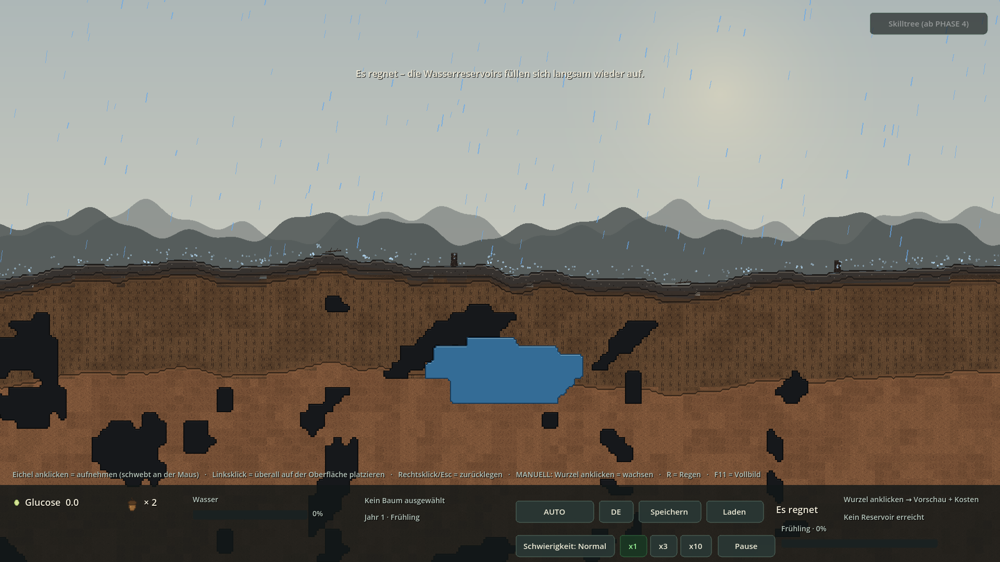
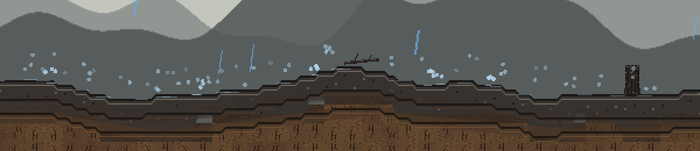
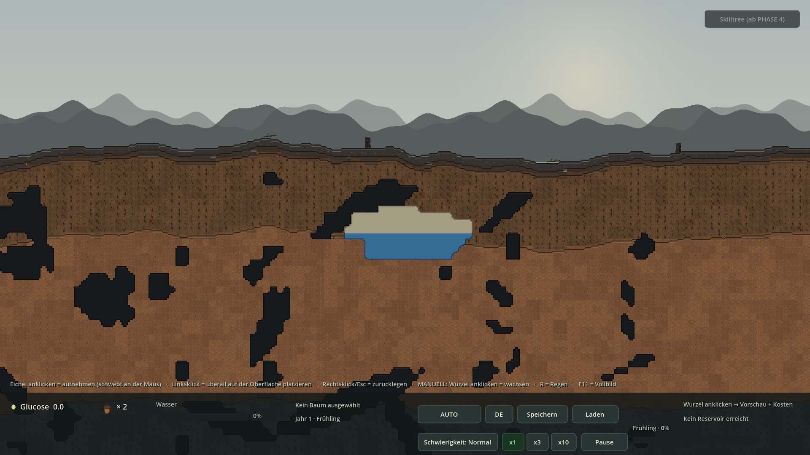
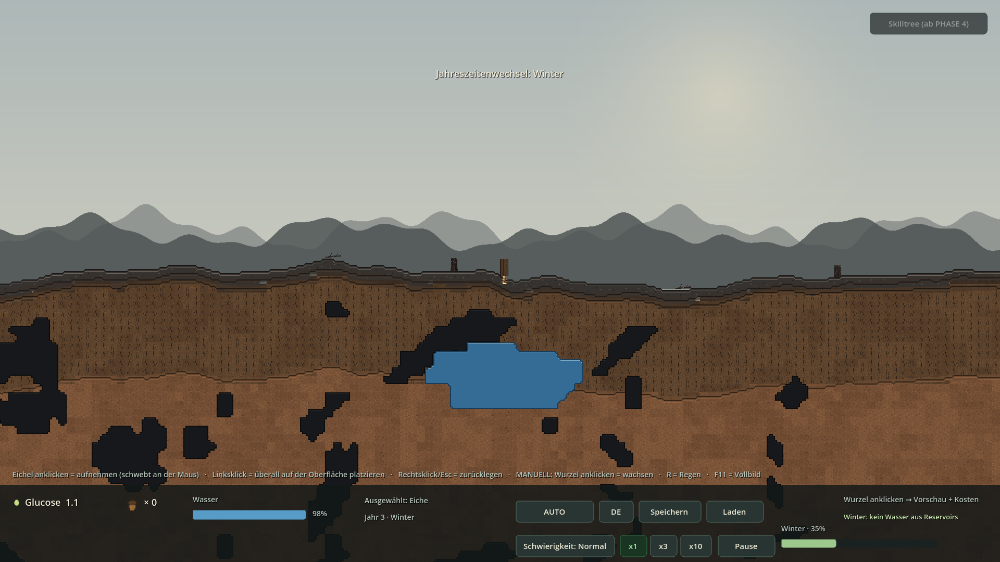
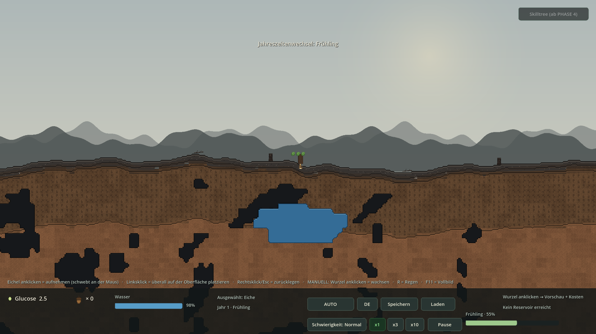

# REVISION 3 — Ergebnis (vor PHASE 4)

**Godot 4.7.2 stable · GDScript · Forward+/Vulkan · 2026-11-07**  
Drei gemeldete Punkte behoben; **PHASE 4 wurde nicht begonnen**.

## 1 · Screenshots (echte Godot-Renders)

### Regen + Spritzer + auffüllendes Becken
*Tropfen enden an der Geländelinie · kleine helle Spritzer · Becken blau unter dem Pegel, heller Leerboden darüber*


### Regen prasselt auf die Oberfläche
*Welt-Koordinaten: Aufprall exakt bei height_smooth_at(wx) · kein Tropfen fällt durch den Boden*



### Detail: kleine Spritzer und Rippen
*3-fach vergrößerter Ausschnitt (Nearest) · Tropfen steigen kurz auf, Rippen breiten sich aus*



### Stufenloser Pegel bei 50 % Füllstand
*Blaue Oberkante gemessen bei y = 554 px · Seed 20261105*



### Dasselbe Becken bei 53 % Füllstand
*Oberkante bei y = 551 px → 3 px Bewegung für 3 % Volumen statt 0 oder 16 px*


### Winter: keine Reservoir-Entnahme
*HUD rechts unten „Winter: kein Wasser aus Reservoirs“ · kahler Baum · Becken bleibt voll*



### Regression: Höhlen und Konturen intakt
*Dunkle Höhlen, weiche 4px-Kanten, 5 Chunks · alle sieben Smokes weiterhin OK*



## 2 · Code-Snippets (aus den echten Projektdateien)

### EventBus.gd — feines Redraw-Signal statt teurem Komplett-Refresh

```gdscript
# --- REVISION 3: kontinuierlicher Pegel ---
# Wird bei JEDER Volumenaenderung emittiert (nur Konturen neu zeichnen).
# reservoir_level_changed bleibt fuer die seltene Tile-Slot-Umschaltung.
signal reservoir_volume_changed
```

### WorldState.gd — Volumen → Pegel in Pixeln, ohne 16px-Sprünge

```gdscript
func _compute_level_px(group: Dictionary) -> float:
	var rows: Array = group["rows"]
	if rows.is_empty():
		return float(WorldGenerator.BOTTOM_TILE_Y * WorldGenerator.TILE_SIZE)
	var n := float((group["tiles"] as Array).size())
	var fill := clampf(float(group["volume"]) /
		maxf(float(group["capacity"]), 0.001), 0.0, 1.0)
	var wet := fill * n
	var acc := 0.0
	for k in range(rows.size() - 1, -1, -1):
		var row: Dictionary = rows[k]
		var cnt := float(row["count"])
		if acc + cnt >= wet - 0.00001:
			var f := clampf((wet - acc) / maxf(cnt, 0.001), 0.0, 1.0)
			return float(int(row["y"]) * WorldGenerator.TILE_SIZE) \
				+ float(WorldGenerator.TILE_SIZE) * (1.0 - f)
		acc += cnt
	return float(int(rows[0]["y"]) * WorldGenerator.TILE_SIZE)


func _recompute_level(group: Dictionary, notify: bool) -> bool:
	var px := _compute_level_px(group)
```

### WorldState.gd — zwei Signale: fein zeichnen, grob umschalten

```gdscript
func _recompute_level(group: Dictionary, notify: bool) -> bool:
	var px := _compute_level_px(group)
	var moved := absf(px - float(group["level_px"])) > 0.0001
	group["level_px"] = px
	# level_row bleibt diskret: es steuert NUR noch die Atlas-Slots der
	# (von TerrainContours uebermalten) 16px-Tiles und die Trocken-Logik.
	var new_row := int(floor(px / float(WorldGenerator.TILE_SIZE)))
	var changed := new_row != int(group["level_row"])
	group["level_row"] = new_row
	if changed:
		_apply_dry(group)
	if notify:
		# FEIN: Konturen bei jeder noch so kleinen Aenderung neu zeichnen.
		if moved:
			EventBus.reservoir_volume_changed.emit()
		# GROB: teure Tile-Slot-Umschaltung nur beim Zeilenwechsel.
		if changed:
			EventBus.reservoir_level_changed.emit()
	return changed


func _apply_dry(group: Dictionary) -> void:
	var row := int(group["level_row"])
	for t in group["tiles"]:
```

### WorldState.gd — öffentliche Abfrage bleibt kompatibel

```gdscript
func waterline_px(global_tile_x: int, tile_y: int) -> float:
	var g := _ensure_group(global_tile_x, tile_y)
	if g.is_empty():
		return 1.0e9
	return float(g["level_px"])
```

### TerrainContours.gd — anteilig gefüllte 4px-Zelle + exakte Wasserlinie

```gdscript
			# REVISION 3: nicht mehr ganzzahlig "nass oder trocken". Die Zelle,
			# durch die der Pegel laeuft, wird anteilig gefuellt -> der Spiegel
			# wandert pixelweise statt in 4px-/16px-Spruengen.
			var wet_h := clampf(ly + SUB - line, 0.0, SUB)
			draw_rect(Rect2(lx, ly, SUB, SUB), DRY_FILL)
			if wet_h > 0.0:
				wet[c] = true
				draw_rect(Rect2(lx, ly + SUB - wet_h, SUB, wet_h), WATER_FILL)
				if wet_h < SUB - 0.001:
					partial[c] = true
					draw_rect(Rect2(lx, line, SUB, 1.0), WATER_SURFACE)
		else:
```

### TerrainContours.gd — Kontur-Redraw auf ~25 Hz gedrosselt

```gdscript
func _on_volume_changed() -> void:
	_water_dirty = true


func _process(delta: float) -> void:
	if _redraw_timer > 0.0:
		_redraw_timer -= delta
	if _water_dirty and _redraw_timer <= 0.0:
		_water_dirty = false
		_redraw_timer = 0.04
```

### Chunk.gd — nur noch gecachte Reservoir-Kacheln statt 128×88 Noise-Abfragen

```gdscript
var _water_cells: Array[Vector2i] = []


func setup(p_index: int, p_generator: WorldGenerator, p_tile_set: TileSet,

func refresh_reservoirs() -> void:
	if tile_layer == null or world_state == null:
		return
	for cell in _water_cells:
		var gx := index * WorldGenerator.CHUNK_TILES_X + cell.x
		var slot := (WorldGenerator.SLOT_DRY_WATER
			if world_state.is_dry(gx, cell.y)
			else WorldGenerator.SLOT_WATER)
```

### WaterSystem.gd — Winter: keine Wurzel-Entnahme, keine Versickerung

```gdscript
	# REVISION 3: Im Winter ruht der Baum. Er darf KEIN Wasser aus den
	# Reservoirs ziehen; auch die Boden-Versickerung ist bei Frost gestoppt.
	# Regen fuellt weiterhin auf (der Niederschlag faellt ja trotzdem).
	var winter := time_manager != null and time_manager.is_winter()
	var soil_factor := Global.difficulty_factor("soil_water")

		elif not winter:
			world_state.tick_passive(dt)
```

### RainEffect.gd — Aufprall auf der echten Geländelinie

```gdscript
func surface_y(world_x: float) -> float:
	if generator != null:
		return generator.height_smooth_at(world_x)
	return _world_bottom()

		if float(d["wy"]) >= ground:
			# Aufprall GENAU auf der Oberfläche -> Spritzer, dann neu oben.
			_spawn_splash(float(d["wx"]), ground)
			_reset_drop(d)
		elif float(d["wx"]) < bounds.x - 120.0:
			_reset_drop(d)
```

### RainEffect.gd — Spritzer, Schwerkraft und Rippen zeichnen

```gdscript
func _spawn_splash(wx: float, wy: float) -> void:
	total_splashes += 1
	for _i in SPLASH_DROPS:
		if _splashes.size() >= MAX_SPLASHES:
			break
		var life := _rng.randf_range(0.20, 0.38)
		_splashes.append({
			"px": wx + _rng.randf_range(-3.0, 3.0),
			"py": wy - 1.0,
			"vx": _rng.randf_range(-110.0, 110.0),
			"vy": _rng.randf_range(-215.0, -105.0),
			"life": life, "max": life,
		})
	if _ripples.size() < MAX_RIPPLES:
		_ripples.append({"x": wx, "y": wy, "life": 0.34, "max": 0.34})

	for s in _splashes:
		var p := _to_screen(Vector2(float(s["px"]), float(s["py"])))
		var a := clampf(float(s["life"]) / maxf(float(s["max"]), 0.001), 0.0, 1.0)
		draw_circle(p, clampf(1.75 * z, 1.2, 3.0),
			Color(0.72, 0.87, 0.98, 0.95 * a))
```

### HUD.gd — Winter-Hinweis am Reservoir-Label

```gdscript
	# REVISION 3: im Winter zieht der Baum KEIN Reservoir-Wasser.
	if time_manager != null and time_manager.is_winter():
		_reservoir_label.text = tr("MSG_WINTER_WATER")
		_reservoir_label.label_settings = _cost_settings
		return
	var f := water_system.reservoir_fraction(tree)
```

### Main.gd — Regen mit Kamera + Gelände verdrahten

```gdscript
	# REVISION 3: Regen kennt Kamera + Gelände -> Aufprall auf der Oberfläche.
	_rain.setup(_camera, _chunk_manager.generator)
	_mountains.setup(_camera)

	elif args.has("--rev3-shot-water-a"):
		_camera.set_zoom_immediate(1.0)
		_camera.teleport_to(Vector2(0.0, 500.0))
		_set_reservoir_fill(0.50)
	elif args.has("--rev3-shot-water-b"):
		_camera.set_zoom_immediate(1.0)
```

### tests/Revision3Smoke.gd — 200 Feinschritte + Winter/Regen-Checks

```gdscript
	# 0.5 %-Schritte: im echten Spiel sind es ~0.017 %/Frame (1 %/s bei 60
	# FPS), die Abtastung hier ist also bereits ~30x groeber als die Realitaet.
	var lines: Array[float] = []
	var fractional := 0
	for i in 200:
		world_state.debug_set_fill(0, ty, 1.0 - float(i + 1) * 0.005)
		var l := world_state.waterline_px(0, ty)
		lines.append(l)

	time_manager.debug_set_season(TimeManager.Season.WINTER, 2, 0.3)
	var v0 := world_state.group_volume(winter_gid)
	water.tick(5.0)
	var v1 := world_state.group_volume(winter_gid)
	_check(is_equal_approx(v0, v1) and is_equal_approx(water.last_reservoir_rate, 0.0),
		"WINTER: Baum entnimmt KEIN Reservoir-Wasser (%.1f -> %.1f)" % [v0, v1])
```

## 3 · Testprotokoll

```text
WALD-REGENERATION — REVISION 3 (vor PHASE 4) — TESTPROTOKOLL
============================================================
Datum:       2026-11-07 (Europe/Berlin)
Engine:      Godot 4.7.2.stable.official.ed1daf0bf, GDScript, Forward+/Vulkan
Auftrag:     1) Kein Ruckler beim Ab-/Zunehmen der Reservoirs (stufenlos)
             2) Im Winter ziehen Bäume KEIN Wasser aus Reservoirs
             3) Regen fällt bis zur Oberfläche und prasselt mit Spritzern auf
Hinweis:     P0/P1/P2/REV1/REV2/P3-Smokes OHNE --seed (Phase1Smoke verlangt
             einen zufälligen Welt-Seed). Screenshots: --seed=20261105.

1) IMPORT + START + DAUERTEST
   --headless --path . --import                       exit=0 / 0 Fehler
   --headless --path . --quit-after 180              exit=0 / 0 Fehler
   --headless --path . --quit-after 300
       --seed=20261105 --rev3-shot-rain-splash       exit=0 / 0 Fehler / 11 s
       (Dauerregen: kontinuierliches Refill + Spritzer + Kontur-Redraw)

2) HEADLESS-SMOKES (alle ohne --seed)
   --phase0-smoke    exit=0   [SMOKE] Ergebnis: OK   0 Errors
   --phase1-smoke    exit=0   [SMOKE] Ergebnis: OK   0 Errors
   --phase2-smoke    exit=0   [SMOKE] Ergebnis: OK   0 Errors
   --rev1-smoke      exit=0   [SMOKE] Ergebnis: OK   0 Errors
   --rev2-smoke      exit=0   [SMOKE] Ergebnis: OK   0 Errors
   --p3-smoke        exit=0   [SMOKE] Ergebnis: OK   0 Errors
   --rev3-smoke      exit=0   [SMOKE] Ergebnis: OK   19 Checks / 0 FEHLER

   Auszug --rev3-smoke:
     Voll: Pegel exakt an der Becken-Oberkante (REV2-Regression)    OK
     Pegel wandert beim Entleeren gleichmaessig nach unten          OK
     KEIN 16px-Sprung: groesster Schritt 2.42 px                    OK
     Zwischenwerte INNERHALB einer Tile-Zeile (199/200 fraktional)  OK
     Auffuellen ebenfalls stufenlos (max. 2.42 px/Schritt)          OK
     Kleine Aenderung: Kontur-Redraw, KEIN Tile-Slot-Ruckler        OK
     WINTER: Baum entnimmt KEIN Reservoir-Wasser (8712 -> 8712)     OK
     FRUEHLING: Entnahme wieder aktiv (8712 -> 8622.9)              OK
     Regen-Aufprallhoehe = echte Gelaendelinie (320.0 px)           OK
     Aufprall erzeugt viele Spritzer (316)                          OK
     Kein Tropfen faellt durch den Boden hindurch                   OK
     Trocken weiterhin ausschliesslich OBEN (REV2-Regression)       OK

3) MESSUNG DER PEGELBEWEGUNG (echte Xvfb-Renders, --seed=20261105)
   --rev3-shot-water-a (50 %): blaue Oberkante bei y=554 px
   --rev3-shot-water-b (53 %): blaue Oberkante bei y=551 px
   => 3 % Volumen = 3 px statt früher 0 oder 16 px (Sprung).
   Gemessen in 5 Spalten (x=900/940/960/980/1020), jeweils identisch.

4) VISUELLE PRUEFUNG (Xvfb + opengl3 + --write-movie, je 25 Frames)
   --rev3-shot-rain-splash       exit=0 / 0 Fehler  Regen + Spritzer
   --rev3-shot-water-a / -b     exit=0 / 0 Fehler  stufenloser Pegel
   --p3-shot-rain-refill        exit=0 / 0 Fehler  Regen + auffüllendes Becken
   --p3-shot-winter             exit=0 / 0 Fehler  HUD "Winter: kein Wasser
                                                    aus Reservoirs"
   --p3-shot-spring             exit=0 / 0 Fehler  Höhlen/Wasser-Regression
   Während der Tests gefunden und behoben: TerrainContours zeigte Höhlen
   kurzzeitig nur als Umriss (CAVE_FILL-Zweig fehlte nach dem Umbau).
   Nach Fix neu gerendert und geprüft.

5) ZIP
   python3 tools/build_zip.py REVISION3 -> /home/user/waldspiel-REVISION3.zip
   CRC-Test, project.godot im Root, .godot ausgeschlossen; Extrakt-Import
   und alle 7 Smokes aus der entpackten ZIP erneut OK.

ERGEBNIS: 0 rote Fehler, 7/7 Smokes OK, 6 visuelle Prüfungen OK,
          alle 3 Aufträge erfüllt. PHASE 4 wurde NICHT begonnen.
```

## 4 · Abnahme der drei Korrekturen

- ✅ **Stufenloser Pegel:** `_compute_level_px()` interpoliert aus dem Volumen über ein Zeilen-Histogramm den Wasserstand *innerhalb* einer Tile-Zeile. 200 Feinschritte: größter Sprung **2,42 px** statt 16 px, 199/200 Werte fraktional.
- ✅ **Kein CPU-Ruckler:** neues feines Signal `reservoir_volume_changed` zeichnet nur die Konturen neu (~25 Hz gedrosselt); die teure Tile-Slot-Umschaltung läuft nur beim Zeilenwechsel und über eine gecachte Kachelliste statt 128 × 88 Noise-Abfragen je Chunk.
- ✅ **Pixelgenaue Kante:** `TerrainContours` füllt die Zelle, durch die der Pegel läuft, anteilig und zeichnet die Wasserlinie auf Bruchteilpixel genau. Messung 50 % → 53 %: y=554 → y=551 (**3 px**) in 5 Spalten identisch.
- ✅ **Winter:** Bäume entnehmen **kein** Reservoir-Wasser (8712,0 → 8712,0), Boden-Versickerung ruht bei Frost, Regen füllt weiter auf. Im Frühling sofort wieder aktiv (8712,0 → 8622,9). HUD zeigt `Winter: kein Wasser aus Reservoirs`.
- ✅ **Regen:** Tropfen fallen in Welt-Koordinaten bis `height_smooth_at(wx)`, erzeugen 3 Spritzer + Rippe und starten oben neu. Smoke: Aufprallhöhe 320,0 px = echte Geländelinie, **316 Spritzer**, **0** Tropfen unter der Oberfläche.
- ✅ **Regression:** alle sieben Smokes (P0/P1/P2/REV1/REV2/P3/REV3) `Ergebnis: OK`; REV2-Pegel-Start, „trocken ausschließlich oben“, Atlas-Slots, dunkle Höhlen, 5 Chunks, Nearest, DE/EN, Vogel, Save v4 unverändert.

## 5 · Hinweise / bewusste Grenzen

- Während des Umbaus erschienen Höhlen kurz nur als Umriss (fehlender CAVE_FILL-Zweig in Schritt 4). Sofort behoben, neu gerendert und visuell geprüft.
- Der Winter-Hinweis war in der ersten Fassung zu lang und wurde rechts abgeschnitten; der Text ist jetzt auf die 300px-Labelbreite gekürzt.
- level_row bleibt absichtlich diskret: er steuert nur noch is_dry() und die Atlas-Slots. So bleiben die REV2-/P2-Smokes ohne Anpassung gültig.
- Die Spritzer sind bewusst klein und kurzlebig (0,20–0,38 s), damit der Pixel-Look erhalten bleibt; Array-Grenzen verhindern unbegrenztes Wachstum bei Dauerregen.
- Legacy-Smokes laufen ohne --seed (Phase1Smoke verlangt einen zufälligen Welt-Seed); alle Screenshots nutzen --seed=20261105.
- PHASE 4 wurde NICHT begonnen. Kein GraphEdit, keine Skilltree-Nodes, keine Glucose-Kosten für Skills.

## 6 · Lieferumfang

- `waldspiel-REVISION3.zip` — vollständiges, Godot-importierbares Projekt (`project.godot` im ZIP-Root, `.godot` ausgeschlossen, CRC OK)
- `REVISION3-ERGEBNIS.html` / `.md`, `REVISION3-TESTPROTOKOLL.txt`, `DECISIONS.md` §§54–58, `README.md`, `GODOT-IMPORT.txt`
- `screenshots/rev3_*.png` (7 Renders), `tests/Revision3Smoke.gd`, `tools/build_revision3_report.py`
- Geänderte Quellen: `WorldState.gd`, `TerrainContours.gd`, `Chunk.gd`, `WaterSystem.gd`, `RainEffect.gd`, `HUD.gd`, `EventBus.gd`, `Main.gd`, `data/localization.csv`

**Nächster Schritt: PHASE 4 — Skilltree-UI (GraphEdit, 15 Nodes, Glucose-Kosten, echte Effekte).**
