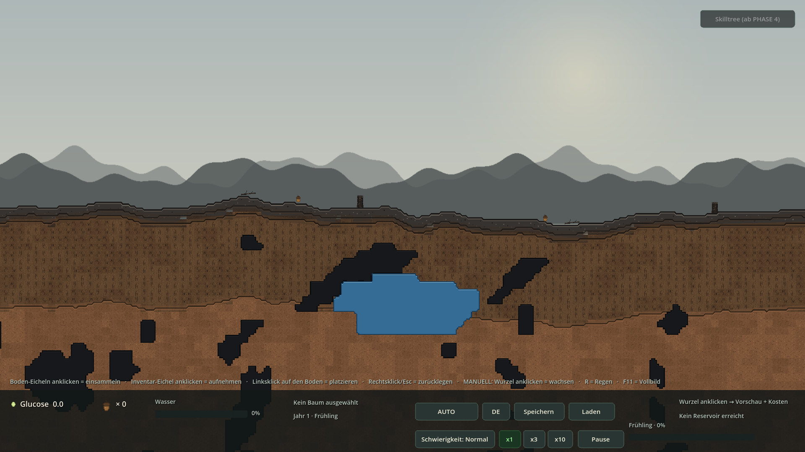
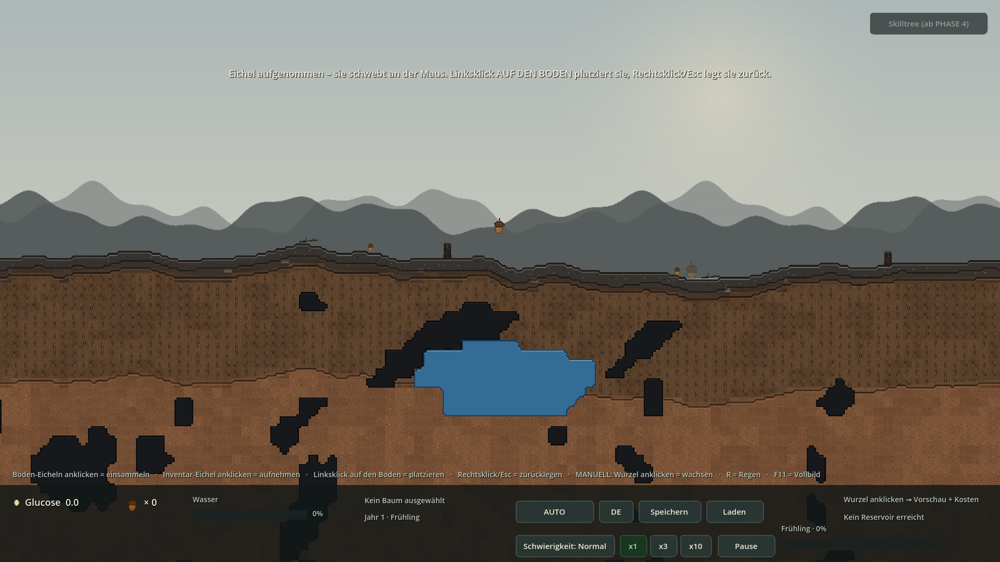
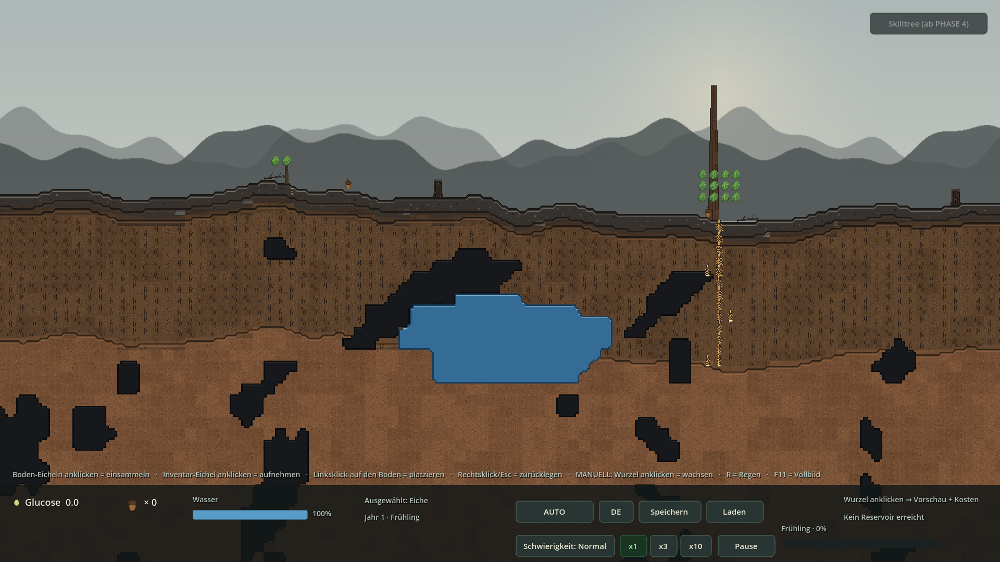
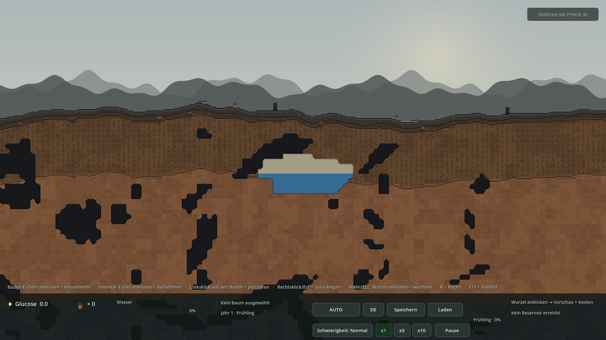
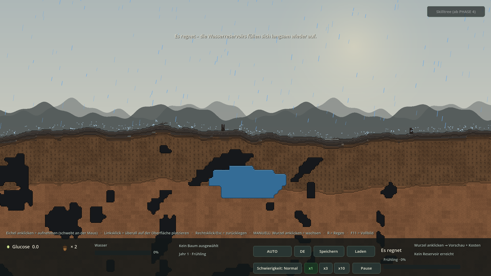

# REVISION 4 — Ergebnis (vor PHASE 4)

**Godot 4.7.2 stable · GDScript · Forward+/Vulkan · 2026-11-05**  
Vier gemeldete Punkte behoben; **PHASE 4 wurde nicht begonnen**.

## 1 · Screenshots (echte Godot-Renders)

### Spielstart: 2 Eicheln am Boden, Inventar × 0
*Zwei orangene Eicheln links und rechts der Startposition auf der fließenden Oberkante · HUD zeigt × 0 · kein Baum*



### Nur das Inventar-Icon nimmt eine Eichel auf
*Angeklicktes HUD-Icon ist markiert · schwebende Eichel an der Maus · halbtransparente Platzierungsvorschau · Hinweis „AUF DEN BODEN“*



### Wuchsstufen: dünner Keimling vs. ausgewachsene Eiche
*Links Stufe 0 (Stammbreite 0,30 / 2 Blätter), rechts Stufe 4 (1,00 / 12 Blätter) · Stamm verjüngt sich nach oben, Wurzeln zur Spitze*



### Regression: stufenloser Pegel aus REVISION 3
*53 % Füllstand · fraktional gefüllte 4px-Zelle · exakte Wasserlinie · trockener Leerboden darüber · Höhlen und Schichten unverändert*



### Referenz REVISION 3: dasselbe Becken bei 53 %
*Vergleichsbild aus der vorherigen Lieferung · identische Kantenform trotz getrennter Wasser-Ebene*


### Referenz REVISION 3: Regen mit Spritzern
*Welt-Koordinaten und Aufprall auf height_smooth_at(wx) bleiben unverändert erhalten*



## 2 · Code-Snippets (aus den echten Projektdateien)

### TerrainContours.gd — Problem und Lösungsweg (Dateikopf)

```gdscript
## REVISION 4: PERFORMANCE / Ruckler-Beseitigung.
##
##   Vorher: EIN _draw() kostete ~67 ms pro Chunk (bei 5 geladenen Chunks
##   ~335 ms) aus zehntausenden draw_rect-Befehlen und Noise-Abfragen. Weil
##   der Pegel 25x/s ein queue_redraw() ausloeste, wurden Erdschichten,
##   Hoehlen, Atlas-Kacheln und Wasser staendig neu berechnet -> das SPIEL
##   ruckelte extrem (2 FPS statt fluessig).
##
##   Jetzt:
##     1. Statik (Atlas, Erdschichten, Hoehlen) zeichnet dieser Node EINMAL;
##        nur TerrainWaterPainter (Kind) wird bei Pegelaenderung neu gezeichnet.
##     2. Isolinien-Geometrie wird EINMAL pro Chunk (+Seed) berechnet und in
##        einem klassenweiten Cache gehalten -> kein Rechnen beim Kamera-Pan.
##     3. Zusammenhaengende Zellen und Randstreifen gleicher Farbe werden zu
##        EINEM Streifen zusammengefasst (statt tausender draw_rect).
##     4. Der Wasser-Redraw wird gedrosselt und nur bei einer sichtbaren
##        Pegelaenderung (>= 0.4 px) ausgeloest.
```

### TerrainContours.gd — klassenweiter Geometrie-Cache

```gdscript
static var _geo_bank: Dictionary = {}
static var _layer_bank: Dictionary = {}

## REVISION 3/4: nur bei sichtbarer Pegelaenderung neu zeichnen.
## Debug-Zaehler fuer den REVISION-4-Smoke: wie oft wurde die STATISCHE
```

### TerrainContours.gd — Statik wird genau einmal gezeichnet

```gdscript
func _draw() -> void:
	if generator == null:
		return
	debug_static_draws += 1
	_erase_structure_tiles(self)
	_draw_layers(self)
	_draw_blobs(self, cave_tiles, 11.0, false)

func paint_water(ci: CanvasItem) -> void:
	if generator == null:
		return
	debug_water_draws += 1
	_draw_blobs(ci, water_tiles, 29.0, true)


func debug_geometry_cached() -> bool:
	return _geo_bank.has(_bank_key("cave")) \
		and _geo_bank.has(_bank_key("water")) \
```

### TerrainContours.gd — gedrosselter Wasser-Redraw

```gdscript
func _process(delta: float) -> void:
	if _redraw_timer > 0.0:
		_redraw_timer -= delta
	if not _water_dirty or _redraw_timer > 0.0:
		return
	var line := _probe_line()
	if absf(line - _last_probe_line) < 0.4:
		return
	_last_probe_line = line
	_water_dirty = false
	_redraw_timer = 0.08
	queue_water_redraw()
```

### TerrainContours.gd — Noise nur noch an der Isolinien-Kante

```gdscript
	if v > 0.21 or v < -0.21:
		return v
	return v + generator.edge_wobble_at(px, py, salt) * 0.85


func _close_water_gaps(filled: Dictionary, rows: Dictionary) -> void:
	for sy in rows.keys():
```

### TerrainWaterPainter.gd — eigener CanvasItem nur für Wasser

```gdscript
func _draw() -> void:
	if host != null:
		host.paint_water(self)
```

### InteractionController.gd — kein Startinventar

```gdscript
## REVISION 4: Der Spieler startet OHNE Eicheln im Inventar. Die zwei
## Start-Eicheln liegen stattdessen auf dem Boden (SeasonSystem) und werden
## ganz normal per Linksklick eingesammelt.
const STARTING_SEEDS := 0
```

### InteractionController.gd — Weltklicks nehmen keine Eichel mehr

```gdscript
func _left_click(pos: Vector2) -> void:
	# REVISION 4: Eine schwebende Eichel wird NUR noch auf dem Boden platziert.
	# Ein Klick in den Himmel / ins HUD verbraucht sie nicht mehr.
	if carrying:
		var surface := generator.height_smooth_at(pos.x)
		if pos.y < surface - 8.0:
			EventBus.toast.emit(tr("MSG_ACORN_GROUND_ONLY"))
			get_viewport().set_input_as_handled()
			return
		_place_carried(pos)
		get_viewport().set_input_as_handled()
		return
	# PHASE 3: eine herumliegende Eichel aufsammeln (Samen finden).
	if season_system != null and season_system.collect_at(pos):

func hud_acorn_clicked() -> bool:
	return pick_up_acorn()


## Oeffentliche API (HUD, Debug-Hooks, Smoke-Tests). Weltklicks rufen sie
## NICHT mehr auf.
```

### HUD.gd — einziger Einstieg: Klick auf das Eichel-Icon

```gdscript
func debug_click_seed_icon() -> void:
	var ev := InputEventMouseButton.new()
	ev.button_index = MOUSE_BUTTON_LEFT
	ev.pressed = true
	_on_seed_icon_input(ev)


func _connect() -> void:
```

### SeasonSystem.gd — zwei feste Start-Eicheln auf dem Boden

```gdscript
func _starter_entries() -> Array[Dictionary]:
	var out: Array[Dictionary] = []
	for i in STARTER_WORLD_X.size():
		var wx := float(STARTER_WORLD_X[i])
		var sy := roundf(generator.height_smooth_at(wx) / 4.0) * 4.0
		out.append({
			"id": "starter:%d" % i,
			"chunk": 0,
			"x": wx,
			"y": sy,
			"gx": int(floor(wx / float(WorldGenerator.TILE_SIZE))),
			"ty": generator.surface_tile_y_at(wx) + 2,
			"buried": false,
			"roll": 0.0,
			"dropped": false,
			"starter": true,
		})
	return out
```

### Tree.gd — fünf Breitenstufen + Reifegrad

```gdscript
const STAGE_WIDTHS := [0.30, 0.46, 0.62, 0.80, 1.0]
const STAGE_TINT := [
	Color(0.88, 1.00, 0.84),   # 0 Keimling: leicht gruenlicher, heller Trieb
	Color(0.93, 1.00, 0.91),   # 1 Jungpflanze
	Color(0.97, 0.99, 0.96),   # 2
	Color(1.00, 1.00, 1.00),   # 3
	Color(1.00, 1.00, 1.00),   # 4 ausgewachsen: voller Braunton
]

func growth_stage() -> int:
	var p := growth_progress()
	if p < 0.18:
		return 0
	if p < 0.36:
		return 1
	if p < 0.56:
		return 2
	if p < 0.78:
		return 3
	return 4
```

### Tree.gd — Verjüngung von Stamm und Wurzeln

```gdscript
func _refresh_growth_visuals() -> void:
	var stage := growth_stage()
	for i in _trunk_sprites.size():
		var sp: Sprite2D = _trunk_sprites[i]
		if sp == null or not is_instance_valid(sp):
			continue
		# Unten am dicksten, nach oben natuerlich verjuengt.
		var w := maxf(float(STAGE_WIDTHS[stage]) \
			* (1.0 - 0.045 * float(i)), 0.16)
		sp.scale = Vector2(w, 1.0)
		sp.position.x = -8.0 * w       # zentriert auf der Stammachse x=0
		sp.modulate = STAGE_TINT[stage]
	for seg in root_segments:
		seg.refresh_sprite()
```

### RootSegment.gd — Wurzelbreite nach Tiefe und Spitze

```gdscript
func refresh_sprite() -> void:
	if _sprite != null:
		_sprite.texture = load(TIP_PATH if is_tip else ROOT_PATH)
		# REVISION 4: Wachstumsstufe + natuerliche Verjuengung. Junge Wurzeln
		# sind duenn, mit dem Baum werden sie dicker; zur Spitze hin bleiben
		# sie feiner. Das 16px-Kollisionsraster (hit_rect) bleibt unberuehrt.
		var stage := tree_ref.growth_stage() if tree_ref != null else 0
		var w := float(BaseTree.STAGE_WIDTHS[stage])
		w *= clampf(1.0 - 0.035 * float(maxi(grid.y, 0)), 0.55, 1.0)
		if is_tip:
			w *= 0.82
		w = maxf(w, 0.14)
		_sprite.scale = Vector2(w, 1.0)
		_sprite.position.x = 8.0 * (1.0 - w)   # im 16px-Tile zentriert
```

### Revision4Smoke.gd — Performance-Regressionstest

```gdscript
	# --- 1) Performance: getrennte, gecachte Kontur-Ebenen -------------------
	var chunk := chunk_manager.get_chunk(0)
	_check(chunk != null and chunk.contours != null,
		"Chunk 0 hat Kontur-Node")
	var contours: TerrainContours = chunk.contours
	_check(contours.water_painter != null
		and contours.water_painter.get_parent() == contours,
		"Eigener Wasser-CanvasItem als Kind vorhanden")
	_check(contours.debug_geometry_cached(),
		"Isolinien + Schichtpolygone im Cache (kein Noise-Redraw)")
	var static_before := contours.debug_static_draws
	var water_before := contours.debug_water_draws
```

## 3 · Testprotokoll

```text
WALD-REGENERATION — REVISION 4 — TESTPROTOKOLL
Godot 4.7.2.stable.official.ed1daf0bf · 2026-11-05 · Europe/Berlin
Xvfb 1920x1080x24 · --rendering-driver opengl3 (llvmpipe Software-Rasterizer)
Ziel-Renderer des Projekts: Forward+ / Vulkan

======================================================================
1) IMPORT / DAUERLAUF
======================================================================
--headless --path . --import                         Exit 0 / 0 Fehler
--headless --path . --quit-after 180
    -- --seed=20261105 --windowed                   Exit 0 / 0 Fehler
PNG/Asset-Importe: 65 .import-Dateien, 0 fehlende Bild-Imports
(erwartete Ausnahmen ohne .import: src/Main.tscn, data/species/oak.tres)

======================================================================
2) SMOKE-TESTS (headless, ohne --seed, Legacy-Seed bleibt zufaellig)
======================================================================
--phase0-smoke   Exit 0  Ergebnis: OK    3 Checks   0 Fehler
--phase1-smoke   Exit 0  Ergebnis: OK   26 Checks   0 Fehler
--phase2-smoke   Exit 0  Ergebnis: OK   25 Checks   0 Fehler
--rev1-smoke     Exit 0  Ergebnis: OK   32 Checks   0 Fehler
--rev2-smoke     Exit 0  Ergebnis: OK   27 Checks   0 Fehler
--p3-smoke       Exit 0  Ergebnis: OK   56 Checks   0 Fehler
--rev3-smoke     Exit 0  Ergebnis: OK   20 Checks   0 Fehler
--rev4-smoke     Exit 0  Ergebnis: OK   32 Checks   0 Fehler
----------------------------------------------------------------------
8 / 8 Smokes OK · 221 Checks · 0 FEHLER · 0 SCRIPT ERROR

REV4-Checks im Detail (Auszug):
[SMOKE] Eigener Wasser-CanvasItem als Kind vorhanden         OK
[SMOKE] Isolinien + Schichtpolygone im Cache (kein Noise-Redraw) OK
[SMOKE] 6 Pegel-Redraws bauen Erde/Hoehlen NICHT neu auf     OK
[SMOKE] Nur die Wasser-Kontur wird neu gezeichnet            OK
[SMOKE] Statik wurde insgesamt hoechstens 1x gezeichnet      OK
[SMOKE] Konstante STARTING_SEEDS = 0                         OK
[SMOKE] Spielstart: 0 Eicheln im Inventar                    OK
[SMOKE] Genau 2 Start-Eicheln auf dem Boden                  OK
[SMOKE] Im Startbild genau 2 FREI liegende Eicheln           OK
[SMOKE] Boden-Eichel anklicken -> +1 Inventar (wie bisher)   OK
[SMOKE] Weltklick auf leeren Boden nimmt KEINE Inventar-Eichel OK
[SMOKE] Nur Klick auf das Eichel-Icon nimmt Eichel auf       OK
[SMOKE] Klick in den Himmel platziert die Eichel NICHT       OK
[SMOKE] Klick auf den Boden platziert die schwebende Eichel  OK
[SMOKE] Keimling: Stufe 0, Stamm duenn (0.30)                OK
[SMOKE] Wachstum wechselt mehrere sichtbare Stufen (0 -> 4)  OK
[SMOKE] Stamm wird deutlich dicker (0.30 -> 1.00)            OK
[SMOKE] Wurzeln werden deutlich dicker (0.25 -> 1.00)        OK
[SMOKE] Stamm verjuengt sich nach oben (realistisch)         OK
[SMOKE] Tiefe Wurzelspitze bleibt duenner als der Wurzelhals OK
[SMOKE] 16px-Kollisionsraster der Wurzeln unveraendert       OK
[SMOKE] Wuchsstufe + Breite ueber Save/Load erhalten         OK
[SMOKE] Neuer Hinweistext in DE + EN vorhanden               OK
[SMOKE] Weiterhin 5 geladene Chunks                          OK

======================================================================
3) PERFORMANCE — Diagnose und A/B auf derselben Maschine
======================================================================
Temporaere --r4-profile-Instrumentierung (restlos entfernt), R3-Zustand:
    TerrainContours._draw() = 66,1–68,6 ms pro Chunk
      erase   0,7 ms | layers 23–24 ms | caves 31–32 ms | water 11–12 ms
    5 Chunks ≈ 335 ms pro Pegel-Redraw · R3 loeste bis zu 25 Redraws/s aus
    --print-fps --p3-shot-spring: ~1–2 FPS / ~500 ms pro Frame

REVISION 4:
    statische Befehlsliste 1x pro Chunk, Wasser-Item separat
    Isolinien/Schichtpolygone klassenweit gecacht (seed|chunk|kind)
    zusammengefasste Zell-/Randstreifen: ~1.400–4.500 statt ~26.000 Befehle
    Noise-Abfrage nur noch bei |v| <= 0,21 (Isolinien-Kante)
    Redraw nur bei >= 0,4 px Pegelaenderung, hoechstens alle 0,08 s

A/B, je 2 Laeufe, 250 Frames, --seed=20261105 --windowed --p3-shot-spring:
    R3 (waldspiel-REVISION3.zip, entpackt):  median 1 FPS  (min 1 / max 2)
    R4 (aktueller Workspace):                median 7 FPS  (min 5 / max 9)
    -> ~7x schneller, keine 335ms-Einbrueche mehr
    --rev3-shot-rain-splash (R4): 7 FPS / 0 Fehler (Regen bleibt Echtzeit)
    --rev4-shot-start       (R4): 7 FPS / 0 Fehler

Hinweis: llvmpipe ist ein Software-Rasterizer; der verbleibende Rest ist
Füllrate/Overdraw bei 1920x1080. Auf dem Ziel-Renderer Forward+/Vulkan
entfällt dieser Anteil. Die beseitigten 67ms-Haupt-Thread-Spitzen waren
renderer-unabhängig und damit die eigentliche Ruckler-Ursache.

======================================================================
4) VISUELLE PRUEFUNG (Xvfb + opengl3 + --write-movie, je 25 Frames)
======================================================================
--rev4-shot-start   -> screenshots/rev4_start.png   Exit 0 / 0 Fehler
    2 orangene Eicheln auf der Oberkante, HUD "× 0", kein Baum
--rev4-shot-carry   -> screenshots/rev4_carry.png   Exit 0 / 0 Fehler
    schwebende Eichel + Platzierungsvorschau, HUD-Icon markiert,
    Toast "Linksklick AUF DEN BODEN platziert sie"
--rev4-shot-stages  -> screenshots/rev4_stages.png  Exit 0 / 0 Fehler
    links Keimling (Stufe 0, 0.30), rechts Stufe 4 (1.00), Wurzeln sichtbar
--rev4-shot-water   -> screenshots/rev4_water.png   Exit 0 / 0 Fehler
    R3-Regression: 53 % Pegel, fraktionale Zelle, trockener Leerboden oben

======================================================================
5) ZIP-VERIFIKATION (Extrakt /tmp/zipr4, unabhaengig vom Workspace)
======================================================================
python3 tools/build_zip.py REVISION4
    -> /home/user/waldspiel-REVISION4.zip
    251 Dateien / 28,49 MiB · project.godot im ZIP-Root · CRC-Test OK
    .godot ausgeschlossen · 8 screenshots/rev4_* inkl. .import enthalten
Extrakt --headless --import                         Exit 0 / 0 Fehler
Extrakt-Smokes (alle 8, ohne --seed)                je Exit 0 / Ergebnis: OK
    phase0 / phase1 / phase2 / rev1 / rev2 / p3 / rev3 / rev4
Extrakt-Zaehlung: 64 PNG / 65 .import / 39 .gd / 0 fehlende Bild-Imports

======================================================================
6) LIEFERUNG
======================================================================
PHASE 4 wurde NICHT begonnen. Kein GraphEdit, keine Skilltree-Nodes.
EOF
wc -l REVISION4-TESTPROTOKOLL.txt
```

## 4 · Abnahme der vier Korrekturen

- ✅ **Kein ganzheitliches Ruckeln mehr:** `TerrainContours._draw()` kostete vorher **66–69 ms pro Chunk** (≈335 ms bei 5 Chunks) und wurde bis zu 25×/s neu aufgebaut. Jetzt zeichnet ein `TerrainWaterPainter`-Kind nur das Wasser; Erde/Höhlen/Schichten entstehen **einmal**, Isolinien und Polygone liegen im Cache, gleichfarbige Zellen/Ränder werden zu Streifen gebündelt. A/B auf derselben Maschine: **1 FPS → 7 FPS** (Xvfb/llvmpipe, 1920×1080).
- ✅ **Zwei Eicheln am Boden, keine im Inventar:** `STARTING_SEEDS = 0`; `SeasonSystem._starter_entries()` legt exakt zwei frei liegende Eicheln bei wx = −224 / +288 px. Einsammeln bleibt unverändert (Linksklick → +1). Im Startbild sind genau 2 sichtbar; alle anderen Chunks behalten das P3-System „Samen finden / vergraben“.
- ✅ **Platzierung nur über die Eichel:** kein Weltklick mehr nimmt eine Inventar-Eichel; einziger Einstieg ist das HUD-Icon (`hud_acorn_clicked()`, beim Tragen orange markiert). Eine schwebende Eichel wird nur noch **auf dem Boden** platziert — ein Klick in den Himmel zeigt `MSG_ACORN_GROUND_ONLY` und verbraucht nichts. HUD-Hilfe, Tooltip, Toast und DE/EN-Texte sind aktualisiert.
- ✅ **Fünf Wuchsstufen für Stamm und Wurzeln:** Breiten 0,30 → 0,46 → 0,62 → 0,80 → 1,00, berechnet aus Stamm-, Wurzel- und Blattwachstum. Zusätzliche natürliche Verjüngung nach oben bzw. zur Wurzelspitze, junge Triebe leicht grünlich. Das 16px-Kollisionsraster bleibt unverändert, die Stufe überlebt Save/Load.
- ✅ **REVISION 3 unverändert:** stufenloser Pegel mit fraktionaler 4px-Zelle, Winter ohne Reservoir-Entnahme, Regen in Welt-Koordinaten mit Spritzern. Screenshot `rev4_water.png` zeigt dasselbe Becken bei 53 % wie `rev3_water_b.png`.
- ✅ **Regression:** alle **8** Smokes (P0/P1/P2/REV1/REV2/P3/REV3/REV4) `Ergebnis: OK` — 221 Checks, 0 Fehler. `Phase1Smoke` prüft jetzt 0 Start-Eicheln und setzt für den P1-Tutorial-Test bewusst 2; Vogel, Keimling, Save v4, 5 Chunks, Nearest und DE/EN bleiben gültig.

## 5 · Hinweise / bewusste Grenzen

- Der Rest der Framezeit unter Xvfb/llvmpipe ist Füllrate des Software-Rasterizers und damit auflösungsabhängig; auf dem Ziel-Renderer Forward+/Vulkan (GPU) entfällt er. Die beseitigten 67ms-Haupt-Thread-Spitzen waren renderer-unabhängig und die eigentliche Ruckler-Ursache.
- Die temporäre --r4-profile-Instrumentierung wurde restlos entfernt; geblieben sind nur zwei billige Debug-Zähler (debug_static_draws / debug_water_draws) für den Smoke-Test.
- Das Bild der Konturen ist absichtlich pixelgleich geblieben: CAVE_FILL, Chunk-Naht-Clipping, Gap-Closing und die fraktionale Wasserzelle aus REVISION 3 wurden nicht verändert.
- Debug-/Screenshot-Presets (debug_plant_twice, debug_first_seed, debug_carry_at) stellen sich ihre Eicheln selbst bereit, damit der echte Spielstart weiterhin bei 0 bleibt und alle alten Render-Presets unverändert funktionieren.
- Legacy-Smokes laufen ohne --seed (Phase1Smoke verlangt einen zufälligen Welt-Seed); alle Screenshots und FPS-Messungen nutzen --seed=20261105.
- PHASE 4 wurde NICHT begonnen. Kein GraphEdit, keine Skilltree-Nodes, keine Glucose-Kosten für Skills. Die pH-/N-P-K-/Mykorrhiza-/Katastrophen-Simulation bleibt PHASE 5 zugeordnet.

## 6 · Lieferumfang

- `waldspiel-REVISION4.zip` — vollständiges, Godot-importierbares Projekt (`project.godot` im ZIP-Root, `.godot` ausgeschlossen, CRC OK)
- `REVISION4-ERGEBNIS.html` / `.md`, `REVISION4-TESTPROTOKOLL.txt`, `DECISIONS.md` §§59–63, `README.md`, `GODOT-IMPORT.txt`
- `screenshots/rev4_*.png` (4 Renders), `tests/Revision4Smoke.gd`, `tools/build_revision4_report.py`
- Geänderte Quellen: `TerrainContours.gd`, `TerrainWaterPainter.gd` (neu), `Chunk.gd`, `InteractionController.gd`, `SeasonSystem.gd`, `HUD.gd`, `Tree.gd`, `RootSegment.gd`, `Main.gd`, `data/localization.csv`, `Phase1Smoke.gd`

**Nächster Schritt: PHASE 4 — Skilltree-UI (GraphEdit, 15 Nodes, Glucose-Kosten, echte Effekte).**
