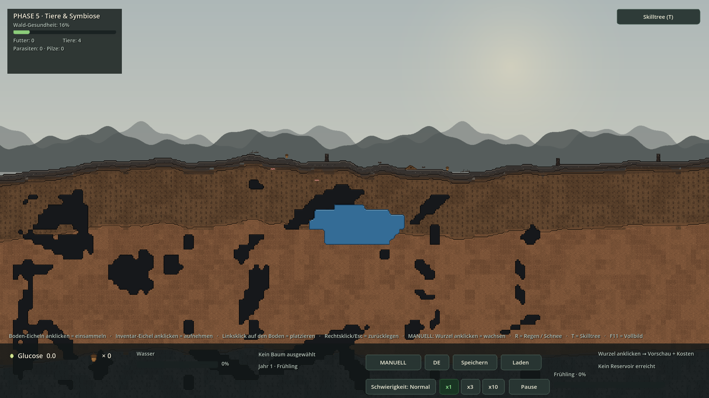
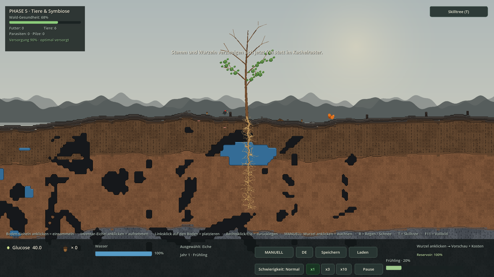
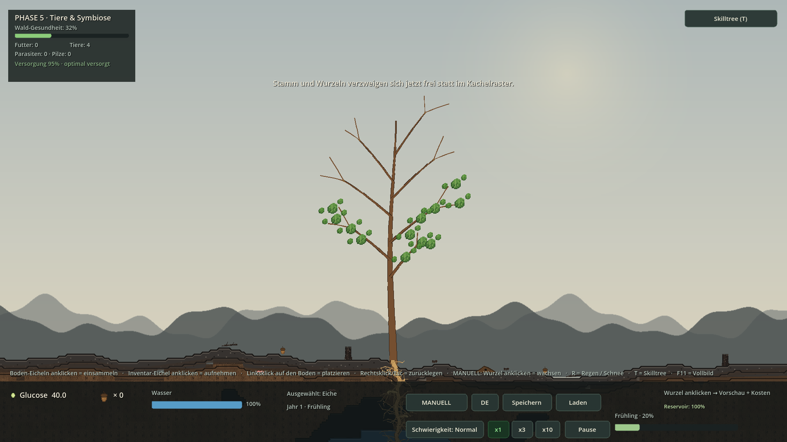
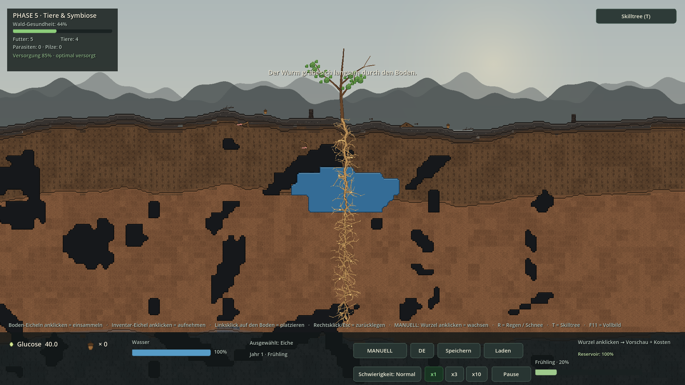
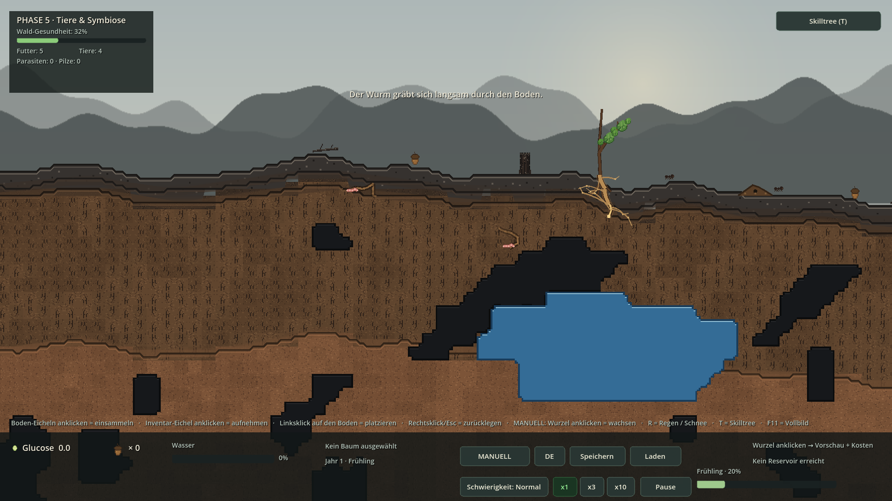
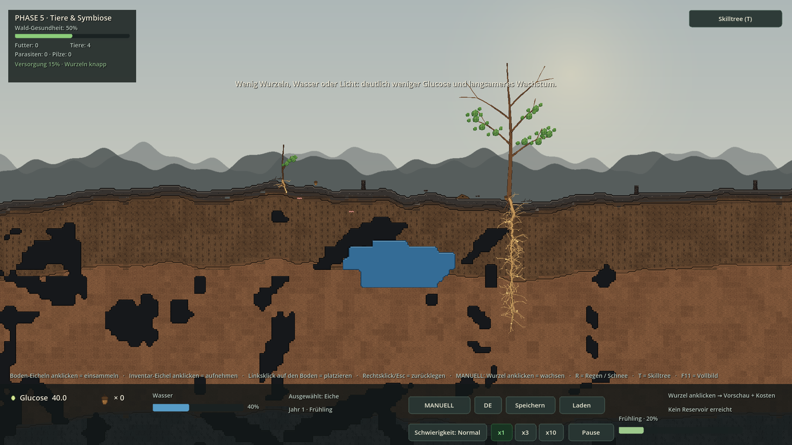

# REVISION 5 — Organisches Wachstum & Bodenleben

**Godot 4.7.2 stable · GDScript · Forward+/Vulkan · 2026-11-05**

Würmer graben unter der Erde · Würmer/Ameisen deutlich kleiner · Bäume ~5× langsamer und ~3× größer · Glucose hängt an Wasser, Sonne, Nährstoffen und Wurzelmasse · Stamm und Wurzeln verzweigen sich frei statt im Kachelraster. **11/11 Smokes · 377 OK-Zeilen · 0 Fehler.**

## 1 · Screenshots (echte Godot-Renders)

### F5-Start — REVISION 5 lauffähig
*Ohne Preset · AUTO aus (MANUELL) · Ökologie-Panel mit neuer Versorgungs-Zeile · kleine Bodenfauna*



### Ausgewachsene Eiche: ~476px statt 192px
*28 freie Wuchsschritte · geschwungener Stamm · 7 Hauptäste mit Zwigen · Krone aus Astspitzen*



### Stamm verzweigt sich, ohne Kachelraster
*Nahaufnahme: asymmetrische Kurven, Verjüngung nach oben, Blätter an freien Astspitzen*



### Mycelarium-artiges Wurzelnetz
*Goldene Hauptfaser mit 3–5 feinen Hyphen pro Segment, Gabeln und Seitenfächern; logisches 16px-Raster nur noch für Wasser/Klick*



### Würmer graben sich unter der Erde langsam durch
*Zwei deutlich kleinere Regenwürmer mit aufgelockerten Gang-Spuren · Ameisen nur noch 9px · Specht unverändert*



### Versorgungs-Bilanz steuert Glucose und Wuchs
*Links ein schlecht versorgter Keimling (wenig Wurzeln/Wasser), rechts ein gut versorgter Baum; HUD zeigt den knappsten Faktor*



---

## 2 · Code-Snippets (aus den echten Projektdateien)

### Tree.gd — neue Wachstums-/Glucose-Konstanten

```gdscript
const MAX_LEAVES := 12
const MAX_ROOTS := 72          # REVISION 5: deutlich tieferes Myzel-Netz
const MAX_TRUNK := 28          # REVISION 5: 28 Schritte statt 12
const INVALID_TILE := Vector2i(-9999, -9999)

## REVISION 5: EIN Wuchsschritt ist 17 px freie Geometrie statt eines 16px-Felds.
## Ausgewachsen: 28 * 17 = 476 px Stammhoehe (vorher 12 * 16 = 192 px).
const TRUNK_STEP := 17.0
const BRANCH_EVERY := 4
## REVISION 5: Grundtempo der Glucose-Produktion. 0.2 = ca. 5x langsamer als
## der PHASE-5-Stand. Zusaetzlich drosselt environment_factor() schlecht
## versorgte Baeume (vor allem mit winziger Wurzel) weiter.
```

### Tree.gd — multiplikative Versorgungs-Bilanz

```gdscript
func soil_fertility() -> float:
	if world_generator == null or root_segments.is_empty():
		return 1.0
	var sum := 0.0
	for s in root_segments:
		var gt: Vector2i = s.global_tile()
		sum += fertility_of(world_generator.material_at(gt.x, gt.y))
	return clampf(sum / float(root_segments.size()), 0.25, 1.25)


func environment_parts(p_sunlight: float = -1.0) -> Dictionary:
	var sun := p_sunlight if p_sunlight >= 0.0 else last_sunlight

func environment_parts(p_sunlight: float = -1.0) -> Dictionary:
	var sun := p_sunlight if p_sunlight >= 0.0 else last_sunlight
	var w := clampf((water - 8.0) / 72.0, 0.0, 1.0)
	var s := clampf(sun, 0.0, 1.25)
	var n := clampf(soil_fertility() * nutrient_mult, 0.15, 1.35)
	# Quadratische Wurzelkurve: 1 Wurzel = 0.24, 18 Wurzeln = 1.0.
	var r := clampf(sqrt(float(maxi(root_count, 1)) / 18.0), 0.12, 1.0)
	return {
		"water": w, "sun": s, "nutrients": n, "roots": r,
		"total": clampf(w * s * n * r, 0.0, 1.30),
	}


func environment_factor(p_sunlight: float = -1.0) -> float:
```

### Tree.gd — langsamere, versorgungsabhängige Fotosynthese

```gdscript
func photosynthesize(dt: float, sunlight: float = 1.0,
		growth: float = 1.0) -> void:
	if not _built or leaves_count <= 0 or water <= 10.0:
		return
	age += dt
	last_sunlight = sunlight
	# Winter: sunlight = 0 und growth = 0 -> Winterruhe (nichts passiert).
	if sunlight <= 0.0 or growth <= 0.0:
		return
	glucose += float(leaves_count) * species.photosynthesis_efficiency \
		* growth * Global.difficulty_factor("photosynthesis") \
		* skill_glucose_mult * GLUCOSE_PACE \
		* environment_factor(sunlight) * dt
	water = maxf(water - species.water_consumption_rate \
		* Global.difficulty_factor("water_consumption") \
		* skill_water_consumption_mult * dt, 0.0)
```

### Tree.gd — freies, deterministisches Ast-Skelett

```gdscript
func _rebuild_skeleton() -> void:
	_skel_trunk.clear()
	_skel_branches.clear()
	_skel_anchors.clear()
	var h := float(trunk_tiles) * TRUNK_STEP
	var stage := growth_stage()
	var n := maxi(trunk_tiles, 2)
	var phase := _h(0, 0, 1) * TAU
	var amp := 2.0 + 1.5 * float(stage)
	for i in range(n + 1):
		var t := float(i) / float(n)
		# Basis bleibt exakt bei x=0, die Krone schwingt leicht aus.
		var x := (sin(t * 5.0 + phase) - sin(phase)) * amp * (0.35 + 0.65 * t)
		_skel_trunk.append(Vector2(x, -h * t))
	var count := clampi(int(trunk_tiles / BRANCH_EVERY), 0, 7)
	for k in range(count):
		var frac := minf(0.34 + 0.085 * float(k), 0.92)
		var idx := clampi(int(roundf(frac * float(n))), 1, n - 1)
		var origin: Vector2 = _skel_trunk[idx]
		var side := 1 if k % 2 == 0 else -1
		var j := _h(k, 11, 2)
		var ang := deg_to_rad(36.0 + 26.0 * j)
		var blen := (30.0 + 13.0 * float(stage) + 6.0 * float(k)) \
			* (0.8 + 0.4 * j)
		var dir := Vector2(float(side) * sin(ang), -cos(ang))
		var bend := origin + dir * blen + Vector2(float(side) * 3.0, -7.0)
		var mid := origin.lerp(bend, 0.55) + Vector2(0.0, -5.0 - 3.0 * j)
		var twigs: Array[Vector2] = []
		for m in range(2):
			var j2 := _h(k, 20 + m, 3)
```

### Tree.gd — Stamm und Äste als Kurven gezeichnet

```gdscript
func _draw() -> void:
	if trunk_tiles <= 0 or _skel_trunk.is_empty():
		return
	var stage := growth_stage()
	var bark := Color(0.34, 0.23, 0.15).lerp(
		Color(0.46, 0.31, 0.19), float(stage) / 4.0)
	var dark := Color(0.19, 0.13, 0.09)
	# Wurzelhals: kurze freie Strahlen vom Stamm in den Boden.
	for r in range(5):
		var j := _h(r, 30, 5)
		var e := Vector2((float(r) - 2.0) * 7.0 + (j - 0.5) * 6.0,
			9.0 + 12.0 * j + 2.0 * float(stage))
		draw_line(Vector2.ZERO, e, dark, 2.4)
		draw_line(Vector2.ZERO, e, bark, 1.2)
	# Stamm: leicht geschwungene, nach oben verjuengte Freiform-Kurve.
	var segs := maxi(_skel_trunk.size() - 1, 1)
	for i in range(_skel_trunk.size() - 1):
		var t := float(i) / float(segs)
		var w := lerpf(3.0 + 2.8 * float(stage), 1.0, t)
		draw_line(_skel_trunk[i], _skel_trunk[i + 1], dark, w + 1.4)
		draw_line(_skel_trunk[i], _skel_trunk[i + 1], bark, w)
	# Aeste mit zwei weiteren Verzweigungen pro Ast.
	for k in _skel_branches.size():
		var bd := _skel_branches[k]
		var o: Vector2 = bd["origin"]
		var m: Vector2 = bd["mid"]
		var e: Vector2 = bd["end"]
		var bw := maxf(1.2, 3.4 - 0.30 * float(k) + 0.35 * float(stage))
		var pts := _curve(o, m, e, 7)
		for i in range(pts.size() - 1):
```

### RootSegment.gd — Mycelium-Faser mit Hyphen und Gabeln

```gdscript
func _draw() -> void:
	if tree_ref == null:
		return
	var tile := float(WorldGenerator.TILE_SIZE)
	var centre := Vector2(tile * 0.5, tile * 0.5)
	var start := Vector2.ZERO
	var end := centre + _jitter() * 0.55
	if parent_segment != null:
		var delta := Vector2(
			float((parent_segment.grid.x - grid.x) * int(tile)),
			float((parent_segment.grid.y - grid.y) * int(tile)))
		start = centre + delta + parent_segment._jitter() * 0.55
	else:
		# Erste Wurzel beginnt direkt am Wurzelhals des Stamms.
		start = Vector2(0.0, -8.0) + _jitter() * 0.25
	var ctrl := (start + end) * 0.5 \
		+ Vector2((_r(5) - 0.5) * 13.0, (_r(6) - 0.5) * 11.0)
	var stage := tree_ref.growth_stage()
	var depth_fade := clampf(1.0 - 0.030 * float(maxi(grid.y, 0)), 0.30, 1.0)
	# REVISION 5: kraeftige Hauptfaser mit hellem, aufgelockertem Erd-Hof.
	var width := (2.6 + 5.2 * float(BaseTree.STAGE_WIDTHS[stage])) * depth_fade
	if is_tip:
		width *= 0.60
	width = maxf(width, 1.4)
	var halo := Color(0.60, 0.45, 0.27, 0.30)
	var dark := Color(0.21, 0.13, 0.08)
	var fibre := Color(0.72, 0.55, 0.33).lerp(
		Color(0.86, 0.70, 0.43), 0.45 * float(stage) / 4.0)
	if is_tip:
		fibre = Color(0.90, 0.76, 0.48)
	var pts := PackedVector2Array()
	for i in range(7):
		pts.append(_quad(start, ctrl, end, float(i) / 6.0))
	draw_polyline(pts, halo, width + 4.0)
	draw_polyline(pts, dark, width + 1.8)
	draw_polyline(pts, fibre, width)
	# Mycelarium-Netz: 3-4 feine, schraeg abzweigende Hyphen pro Segment,
	# jede mit einer eigenen kleinen Gabel. Keine 8 Rasterrichtungen mehr.
	var shallow := grid.y < 2
	var hyphae := 2 if shallow else 4
	if grid.x != 0:
		hyphae += 1
	for j in range(hyphae):
		var ang := (_r(10 + j) * 2.0 - 1.0) * PI
```

### RootSegment.gd — logische 16px-Hitbox bleibt erhalten

```gdscript
func hit_rect() -> Rect2:
	return Rect2(world_pos(), Vector2(float(WorldGenerator.TILE_SIZE),
		float(WorldGenerator.TILE_SIZE)))
```

### Animal.gd — Würmer klein, langsam, 20–120px tief

```gdscript
const WORM_DEPTH_MIN := 20.0
const WORM_DEPTH_MAX := 120.0
const WORM_BURROW_SPEED := 7.0
const BODY_SPAN := {
	"worm": 12.0,
	"ant": 9.0,
	"woodpecker": 40.0,
	"squirrel": 40.0,
}

var species: String = "worm"
var state: int = State.IDLE
```

### Animal.gd — langsames Graben mit Gang-Spur

```gdscript
func _tick_burrow(dt: float) -> void:
	burrow_depth = move_toward(burrow_depth, burrow_target,
		WORM_BURROW_SPEED * 0.5 * dt)
	surface_y = generator.height_smooth_at(position.x)
	base_y = surface_y + burrow_depth
	position.y = base_y + sin(phase * 2.2) * 1.0
	_trail_timer += dt
	if _trail_timer >= 0.30:
		_trail_timer = 0.0
		_trail.append(global_position)
		if _trail.size() > 30:
			_trail.remove_at(0)


func _move_toward(target: float, step: float) -> void:
	var dist := absf(target - position.x)
```

### Animal.gd — Fels/Stein/Wasser sind undurchlässig

```gdscript
func _worm_blocked(next_x: float) -> bool:
	var tile_depth := int(clampf(burrow_depth / 16.0, 1.0, 7.0))
	var gx := int(floor(next_x / float(WorldGenerator.TILE_SIZE)))
	var gy := generator.surface_tile_y_at(next_x) + tile_depth
	var k := generator.material_at(gx, gy)
	return k == WorldGenerator.SoilKind.AIR \
		or k == WorldGenerator.SoilKind.WATER \
		or k == WorldGenerator.SoilKind.CAVE \
		or k == WorldGenerator.SoilKind.ROCK \
		or k == WorldGenerator.SoilKind.STONE
```

### Animal.gd — Wurm klein, Tunnel sichtbar

```gdscript
func _draw_worm(f: float, w: float) -> void:
	# 1) Gang-Spur: dunkler Tunnel mit hellerer, aufgelockerter Erdmitte.
	if _trail.size() >= 2:
		var n := maxi(_trail.size() - 1, 1)
		for i in range(_trail.size() - 1):
			var a := to_local(_trail[i])
			var b := to_local(_trail[i + 1])
			var fade := 0.45 + 0.45 * float(i) / float(n)
			# Aufgelockerte Erde: dunkler Gang + helle Krumen-Mitte.
			draw_line(a, b, Color(0.15, 0.10, 0.06, fade), 5.4)
			draw_line(a, b, Color(0.66, 0.48, 0.29, fade), 2.1)
			if i % 3 == 0:
				draw_circle(a, 1.3, Color(0.58, 0.42, 0.26, fade))
	# 2) Koerper: ~12 px statt der alten 28 px.
	var pts := PackedVector2Array([
		Vector2(-6.0 * f, -2.0),
		Vector2(-3.0 * f, -2.8 + w * 0.45),
		Vector2(0.0, -2.0),
		Vector2(3.0 * f, -2.8 - w * 0.45),
		Vector2(6.0 * f, -2.0),
	])
	draw_polyline(pts, Color(0.42, 0.24, 0.21, 1.0), 4.0)
	draw_polyline(pts, Color(0.88, 0.52, 0.47, 1.0), 2.6)
	for p in pts:
		draw_circle(p, 1.0, Color(0.96, 0.72, 0.67, 1.0))
	# 3) Aufgewuehlte Krumen vor der Grabespitze.
	for i in range(3):
		var j := float(i)
		draw_circle(Vector2((7.0 + j * 2.4) * f,
			-1.0 - j * 1.2 + sin(phase * 3.0 + j) * 0.8),
```

### GrowthSystem.gd — Wuchskraft statt Sofort-Kauf

```gdscript
		# REVISION 5: Wuchskraft sammelt sich NUR so schnell an, wie der Baum
		# versorgt ist. Bei einer winzigen Wurzel / wenig Wasser / wenig Licht
		# dauert jeder naechste Kauf deutlich laenger als frueher. Der Startwert
		# ist bereits voll, damit ein Kauf mit ausreichend Glucose sofort
		# moeglich bleibt (P0/P1-Smoke-Kompatibilitaet).
		var env := clampf(tree.environment_factor(sun), 0.0, 1.0)
		tree.growth_vigor += dt * maxf(env, 0.05)
		if tree.growth_vigor < BaseTree.AUTO_GROWTH_INTERVAL:
			continue
		# Prioritaet: Wurzeln bei Durst, sonst Blaetter (Stamm als Fallback).
```

### WildlifeSystem.gd — Wurmtiefe im Save v6

```gdscript
			aa.append({"species": a.species, "x": a.position.x,
				"home_x": a.home_x, "depth": a.burrow_depth})
	var hh: Array = []
	for h in anthills:

		a.reseat(x, float(e.get("depth", -1.0)))
		a.home_x = hx
		a.position.x = x
	for e in d.get("anthills", []):
		_spawn_anthill(float(e.get("x", 180.0)), int(e.get("colony", 1)))
```

### HUD.gd — Versorgung mit knappstem Faktor

```gdscript
	# REVISION 5: echte Versorgungs-Bilanz (Wasser/Sonne/Naehrstoffe/Wurzeln)
	# plus der jeweils knappste Faktor. Kein erfundener Wert: alles kommt aus
	# BaseTree.environment_parts().
	var tree: BaseTree = null
	if interaction != null:
		tree = interaction.selected_tree
	if tree == null:
		_p5_supply.text = ""
	else:
		var parts := tree.environment_parts()
		var total := int(roundf(clampf(float(parts["total"]), 0.0, 1.0) * 100.0))
		var worst := 2.0
		var limit := "SUPPLY_LIMIT_OK"
		var pairs := [["water", "SUPPLY_LIMIT_WATER"],
			["sun", "SUPPLY_LIMIT_SUN"],
			["nutrients", "SUPPLY_LIMIT_NUTRIENTS"],
			["roots", "SUPPLY_LIMIT_ROOTS"]]
		for pair in pairs:
			var v := float(parts[String(pair[0])])
			if v < worst:
				worst = v
				limit = String(pair[1])
		if worst >= 0.85:
			limit = "SUPPLY_LIMIT_OK"
		_p5_supply.text = tr("HUD_SUPPLY") % [total, tr(limit)]
```

### Main.gd — sechs reproduzierbare Screenshot-Zustände

```gdscript
	# --- REVISION 5: organisches Wachstum + Bodenleben ------------------------
	if args.has("--rev5-shot-f5"):
		_p5_freeze()
		_camera.set_zoom_immediate(0.85)
		_camera.teleport_to(Vector2(0.0, 430.0))
		_hud.refresh()
	elif args.has("--rev5-shot-mature"):
		_p5_reset_world()
		_camera.set_zoom_immediate(0.72)
		_camera.teleport_to(Vector2(0.0, 430.0))
		var mt := _rev5_grow_tree(0.0, 28, 30, 12)
		_interaction.select_tree(mt)
		_forest_health.recompute()
		_hud.refresh()
		EventBus.toast.emit(tr("MSG_ORGANIC_GROWTH"))
	elif args.has("--rev5-shot-branches"):
		_p5_reset_world()
		_camera.set_zoom_immediate(1.25)
		_camera.teleport_to(Vector2(0.0, 40.0))
		var bt := _rev5_grow_tree(0.0, 28, 20, 12)
```

### Revision5Smoke.gd — Abnahme der neuen Regeln

```gdscript
	# --- 4) Glucose: Grundtempo + echte Versorgungs-Bilanz -----------------
	_check(is_equal_approx(BaseTree.GLUCOSE_PACE, 0.2),
		"Glucose-Grundtempo 0.2 = ca. 5x langsamer")
	var young: BaseTree = interaction.spawn_tree_at(Vector2(420.0, 0.0), {})
	young.water = 100.0
	young.glucose = 0.0
	young.photosynthesize(1.0, 1.0, 1.0)
	var g_young := young.glucose
	var young_parts := young.environment_parts(1.0)
	_check(float(young_parts["roots"]) < 0.30,
		"Winzige Wurzel: Wurzel-Faktor nur %.2f" % float(young_parts["roots"]))
	mature.water = 100.0
	mature.glucose = 0.0
	mature.photosynthesize(1.0, 1.0, 1.0)
	var g_mature := mature.glucose
	_check(g_young > 0.0 and g_mature > g_young * 3.0,
		"Gut versorgter Baum: %.2f statt %.2f Glucose/s (>3x)"
			% [g_mature, g_young])
	var base_env := mature.environment_factor(1.0)
	mature.water = 20.0
	var dry_env := mature.environment_factor(1.0)
	_check(dry_env < base_env * 0.5,
		"Wenig Wasser senkt die Versorgung um >50 %")
	mature.water = 100.0
```

---

## 3 · Testprotokoll

```text
WALD-REGENERATION — REVISION 5 — TESTPROTOKOLL
======================================================================
Godot 4.7.2.stable.official.ed1daf0bf · Headless + Xvfb · 2026-11-05
Arbeitsstand: /home/user/waldspiel (Basis: GitHub fba40c4 / PHASE 5)

0) AUSGANGSLAGE
----------------------------------------------------------------------
Nach einem erneuten Snapshot-Verlust fehlten .git, P4/P5-Quelldateien,
die Godot-Binary und die Liefer-ZIPs. Der vollstaendige PHASE-5-Stand
wurde aus dem Remote-Klon (Commit fba40c4) wiederhergestellt; die ZIP
hatte danach wieder SHA-256 762a5a2e...b1f6c6aeac6618d3a6ef7b0a.
Godot 4.7.2 stable und Xvfb wurden frisch installiert.

1) IMPORT
----------------------------------------------------------------------
$ Godot_v4.7.2-stable_linux.x86_64 --headless --path . --import
  Exit 0 · 0 SCRIPT ERROR · 0 Parse Error
  data/localization.csv -> .de/.en.translation neu erzeugt
  tests/Revision5Smoke.gd.uid erzeugt
  screenshots/rev5_*.png.import erzeugt

2) HEADLESS-SMOKES (11/11)
----------------------------------------------------------------------
$ timeout 240 $G --headless --path . -- --<task>-smoke

  phase0-smoke   3 OK-Zeilen   Exit 0   Ergebnis: OK
  phase1-smoke  26 OK-Zeilen   Exit 0   Ergebnis: OK
  phase2-smoke  25 OK-Zeilen   Exit 0   Ergebnis: OK
  rev1-smoke    32 OK-Zeilen   Exit 0   Ergebnis: OK
  rev2-smoke    27 OK-Zeilen   Exit 0   Ergebnis: OK
  p3-smoke      56 OK-Zeilen   Exit 0   Ergebnis: OK
  rev3-smoke    20 OK-Zeilen   Exit 0   Ergebnis: OK
  rev4-smoke    32 OK-Zeilen   Exit 0   Ergebnis: OK
  phase4-smoke  63 OK-Zeilen   Exit 0   Ergebnis: OK
  phase5-smoke  58 OK-Zeilen   Exit 0   Ergebnis: OK
  rev5-smoke    35 OK-Zeilen   Exit 0   Ergebnis: OK
  ----------------------------------------------------------
  GESAMT        377 OK-Zeilen · 0 FEHLER · 0 SCRIPT ERROR

  rev5-smoke prueft u.a.:
    - 2 Wuermer unter der Erdoberflaeche, Grabtiefe 20..120 px
    - langsame Tiefenaenderung + >=3 Gang-Spur-Punkte
    - Wurm 12 px / Ameise 9 px, kleine Klickflaechen
    - 28 Wuchsschritte, Stamm >=470 px, >=5 Aeste, Kronen-Spread >=60 px
    - Freiform-Faser statt Kachelsprite, Jitter >0.5 px, Hitbox 16x16
    - GLUCOSE_PACE 0.2, Wurzel-Faktor <0.30 bei einer Wurzel
    - gut versorgter Baum >3x mehr Glucose, Trockenheit -50 %,
      Sonne 0 = 0 Versorgung, mehr Naehrstoffe = mehr Versorgung
    - AUTO-Wuchskraft, HUD "Versorgung", 9 neue DE/EN-Schluessel
    - Save v6 mit Wurmtiefe, AUTO standardmaessig aus

3) F5 / DAUERLAUF
----------------------------------------------------------------------
$ timeout 240 $G --headless --path . --quit-after 180 -- \
      --seed=20261105 --windowed
  Exit 0 · 0 Fehler
  "[Main] PHASE 5 bereit: 0 Eicheln, 4 Tiere, Gesundheit 16%, AUTO aus
   (MANUELL)."

4) XVFB-RENDERS (6 x 1920x1080)
----------------------------------------------------------------------
$ xvfb-run -a -s "-screen 0 1920x1080x24" $G --path . \
      --rendering-driver opengl3 --resolution 1920x1080 \
      --fixed-fps 10 --write-movie <frames>/f.png --quit-after 25 \
      -- --seed=20261105 --windowed --rev5-shot-<preset>

  rev5-shot-f5        25 Frames   Exit 0   0 Fehler
  rev5-shot-mature    25 Frames   Exit 0   0 Fehler
  rev5-shot-branches  25 Frames   Exit 0   0 Fehler
  rev5-shot-roots     25 Frames   Exit 0   0 Fehler
  rev5-shot-worms     25 Frames   Exit 0   0 Fehler
  rev5-shot-supply    25 Frames   Exit 0   0 Fehler

  Jeweils das letzte Frame (f00000024.png) als screenshots/rev5_*.png
  uebernommen und visuell geprueft: grosse verzweigte Eiche, goldenes
  Mycelium-Wurzelnetz, kleine Würmer mit Gang-Spuren unter der Erde,
  kleine Ameisen, HUD-Versorgungszeile.

5) REGRESSION / BEWUSSTE ERHALTUNG
----------------------------------------------------------------------
  - AUTO standardmaessig aus (P4-Fix), voller Baum verbraucht 0 Glucose
  - Winter: keine Fotosynthese, kein Wachstum (P3/R3)
  - 5 Chunks, Nearest, Forward+, content_scale_factor 1.0
  - 15 Skilltree-Knoten, Save v6 (v5..v1 lesbar), 180 CSV-Zeilen
  - P0-P5/REV-Berichte, Screenshots und alle alten ZIPs unverändert
    im Projekt erhalten; PHASE-5-Berichte als vorheriger Stand markiert

6) LIEFERDATEI / FRISCHER EXTRAKT
----------------------------------------------------------------------
$ python3 tools/build_zip.py REVISION5
  deliverables/waldspiel-REVISION5.zip · 331 Dateien · 41,40 MiB
  project.godot im ZIP-Root: OK · CRC-Test: OK
  .godot/ ausgeschlossen · .git/ ausgeschlossen · keine Nested-ZIPs

$ unzip -q deliverables/waldspiel-REVISION5.zip -d /tmp/r5zip
  331 Dateien · 51 MiB entpackt · project.godot liegt im Root

$ $G --headless --path /tmp/r5zip --import
  Exit 0 · 0 Fehler (UEbersetzungen und .uid neu erzeugt)

  11/11 Smokes aus dem FRISCHEN EXTRAKT:
    phase0 3 / phase1 26 / phase2 25 / rev1 32 / rev2 27 / p3 56
    rev3 20 / rev4 32 / phase4 63 / phase5 58 / rev5 35
    => je Exit 0 · Ergebnis: OK · 377 OK-Zeilen · 0 Fehler
  Identisch zum Arbeitsbaum (keine versteckte .godot-Abhaengigkeit).

$ $G --headless --path /tmp/r5zip --quit-after 180 -- \
      --seed=20261105 --windowed
  Exit 0 · 0 Fehler

  REVISION5-ERGEBNIS.html: 6 data-URI-PNGs · 16 echte Snippets ·
  0 externe Referenzen · offline im Arena-Preview lesbar.
```

---

## 4 · Abnahme REVISION 5

- Würmer liegen <b>unter der Erdoberfläche</b>, graben 20–120 px tief, bewegen sich langsam (8 px/s) und hinterlassen sichtbare Gang-Spuren; Fels/Stein/Wasser/Hohlräume blockieren sie.
- Wurm <b>12 px</b> und Ameise <b>9 px</b> statt 28/21 px; kleinere Klickflächen; Specht/Eichhörnchen unverändert groß.
- Ausgewachsene Eiche: <b>28 Wuchsschritte × 17 px = 476 px</b> statt 12 × 16 px = 192 px; bis zu 7 Hauptäste mit je 2 Zwigen; Blätter an freien Astspitzen.
- Wurzeln und Stamm sind <b>freie, gekrümmte, deterministische Geometrie</b> abseits des 16px-Rasters; Wurzeln tragen 3–5 feine Hyphen mit Gabeln (Mycelarium-Anmutung).
- Wasser/Reservoir, Ghost-Preview, Klick-Hitboxen (16×16) und Save v6 bleiben <b>logisch unverändert</b> — nur die Darstellung wurde entkoppelt.
- Glucose-Grundtempo <b>0,2</b> (≈5× langsamer) plus multiplikative Bilanz aus <b>Wasser, Sonne, Nährstoffen (echte Bodengüte) und Wurzelmasse</b>.
- Ein Keimling mit 1 Wurzel produziert ~<b>1/4</b> bis <b>1/80</b> der Glucose eines gut versorgten Baums; AUTO-Wuchskraft sammelt sich nur entsprechend der Versorgung an.
- HUD zeigt <code>Versorgung …%</code> mit dem jeweils knappsten Faktor; 9 neue DE/EN-Schlüssel; Wurmtiefe über Save/Load erhalten.
- <b>11/11 Smokes OK · 377 OK-Zeilen · 0 Fehler</b>; Import, F5 ohne Preset und 180-Frame-Dauerlauf fehlerfrei; sechs 1920×1080-Xvfb-Renders.
- Regression: AUTO standardmäßig aus, ausgewachsener Baum verbraucht keine Glucose, P0–P5/REV-Artefakte und alle alten ZIPs erhalten.

---

## 5 · Hinweise / bewusste Grenzen

- Der User wählte per Rückfrage „~5× langsamer, ~3× größer" und „freie organische Geometrie, Tile-Logik bleibt". Beides ist in DECISIONS.md §71 verbindlich dokumentiert.
- „Entkoppelt von den Feldern" wird als Entkopplung der DARSTELLUNG umgesetzt: die Simulation braucht weiterhin Bodentiles für Reservoire, Wasseraufnahme, Bodenhärte und Speicherstände. Ein kompletter Umbau der Simulation wurde bewusst nicht gewählt.
- Die Freiform-Geometrie wird aus tree_id + Index gehasht, nicht pro Frame zufällig generiert: kein Flackern, kein zusätzlicher Savegame-State, identische Bäume nach Laden.
- pH-/N-P-K-/Mykorrhiza-/Katastrophen-Vollsimulation bleibt weiterhin einer späteren Ausbaustufe vorbehalten. Es wurde keine PHASE 6 begonnen.

---

## 6 · Lieferumfang

- `deliverables/waldspiel-REVISION5.zip` — vollständiges Projekt, `project.godot` im ZIP-Root, CRC OK, frischer Extrakt geprüft
- `REVISION5-ERGEBNIS.html` / `.md`, `REVISION5-TESTPROTOKOLL.txt`, `DECISIONS.md` (§71)
- `screenshots/rev5_*.png` (6 Renders), `tests/Revision5Smoke.gd`, `tools/build_revision5_report.py`
- geändert: `src/plants/Tree.gd`, `src/plants/RootSegment.gd`, `src/animals/Animal.gd`, `src/systems/GrowthSystem.gd`, `src/systems/WildlifeSystem.gd`, `src/ui/HUD.gd`, `src/Main.gd`, `data/species/oak.tres`, `data/localization.csv`

**REVISION 5 ist abgeschlossen. Es wurde keine PHASE 6 begonnen.**
