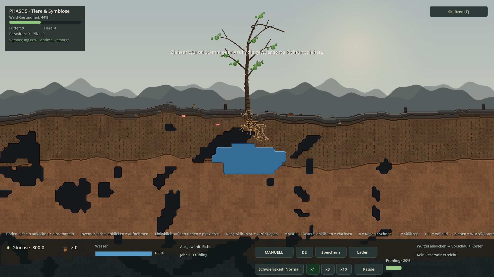
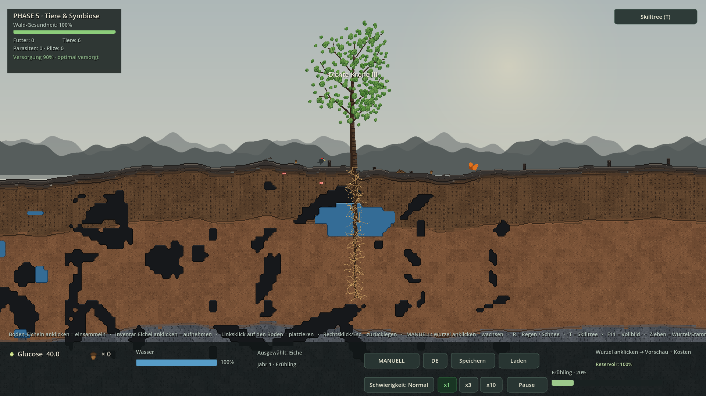
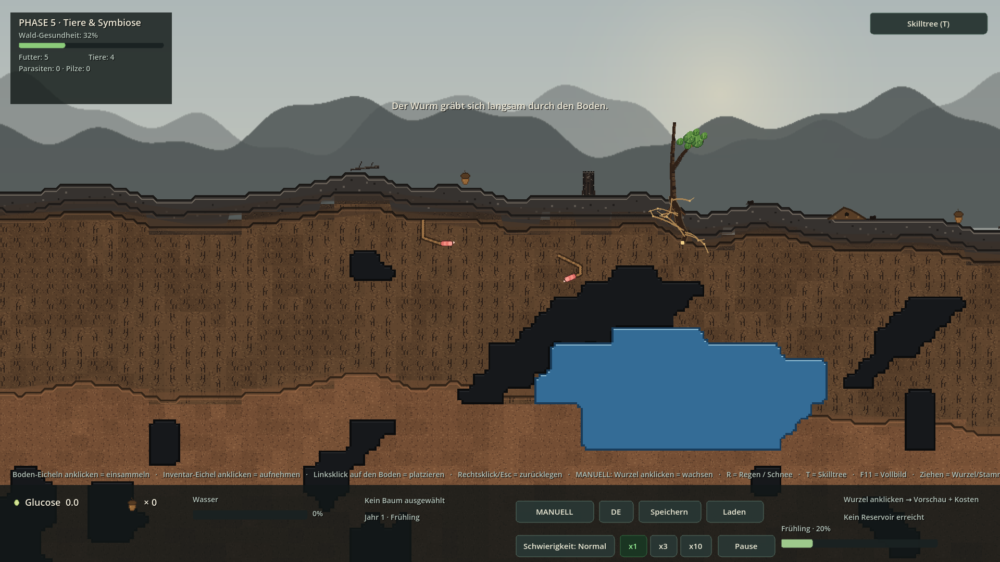

# REVISION 6 — Ziehen, Verdickung, stabile Bodenfauna, Pixelart-Slots

Vollstaendiger Stand auf GitHub, Nachfolger von `5854ac5` (REVISION 5).
Enthaelt Quellen, Assets, Tests, drei Screenshots und `waldspiel-REVISION6.zip`.

## Was sich geaendert hat

1. **Wurm-Gang wackelt nicht mehr.** Der Tunnel liegt auf einer stabilen,
   Catmull-Rom-geglaetteten Mittellinie; nur der Koerper hat noch ein
   minimales visuelles Wackeln. Die Spur wird in Eltern-Koordinaten
   gespeichert und wandert nicht mehr mit dem Animations-Offset mit.
2. **Wurm rotiert mit der Grabrichtung.** `atan2(vel.y, vel.x)` steuert
   ein 16x16-`Sprite2D`: oben/unten senkrecht, links/rechts waagerecht,
   diagonal entsprechend dem Pfad.
3. **Ameisen laufen nicht mehr in der Luft.** Nach jeder x-Bewegung wird
   `height_smooth_at(position.x)` neu abgefragt; die Fuesse bleiben auf
   der Geländekante.
4. **Wurzeln, Stamm und Aeste sind gezielt ziehbar.** Linksklick auf eine
   Wurzel / den Baum halten, in die gewuenschte Richtung ziehen, loslassen.
   Das sichtbare Mycelarium-Netz folgt dem Mauspfad (`free_target`,
   `trunk_guide`, `branch_paths`); das logische 16px-Raster bleibt fuer
   Wasser, Reservoir, Klick-Hitboxen und Savegame erhalten.
5. **Jede bereits verbundene Wurzel wird dicker**, analog alle Stamm-
   segmente: Breite = Wuchsstufe x Netzalter x Anzahl Nachkommen.
6. **Alle Texturen sind zentral ersetzbar.** `src/render/PixelArt.gd`
   enthaelt 21 Slots, Palette und `draw_fibre()`; `PIXELART.md`
   beschreibt Groessen und Austausch. Stamm/Ast/Wurzel-Hauptfasern
   sind bereits gekachelte 16x16-Texturen.
7. **Skilltree-Option fuer genug Blaetter.** Drei Stufen
   `canopy_i/ii/iii` (+12 Obergrenze und +12 sofortige Blaetter pro
   Stufe, dazu Kronendichte) heben das Cap von 12 auf 50; 50 Blaetter
   verteilen sich per Goldener-Schnitt-Folge auf alle Ast-Anker.

## Bedienung

* MANUELL (Standard): Wurzel oder Baum **anklicken, ziehen, loslassen**.
  Ein kurzer Klick ohne Bewegung verhaelt sich exakt wie vorher.
* `T` oeffnet den Skilltree; Kette: Effizientere Blaetter →
  Photosynthese plus → Kronenwuchs → Dichte Krone I/II/III.
* `R` Regen, Rechtsklick Info, `Esc` Eichel zuruecklegen (unveraendert).

## Technische Anker

| Datei | Rolle |
|---|---|
| `src/render/PixelArt.gd`, `assets/placeholders/PIXELART.md` | 21 Slots, Palette, `draw_fibre()`, `draw_sprite()` |
| `src/animals/Animal.gd` | stabile Mittellinie, Rotation, Bodenbindung, rotiertes `Sprite2D` |
| `src/plants/Tree.gd` | Drag-Geometrie, Verdickung, Blattverteilung, optionale Save-Felder |
| `src/plants/RootSegment.gd` | `free_target`, Nachkommen-Zaehlung, gekachelte Wurzelfaser |
| `src/systems/InteractionController.gd` | Drag-State-Machine, Kosten pro ~16 px |
| `src/systems/SkillTree.gd`, `tools/generate_skilltree.gd`, `data/skilltrees/oak.tres` | 18 Knoten / 17 Verbindungen |
| `tests/Revision6Smoke.gd` | 34 neue Checks |
| `screenshots/rev6_{drag,canopy,worms}.png` | 1920x1080 Renders |

## Testprotokoll

* **Import:** 0 Fehler / 0 Warnungen (Godot 4.7.2, --headless --import)
* **Smokes:** 12/12 gruen: 3+26+25+32+27+56+20+32+63+58+35+34 = 411 Checks, 0 FEHLER
* **REVISION-6-Smoke:** 34 Checks: Gang stabil, Rotation vertikal/horizontal, Ameisen am Boden, Drag, Verdickung, Pixelart, Skilltree, Save/Load, DE/EN
* **F5-Lauf:** 180 Frames, exit 0, 0 SCRIPT ERROR
* **Renders:** 3 Presets x 25 Frames, je 0 Fehler, 1920x1080 PNG
* **Regression:** AUTO aus, Save v6, GLUCOSE_PACE 0.2, 16px-Hitbox, alte Smokes unveraendert gruen

## Screenshots



*Gezogenes Wachstum: Wurzel, Stamm und Ast*



*Dichte Krone nach Skilltree-Kette*



*Rotierte Würmer, stabile Gänge, bodengebundene Ameisen*

## Code-Auszuege

### Zentrale Pixelart-Registry (`src/render/PixelArt.gd`)

```gdscript
const WORM := DIR + "worm.png"
const ANT := DIR + "ant.png"
const PATHS := { "trunk": TRUNK, "branch": BRANCH, "root": ROOT,
                 "leaf": LEAF, "worm": WORM, "ant": ANT, ... }

static func draw_fibre(ci, p, a, b, width, modulate):
    ci.draw_set_transform(a, (b - a).angle(), Vector2(1.0, width / 16.0))
    ci.draw_texture_rect(tex(p), Rect2(0, 0, (b - a).length(), 16.0),
                         true, modulate, false)
    ci.draw_set_transform(Vector2.ZERO, 0.0, Vector2.ONE)
```

### Stabile Gang-Mittellinie (`src/animals/Animal.gd`)

```gdscript
func _sync_worm_motion(dt: float) -> void:
    var prev := _burrow_center
    surface_y = generator.height_smooth_at(position.x)
    base_y = surface_y + burrow_depth
    _burrow_center = Vector2(position.x, base_y)
    position.y = base_y + sin(phase * 2.2) * 0.30   # nur Koerper wackelt
    var vel := _burrow_center - prev
    if vel.length() > 0.02:
        _body_angle = lerp_angle(_body_angle, atan2(vel.y, vel.x),
                                 clampf(dt * 10.0, 0.0, 1.0))
```

### Ameisen bodengebunden (`src/animals/Animal.gd`)

```gdscript
func _follow_ground() -> void:
    surface_y = generator.height_smooth_at(position.x)
    base_y = surface_y - 1.0
    position.y = base_y + sin(phase * 5.0) * 0.30
```

### Gezielt ziehbare Wurzel (`src/plants/Tree.gd`)

```gdscript
func grow_root_along(world_points, max_steps, from_segment = null) -> int:
    var sampled := _resample_path(locals, DRAG_STEP, max_steps + 2)
    var tip := tip_for(from_segment)
    for idx in range(1, sampled.size()):
        var p: Vector2 = sampled[idx]
        p.y = maxf(p.y, 8.0)
        # logisches 16px-Raster bleibt fuer Wasser/Save erhalten ...
        var seg := _add_root_segment(chosen_grid, chosen, tip, false, p)
        tip = seg
    _refresh_growth_visuals()
```

### Verdickung aller verbundenen Fasern (`src/plants/RootSegment.gd`)

```gdscript
var age := (1.0 + 0.010 * float(tree_ref.root_count)) if tree_ref != null else 1.0
var net := 1.0 + 0.030 * float(descendant_count())
_width = (2.6 + 5.2 * float(BaseTree.STAGE_WIDTHS[stage])) * age * net * depth_fade
```

### Drag-State-Machine (`src/systems/InteractionController.gd`)

```gdscript
func _end_drag(pos: Vector2) -> bool:
    if not _drag_active or _drag_tree == null:
        _left_click(_pending_click)   # kurzer Klick = alte Verhalten
        return false
    var ok := apply_drag_growth(_drag_tree, _drag_kind, pts, _drag_origin_segment)
    _drag_tree.clear_growth_preview()
    return ok
```

### Skilltree: genug Blaetter (`tools/generate_skilltree.gd`)

```gdscript
d.nodes.append(_node("canopy_i", ..., {"max_leaves": 12.0, "grant_leaves": 12.0}))
d.nodes.append(_node("canopy_ii", ..., {"max_leaves": 12.0, "grant_leaves": 12.0,
                                          "leaf_density": 1.0}))
d.nodes.append(_node("canopy_iii", ..., {"max_leaves": 12.0, "grant_leaves": 12.0,
                                           "leaf_density": 1.0}))
```

### Savegame v6: optionale Felder (`src/plants/Tree.gd`)

```gdscript
"free": s.has_free_target, "fx": s.free_target.x, "fy": s.free_target.y,
"trunk_guide": _vecs_to_data(trunk_guide),
"branch_paths": paths,
"skill_leaf_density": skill_leaf_density
```

## Bekannte Grenze

Der komplette Arbeitsbaum wurde als ein Commit auf `main` gepusht; der
Remote-HEAD ist der Nachfolger von `5854ac5`. Zusaetzlich liegt ein
Godot-importierbares Komplett-Paket `waldspiel-REVISION6.zip` bereit.
Der PAT wurde nur temporaer prozess-lokal verwendet, nicht in Dateien
oder in der Git-Historie abgelegt.
